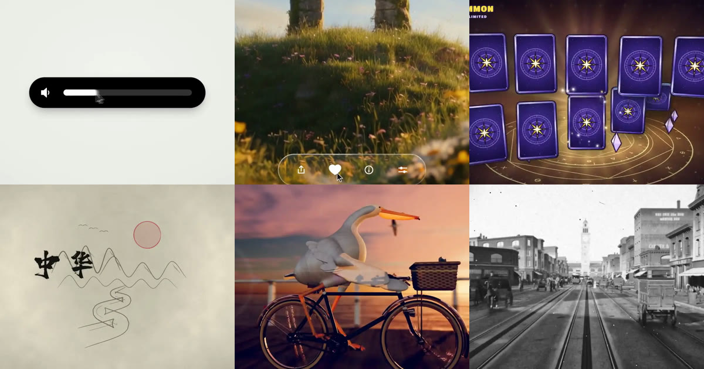

<div align="center">

<a href="https://apiko.app/claude-opus-5-5-video-prompts?utm_source=github&utm_medium=banner&utm_campaign=awesome-claude-opus-5.5-video-prompts"></a>

[](LICENSE)
[](README.md#menu)
[](https://apiko.app/models/claude-opus-5-5?utm_source=github&utm_medium=badge&utm_campaign=awesome-claude-opus-5.5-video-prompts&utm_content=model_try)
[](https://apiko.app/docs/api-manual/text-series/claude?utm_source=github&utm_medium=badge&utm_campaign=awesome-claude-opus-5.5-video-prompts&utm_content=docs)

[](README.md)
[](README_zh-CN.md)
[](README_zh-TW.md)
[](README_ko.md)

</div>

# Awesome Claude Opus 5.5 Video Prompts

<a id="introduction"></a>
## 🌟 Introduction

**Claude Opus 5.5 video prompts: 54 prompts and methods that turn code into video, from one HTML file to Remotion, Three.js and Blender.**

Claude Opus 5.5 video prompts make the model write code, and the code renders the video on your machine. Copy a prompt, or read how each creator built theirs. Every result video plays right here on GitHub.

Search and filter them on [apiko.app/claude-opus-5-5-video-prompts](https://apiko.app/claude-opus-5-5-video-prompts?utm_source=github&utm_medium=readme&utm_campaign=awesome-claude-opus-5.5-video-prompts&utm_content=intro).

> [!NOTE]
> Each prompt is kept exactly as its author posted it, so most are in English; titles and descriptions are ours. Every case credits the author and links to the original post.

<a id="quick-start"></a>
## 🚀 Quick start

**In the browser:** every case has a **Run on APIKO** link. It opens the example on [apiko.app](https://apiko.app/claude-opus-5-5-video-prompts?utm_source=github&utm_medium=quickstart&utm_campaign=awesome-claude-opus-5.5-video-prompts&utm_content=browser); press **Use** there to load the prompt into the Claude Opus 5.5 playground.

**With the API:** create an [APIKO API key](https://apiko.app/dashboard/apikeys?utm_source=github&utm_medium=quickstart&utm_campaign=awesome-claude-opus-5.5-video-prompts&utm_content=api_key) and send the prompt to the Messages API. Claude replies with code; run it on your machine to render the video.

```bash
export APIKO_API_KEY="your_key_here"

curl -s https://api.apiko.app/v1/messages \
  -H "Authorization: Bearer $APIKO_API_KEY" \
  -H "anthropic-version: 2023-06-01" \
  -H "Content-Type: application/json" \
  -d '{
  "model": "claude-opus-5-5",
  "max_tokens": 16000,
  "messages": [{
    "role": "user",
    "content": "Write one self-contained index.html that animates a paper boat crossing a lake at sunrise for 10 seconds at 1920x1080, plus the Playwright and FFmpeg commands that render it to boat.mp4."
  }]
}' | python3 -c 'import json,sys; print("".join(b.get("text","") for b in json.load(sys.stdin)["content"]))'
```

Endpoints: `POST https://api.apiko.app/v1/messages` (send a prompt)

<a id="how-to-write"></a>
## ✍️ How to write Claude Opus 5.5 video prompts

Claude outputs code, not video. You run that code, a renderer captures the frames, and FFmpeg joins them. Pick the route first and name it in the prompt.

- **Single HTML file, headless browser, FFmpeg** · `One HTML file + seek(t) + headless browser + FFmpeg + size, fps, length` — The default route in these cards: one index.html where every style is computed from time, rendered frame by frame by a headless browser such as Playwright, then joined by FFmpeg. It works well for Canvas, CSS and SVG animation.
- **Remotion or HyperFrames** · `Framework name + length + script + brand colours + project folder or URL` — If you want a React-based video project, say Remotion or HyperFrames, because otherwise the model picks zero-dependency HTML. Several cards point the model at a site or a project folder and let it pull its own material.
- **Three.js and shaders** · `Scene + camera + palette + sound source + how frames are captured` — For 3D looks without a 3D app, cards ask for Three.js or WebGL shaders and keep every pixel computed in code. Say whether you want a live recording or offline frame rendering.
- **Blender Python** · `Subject + sources first + reusable generators + render length` — The Blender cards have the model build data or generators first, then assemble the scene in Blender Python, and render a short shot. They need Blender installed locally.
- **What to state every time** · `Length + resolution + frame rate + framework + assets you supply` — Cards that give a length and size got that length; one that did not got a lesson of 7.6 minutes. Say which assets you supply (photos, music, clips) and let the prompt ask you for them.

**What the Claude Opus 5.5 examples show**

- **A one-liner tests the setup** The 15-second showreel sentence was run thousands of times and the results look alike. Use it to check that your renderer works, then write your own idea.
- **Ban list and gotchas beat adjectives** The longest prompts list what not to do: bouncy easing, glows, CSS transitions, flattened 3D flips. Each ban comes from a failed render.
- **Check one frame before the full render** The beat-synced templates probe a frame per beat or a set of frames before the long render, which saves hours when something is off.
- **Long films need layers** Five-minute and longer cards plan narration beats, then shot timing, then sound, and use agents or review rounds. Character animation took extra rounds to look right.
- **Mind music and likeness rights** Cards that use a licensed or royalty-free track say so. A few cards use someone else's song or fan homage; read the credit before reusing.
- **Method cards are notes, not prompts** Where the creator shared no prompt, the card describes the toolchain in our own words and ends with a sentence you can adapt.

<a id="menu"></a>
## 📑 Menu

- [✨ Motion graphics](#motion-graphics) (8)
  - [One-line 15-second motion designer showreel](#motion-graphics-01)
  - [Showreel brief that names every technique](#motion-graphics-02)
  - [One shape morphing through a dozen UI states](#motion-graphics-03)
  - [Keynote-style launch film with liquid glass](#motion-graphics-04)
  - [Minimal product launch cut on the beat](#motion-graphics-05)
  - [Mobile-game reward reveal in real 3D](#motion-graphics-06)
  - [Pixel-art wizard casting a spell in pure Canvas](#motion-graphics-07)
  - [Colourful remix of the UI-morph template](#motion-graphics-08)
- [🚀 Product launch](#product-launch) (10)
  - [Punchy launch video for an inference startup](#product-launch-01)
  - [HyperFrames recipe: skill, showreel line, your project](#product-launch-02)
  - [Reusable 30-second business explainer](#product-launch-03)
  - [Arabic vertical promo for a coding-tutor app](#product-launch-04)
  - [Kotlin promo generated from the language's website](#product-launch-05)
  - [Promo animation for a 3D-printed DIN-rail enclosure](#product-launch-06)
  - [Notion column-permissions trailer in Remotion](#product-launch-07)
  - [Shotbase launch video in HyperFrames in under 20 minutes](#product-launch-08)
  - [Cosmos moodboard-app promo from two prompts](#product-launch-09)
  - [UX case-study animation explaining design decisions](#product-launch-10)
- [🧑‍🏫 Explainer](#explainer) (10)
  - [Manim lesson on derivatives with spoken narration](#explainer-01)
  - [12-minute explainer "What is a Transformer"](#explainer-02)
  - [Epic chronicle of Chinese civilization, frame-rendered](#explainer-03)
  - [Explaining recursion in nine different video styles](#explainer-04)
  - [Negroni recipe motion graphic from one photo](#explainer-05)
  - [Interactive Raptor 3 engine you can take apart](#explainer-06)
  - [Twin paradox in paper-cutout style, 1,395 Canvas frames](#explainer-07)
  - [3Blue1Brown-style explainer on autoencoders](#explainer-08)
  - [Three-minute history of AI, all in Remotion code](#explainer-09)
  - [Black-hole lensing lab polished overnight by agents](#explainer-10)
- [🗂️ Storyboard to video](#storyboard-to-video) (4)
  - [Infinite zoom through vintage collage worlds](#storyboard-to-video-01)
  - [Short film through the Krea MCP in 10 minutes](#storyboard-to-video-02)
  - [Vertical review short: diagrams, TTS voice, Seedance opening](#storyboard-to-video-03)
  - [Eight-stage siege game, then a 60-second trailer](#storyboard-to-video-04)
- [🎵 Music video](#music-video) (6)
  - ["Claude Pop" music video from a 12-hour autonomous run](#music-video-01)
  - [1990s demoscene demo in C/C++ and OpenGL](#music-video-02)
  - [Music video painted with p5.brush and parallel agents](#music-video-03)
  - [The same brief re-run with Midjourney and a moodboard](#music-video-04)
  - ["Stroke of a Pen": a vertical music video by an agent swarm](#music-video-05)
  - [Mid-Autumn paper-collage short in p5.brush](#music-video-06)
- [🎞️ Short film](#short-film) (6)
  - [Two-minute sand animation of 250 years of US history](#short-film-01)
  - [Pelican on a bicycle with a custom GPU ray-marcher](#short-film-02)
  - [Tengwang Pavilion at Mid-Autumn, one WebGL2 shader](#short-film-03)
  - [Porco Rosso-style sunset dogfight in Three.js](#short-film-04)
  - [Austerlitz, 2 December 1805: a five-minute film in code](#short-film-05)
  - [Low-poly 3D retelling of "The Taoist of Laoshan"](#short-film-06)
- [🧊 3D and Blender](#3d-blender) (4)
  - [Market Street, San Francisco, the day before 1906](#3d-blender-01)
  - [Same procedural Blender shot: Opus 5.5 vs GPT-6 Astra](#3d-blender-02)
  - [GPU fluid-simulated campfire, self-critiqued 40 times](#3d-blender-04)
  - [Windmill modelled, rigged and animated in 15 minutes](#3d-blender-06)
- [✂️ Video editing](#video-editing) (6)
  - [Raw talking-head clip cut into a punchy edit](#video-editing-01)
  - [Opus 5.5 driving After Effects on generated clips](#video-editing-02)
  - [A full YouTube video edited through DaVinci Resolve](#video-editing-03)
  - [Grok-generated dance clip recut by Opus 5.5](#video-editing-04)
  - [Opus played its own game and cut the best moments](#video-editing-05)
  - [Demo reel for a 110K-body WebGPU physics solver](#video-editing-06)
- [❓ FAQ](#faq)
- [🔗 Related](#related)

<a id="motion-graphics"></a>
## ✨ Motion graphics

> Showreels, UI morphs and launch films drawn frame by frame in HTML, Canvas and shaders. · 8 cases

<a id="motion-graphics-01"></a>
### 1. One-line 15-second motion designer showreel

by [@stephanlivera](https://x.com/stephanlivera) · 15s · 16:9 · **[▶ Run on APIKO](https://apiko.app/claude-opus-5-5-video-prompts?utm_source=github&utm_medium=case&utm_campaign=awesome-claude-opus-5.5-video-prompts&utm_content=motion-graphics-01#motion-graphics-01)** · [Original post](https://x.com/stephanlivera/status/2103315922098470926)

A single sentence at max effort; it tests whether your render setup works rather than an idea.

https://github.com/user-attachments/assets/4fa680de-c11d-444d-adba-ba7b3d083de2

**Prompt:**

```text
make a dynamic 15-second motion graphics video that shows what an incredible motion designer you are, like it's your showreel for a résumé. go all out.
```

<a id="motion-graphics-02"></a>
### 2. Showreel brief that names every technique

by [@lukasersil](https://x.com/lukasersil) · 15s · 16:9 · **[▶ Run on APIKO](https://apiko.app/claude-opus-5-5-video-prompts?utm_source=github&utm_medium=case&utm_campaign=awesome-claude-opus-5.5-video-prompts&utm_content=motion-graphics-02#motion-graphics-02)** · [Original post](https://x.com/lukasersil/status/2103742861971726495)

Listing the techniques (typography, particles, masking, fluids) steers the model across 2D, 3D and shader work in one 15 s cut.

https://github.com/user-attachments/assets/6350570e-d7cf-4ce7-86f4-aa27c9d40cbb

**Prompt:**

```text
Create a bold, dynamic 15-second motion graphics showreel that feels like the ultimate portfolio piece of an exceptionally talented motion designer. Showcase a wide range of advanced techniques: kinetic typography, smooth transitions, 2D and 3D animation, abstract geometry, fluid simulations, particles, distortion, creative masking, compositing, lighting, depth, and seamless camera movement. Keep the pacing fast, confident, and visually surprising, with every shot transitioning naturally into the next. Make it feel meticulously art-directed rather than like a random collection of effects. Push the creativity, polish, timing, and visual impact as far as possible. This should feel like the opening reel that gets a motion designer hired.
```

<a id="motion-graphics-03"></a>
### 3. One shape morphing through a dozen UI states

by [@twoclipping](https://x.com/twoclipping) · 14s · 1:1 · **[▶ Run on APIKO](https://apiko.app/claude-opus-5-5-video-prompts?utm_source=github&utm_medium=case&utm_campaign=awesome-claude-opus-5.5-video-prompts&utm_content=motion-graphics-03#motion-graphics-03)** · [Original post](https://x.com/twoclipping/status/2103273003555402193)

Fixes the beat grid, bans the usual tells and gives a build recipe: time-driven seek(t), springs, a looping last frame.

https://github.com/user-attachments/assets/b411c3df-917a-4fbe-8531-eb0ae334998e

**Prompt:**

```text
<inputs>
Ask me for: 8 to 12 UI states I want the shape to become (e.g. button, loader, player, slider, toggle, tabs, chart, command palette, toast), pure black and white or one accent color, and a royalty-free song around 120 BPM (e.g. Mixkit, free for commercial use).
</inputs>
<direction>
Dribbble-level UI motion. One shape, never cut: every state is the same element morphing its size, radius and color while its content swaps with a short blur. A cursor drives every change with real clicks and drags. Light warm-gray canvas, black and white components, one clean UI font (Geist). Springs everywhere, a tiny overshoot at most. The camera zooms so each state fills the frame. The last frame is the first frame, so it loops.
Banned: bouncy easing, particle bursts, glows, gradients on UI chrome, mismatched icon strokes, dead time, anything that looks like a template.
</direction>
<structure>
120 BPM, 7 bars, something happens on every beat.
Button → loader → check → dynamic island → music player with a play/pause morph → scrub the progress bar → it becomes a volume slider that stretches when dragged past max → a toggle flips on the beat → the knob becomes a liquid tab indicator → the tabs open into a chart that draws itself, with a tooltip on hover → it collapses into ⌘K → type to filter → enter → toast → back to the button.
</structure>
<build>
1. One HTML file, square 1440x1440. Every style is computed from time inside seek(t): no CSS transitions, no timers, no state carried between frames.
2. Springs are closed-form step responses. A value that changes target many times is the sum of one spring per change, so it stays a pure function of time.
3. The tab indicator's two edges ride different springs, so the leading edge stretches ahead of the trailing one. Same trick for the toggle knob.
4. Drags are direct manipulation: while the cursor is held, the value is computed from its position. On release it springs back from wherever it was.
5. Analyze the song with numpy for the beat grid and start on a downbeat. Place every UI sound by its measured peak.
6. Render with Playwright: 4 subframes per frame, blended with ffmpeg tmix for motion blur at 60fps.
7. Render one frame per beat before the full render. Fix anything off the grid, cramped or hard to read.
</build>
<gotchas>
Never put will-change on anything the camera scales or the text renders blurry. Text that swaps inside a morphing container needs its own enter and exit timing or it overlaps. Make the last frame identical to the first, cursor position and speed included, or the loop stutters.
</gotchas>
<start>
Ask me for the inputs, then show me the state list on the beat grid before you write any code.
</start>
```

<a id="motion-graphics-04"></a>
### 4. Keynote-style launch film with liquid glass

by [@twoclipping](https://x.com/twoclipping) · 29s · 1:1 · **[▶ Run on APIKO](https://apiko.app/claude-opus-5-5-video-prompts?utm_source=github&utm_medium=case&utm_campaign=awesome-claude-opus-5.5-video-prompts&utm_content=motion-graphics-04#motion-graphics-04)** · [Original post](https://x.com/twoclipping/status/2103835273813496100)

A 5,000-character direction block asks for your photos and track first, then locks one continuous take with a measured sound sync.

https://github.com/user-attachments/assets/e7bde3a8-cfea-4093-9763-8269b63eb47a

**Prompt:**

```text
<inputs>
Ask me for: a one-word brand name for the wordmark (a verb works best), 9 to 12 high-res photos, a royalty-free song around 120 BPM with a drop and a quiet breakdown (Mixkit, free for commercial use), and a free stock clip of a plain wall with moving plant shadows (Pexels).
</inputs>
<direction>
An Apple-keynote launch film, 2D only, one continuous take. Every scene is made out of the previous one: nothing fades, blurs or cuts. Objects change shape instead: text rises out of a mask line, icons pop from zero on a spring, bars draw across, pages push, and a black shape floods the whole frame and contracts into the next scene. Warm off-white canvas, black UI, iOS 26 liquid glass over the photos. Archivo (wdth 125, weight 800) for the wordmark, Geist for UI. A cursor drives every change with real clicks, drags and long-presses. The camera zooms screen-studio style so each moment fills the square, and the cursor scales with it.
Banned: crossfades, blur-ins, brightness "developing", 3D flips, particles, glows, holds longer than 1s, anything that looks like a template.
</direction>
<structure>
120 BPM, 54 beats, something happens on every beat.
Open: the wordmark squeezes into its own period like an accordion, the dot grows into a black pill, a label rises inside it. Click: six iris blades close over the label and snap open onto a photo. The circle becomes a square, shrinks, the grid unfolds from behind it like a paper map (center, plus, corners), reflows into a bento, and a click zooms into one tile, landing exactly on the drop.
Glass: a glass word pops in letter by letter, melts into a droplet that stretches into a glass toolbar. The adjust icon turns it into a slider. Dragging relights the photo from day to golden hour (two aligned shots), and the knob turns into a glass lens while held. It lifts into a glass orb, the next photo opens inside it as a circle, and the orb expands into a lock screen: glass clock digits, date, and a home bar that stretches into a glass music player.
Stage: the lock screen pulls back into a phone (the bezel grows out of the screen edge). The Dynamic Island stretches like liquid, pinches off, flies over and grows into a Mac window that rolls up like a blind. Long-press the wallpaper, drag it onto a Safari tab, the page pushes in, drop it and it becomes the hero of a landing page. Scroll: the hero morphs into a framed print on a product card, with the mat and molding growing out of the photo's edge. Pick a frame color (it paints across) and a size, then the nav button flies down into "Order print".
Order: one black shape keeps morphing: Ordered ✓ → Printing % → On its way (a van on a route) → Delivered ✓.
Wall: the delivered circle floods the frame edge to edge, holds black for a beat, and contracts into the framed print hanging on the real wall footage. The same iris opens onto the print, closes again, the frame floods the screen and contracts into the pill → the dot → the letters spring back out, landing on the beat return. Last frame = first frame.
</structure>
<build>
1. One HTML file, square 1440x1440. Every style is computed from time inside an async seek(t): no CSS transitions, no timers, no state between frames.
2. Springs are closed-form step responses. A value with many targets is the sum of one spring per change, so it stays a pure function of time.
3. Liquid glass: each glass element holds its own clone of the scene behind it, filtered with an SVG feImage displacement map (a rounded-rect distance field) through three feDisplacementMaps at slightly different scales for chromatic edges, plus a rim light. Glass letters: a canvas distance field per glyph gives the map, mask and highlights.
4. Goo: blur + alpha threshold, then composite the source atop it so the glass stays sharp inside.
5. Iris: 6 blades around a hexagonal aperture. Each blade is its two vertices, both edge extensions and the SHORT arc between them.
6. Wordmark squeeze: every letter moves toward the dot by the same factor and its drawn width follows (narrow the wdth axis, scale the rest), so the letters stay touching.
7. Footage: re-encode all-intra (ffmpeg -g 1), load it as a blob URL, await 'seeked' before drawing each frame.
8. Sound: a downloaded SFX for every event (Mixkit), never synthesized, each placed by its measured peak. The song starts on a downbeat: the zoom lands on the drop, the wall sits in the breakdown, the wordmark returns with the beat. Loudnorm to -14 LUFS.
9. Render with Playwright: 4 subframes per frame blended with ffmpeg tmix, 60fps. Check one frame per beat, then scan for single-frame pops (frame-difference spikes 3x their neighbours).
</build>
<gotchas>
backdrop-filter: url() misreads displacement maps in Chromium, so clone the scene instead. A flood must overscale past the corners and take about 0.3s, or half the screen changes in one frame. A child with visibility: visible shows through a hidden parent, so use inherit. Text that swaps inside a morphing shape needs its own mask. python http.server can't range-seek video, so use the blob URL.
</gotchas>
<start>
Ask me for the inputs, then show me the beat map and 4 stills (open, glass, stage, wall) before you write the full film.
</start>
```

<a id="motion-graphics-05"></a>
### 5. Minimal product launch cut on the beat

by [@twoclipping](https://x.com/twoclipping) · 20s · 16:9 · **[▶ Run on APIKO](https://apiko.app/claude-opus-5-5-video-prompts?utm_source=github&utm_medium=case&utm_campaign=awesome-claude-opus-5.5-video-prompts&utm_content=motion-graphics-05#motion-graphics-05)** · [Original post](https://x.com/twoclipping/status/2102554209166000267)

One idea per shot, one accent colour, one font, and your own vertical clips scanned across a wall.

https://github.com/user-attachments/assets/0676b75d-adf7-4702-b3af-b72e6517a359

**Prompt:**

```text
<inputs>
Ask me for: the product name and a one-line promise, 3 to 5 UI moments to show, one accent color, 10 to 20 real vertical clips I own, and a royalty-free song with a clear drop (e.g. Mixkit, free for commercial use).
</inputs>
<direction>
High-end minimal. One idea per shot, lots of empty space, one accent color, one clean sans (Geist or Inter) with tight tracking. Masked type reveals, match cuts, one smooth camera language. Real footage only, never placeholder cards. No full stops in on-screen text.
Banned: shockwave rings, particle bursts, RGB split, camera shake, lens flares, neon glows, grid floors, flashing backgrounds, bouncy easing.
</direction>
<structure>
10 bars at 120 BPM, 2 seconds each.
Bar 1: the hook lands word by word on the beats.
Bar 2: one hook word morphs into the product UI. A cursor types and clicks.
The drop: a circle opens out of the button into a dark scene.
Then one move per bar: a wall of real clips with a scan line and 3 winners, the key output as big type, a 3D carousel of real videos with floor reflections and a motion-blurred whip onto one hero clip, the hero in a phone next to a panel that flips into results, big stats on push cuts, a 3-word ticker, a logo reveal, a fade to black.
</structure>
<build>
1. One HTML file at 1920x1080. Every style is computed from time inside window.seek(t): no CSS animations, no timers, no state between frames.
2. Real video: extract clips to 30fps JPEG sequences with ffmpeg and swap img sources per frame. seek awaits the image decodes.
3. Analyze the song with numpy: tempo, beat grid, energy per bar, the drop. Calibrate the grid to the real kick hits. Every cut sits on a downbeat, every UI hit on a beat.
4. Render with Playwright: 3 subframes per frame at t minus, at, and plus 1/240s, then blend with ffmpeg tmix for real motion blur at 60fps.
5. Place each sound effect so its measured peak, not its file start, lands on the event. Keep the effects quiet under the music. Loudnorm to -14 LUFS.
6. Probe 20 or more frames before the full render. Fix anything cluttered, overlapping or hard to read.
</build>
<gotchas>
Never set opacity or filter on a preserve-3d element, because it flattens and both faces show. Fade its wrapper instead. Measure element positions at runtime for match cuts. Only use music and sound effects whose license allows commercial use.
</gotchas>
<start>
Ask me for the inputs, then show me a storyboard with every timing on the beat grid before you write any code.
</start>
```

<a id="motion-graphics-06"></a>
### 6. Mobile-game reward reveal in real 3D

by [@op7418](https://x.com/op7418) · 18s · 16:9 · **[▶ Run on APIKO](https://apiko.app/claude-opus-5-5-video-prompts?utm_source=github&utm_medium=case&utm_campaign=awesome-claude-opus-5.5-video-prompts&utm_content=motion-graphics-06#motion-graphics-06)** · [Original post](https://x.com/op7418/status/2104085484347818226)

A fill-in template with tier colours, toon-shaded 3D and a long list of things not to do.

https://github.com/user-attachments/assets/dcfa9d92-a889-4c60-9a6c-8391d0438307

**Prompt:**

```text
帮我做一个原创的手游「高光时刻」动效：[主体，例如：开宝箱 / 段位晋升 / 成就解锁 / Boss 掉落 / 角色升级]。
做成一个可以直接打开的单文件网页（HTML + CSS + JS），点一下就能完整播放，效果对标商业手游的结算 / 奖励演出。
【世界观与风格】
- 原创美术，不要模仿任何现有游戏的 IP、角色或 Logo。
- 卡通手游风：高饱和配色，统一的深色描边（例如 #1A1033），圆润厚重的造型。
- 配色随等级升级：[等级阶梯，例如：普通绿 → 稀有蓝 → 史诗紫 → 传说金]。每升一级都要切换主色、光效颜色和背景色调。
- 标题用圆胖的游戏字体（如 Titan One / Lilita One），描黑边，加投影；文字逐字「砸」进画面，带回弹。
【主体物：做成真 3D】
- 用 Three.js 建模，不要用平面 SVG 贴图。要有厚度、倒角，以及符合主体的结构细节（木板缝、铆钉、包边、宝石切面、锁扣等）；木板缝这类细节用真实几何体拼出来，不要贴黑线条。
- 着色用卡通分阶（MeshToonMaterial 加 3～4 阶的渐变贴图），配三种灯光：主光、天光、等级色的轮廓光。
- 描边用后期边缘检测：渲染法线图 + 深度图，再用着色器画线。外轮廓粗、零件交界细，粗细全程一致；另外做 1.5 倍超采样和多重采样抗锯齿。
不要用「放大一圈的黑色背面」那种描边，那样粗细不均、转角会断。
深度判断的阈值要放宽，接缝主要靠法线判断，否则斜着看的表面会冒出细碎斜纹。
- 活动部件要真实运动，比如箱盖绕铰链翻开、奖章绕竖轴旋转。
- 待机时主体缓慢左右转动，让人看到侧面和厚度，同时轻微上下浮动；脚下要有随高度变化的柔和投影。
【如果画面里有 2D 插画（卡面、奖励图标、角色）】
- 三层卡通着色：底色、成块的阴影色、高光色，不要只用一层渐变。
- 线条分粗细：外轮廓粗，内部结构线细。
- 每个角色或物件要有自己的表情和姿态，不要所有东西共用同一张脸。
- 脚下画投影，让主体「站」在画面里；背景按属性区分图案，不要全用同一套放射线。
【演出节奏：五个阶段，缺一不可】
1. 预备：主体待机浮动，每隔几秒抖一下提示可以点击，底部显示「点击」提示。
2. 升级：每点一次，主体跳起、在空中转一圈、落地时压扁再回弹；同时切换到下一等级的颜色，闪一下光，冒一圈粒子，标题更新。
3. 蓄力（约 1 秒）：主体越抖越剧烈，缝隙透出光，四周粒子往中心吸，音效音调持续上升；最后一刻猛地压扁。
4. 爆发：从爆点向外扩散的泛光闪白、屏幕震动、镜头往前一推、多层冲击波、细长流光迸射、闪光星点、金币和宝石（带旋转）。高等级的爆发要明显更强。彩带只在最高潮用一次，不要满屏彩带。
5. 揭晓与结算：
- 奖励卡片从主体里沿弧线飞出，落位时带超调和晃动收尾，数字滚动计数。
- 稀有物品带彩虹流光边框和「NEW!」角标。
- 点击领取后，金币和宝石沿贝塞尔曲线飞进右上角的余额，每到一个余额就跳一下。
【揭晓舞台：让主角独占画面】
- 最高稀有度揭晓时，其他元素收起或淡出，背后换成一层干净的渐变幕布加缓慢旋转的柔光，不要让主角压在杂乱的背景上。
- 幕布出现时，把场景里的其他 3D 物件隐藏掉，否则后期描边会把它们的轮廓线画在幕布上。
- 主角的外发光要放在主体背后，只从边缘溢出，不能盖在主体前面把它糊成一片白。
- 可以加一圈围绕主角盘旋的星尘拖尾，但轨道必须完整在主角轮廓外侧，不能从主体正面扫过。
【光效：必须柔和，不能有硬边】
- 背景光芒：用带渐变过渡的 conic-gradient，不要一刀切的色块边缘；叠 2～3 层不同密度、不同转速的光。
- 光柱：由 5～7 道带模糊的光束呈扇形散开，亮度各自轻微闪动；根部加一团柔光核心，光里有光尘缓慢上飘。
- 闪白：从爆点向外的径向泛光（mix-blend-mode: screen），强度不超过 0.8，不要整屏纯白过曝。
- 粒子：每个火花都带一圈低透明度的外晕；冲击波用三层描边（宽而淡、中等、细而亮）。
【材质与界面】
- 边框、名牌、按钮要有材质感：金属拉丝渐变、左上亮右下暗的倒角光、内阴影；按稀有度换镶嵌件（钢铆钉 → 银框宝石 → 金框钻石加小王冠）。
- 小卡片上不要塞小字数值；详细数值放到揭晓时的信息面板里，面板里的数字滚动上涨，并弹出「▲+数值」。
- 画在 Canvas 上的贴图，分辨率至少是屏幕上最大显示尺寸的 1.5 倍，否则放大时会发虚。
【动画原则】
- 用 GSAP 时间线编排。所有动作都要有挤压拉伸、超调和弹性回弹，不要匀速。
- 粒子系统用 Canvas 2D 自己写：重力、阻力、生命周期、叠加混合，以及「吸入」「曲线飞行」「环绕」三种运动。
- 不要用 CSS 3D 透视去翻转大尺寸元素，放大加侧翻时会被投影成铺满屏幕的平面，3D 翻转一律放在 WebGL 里做。
- 所有「抖动」「呼吸」类的循环补间，在状态切换时要先取消再归零，避免它比停止指令晚一帧结束，又把值设回去。
【音效】
- 全部用 Web Audio 实时合成，不用音频文件：跳起、落地、升级和弦、蓄力上升音、爆炸低频加噪声、弹出音、计数滴答、金币叮当、胜利号角。
- 第一次点击时才初始化音频；右上角放静音开关。
【界面与工程】
- 顶部 HUD：模式切换、金币和宝石余额、静音按钮。
- 手机宽度也要能用；遵守「减少动态效果」设置（关闭震屏，减少粒子）。
- 动画状态机要严谨：动画播放中忽略点击，不能出现点击被吞或状态错乱。
- 目标 60fps。第一次打开时就是完整的待机画面，不能是空白。
【交付前自检】
在蓄力、爆发、揭晓、结算这几个时刻各截一张图，逐张检查：
- 主角有没有被光晕、粒子或文字挡住？
- 有没有过曝成一片白？
- 背景是否杂乱，有没有穿帮的描边线？
- 小字是否能看清？
- 结算后是否还有东西在不该动的时候继续抖动？
最后告诉我：每个阶段的时长，以及哪些参数可以调整演出强度。
```

<a id="motion-graphics-07"></a>
### 7. Pixel-art wizard casting a spell in pure Canvas

by [@majidmanzarpour](https://x.com/majidmanzarpour) · 11s · 5:4 · **[▶ Run on APIKO](https://apiko.app/claude-opus-5-5-video-prompts?utm_source=github&utm_medium=case&utm_campaign=awesome-claude-opus-5.5-video-prompts&utm_content=motion-graphics-07#motion-graphics-07)** · [Original post](https://x.com/majidmanzarpour/status/2102476258948927543)

Pins the logical resolution, palette, state machine and particle pool so the sprite code stays tidy.

https://github.com/user-attachments/assets/1d707e18-89ad-4c80-ac4a-4aa6c3538f39

**Prompt:**

```text
Create a single self-contained HTML file that renders an animated pixel art wizard casting a spell, using vanilla JavaScript and Canvas 2D. No external assets, libraries, or network requests.
RENDERING
- Draw everything to an offscreen canvas at a fixed logical resolution of 128x96, then blit to a fullscreen display canvas scaled by the largest integer factor that fits the window, centered, with imageSmoothingEnabled = false and CSS image-rendering: pixelated.
- All drawing snaps to integer coordinates on the logical canvas. No sub-pixel positions, anti-aliasing, gradients, or shadowBlur.
- Fixed palette of ~24 hex colors: deep blues/purples for night sky, warm robe tones, 3-4 bright magic colors. Every pixel comes from this palette.
CHARACTER
- Build the wizard procedurally from filled rects and pixel runs, ~24x32 logical pixels: pointed hat with a bend, long beard, two-shade robe with darker outline, staff with a gem at the tip.
- Parameterize the pose (staff angle, arm raise, head tilt, robe sway). Animate parameters smoothly, then quantize to the pixel grid each frame so motion reads at an 8-12 fps pixel animation feel even though the loop runs at 60fps.
ANIMATION
- Looping state machine: IDLE (2-frame bob, beard sway) -> CHARGE (staff raises, gem flickers, sparks spiral inward) -> CAST (bright burst, projectile fires across the scene, 1-2 pixel screen shake) -> RECOVER (settle back). Ease pose parameters between keyframes.
- Pooled allocation-free particle system: preallocate and reuse. Sparks orbit the gem during CHARGE, explode outward on CAST, each particle stepping its palette index from white to magic color to dark before despawn. Snap particle positions to the grid when drawing.
- Fixed 60hz timestep update with rAF rendering. Zero object allocation inside the loop.
SCENE
- Minimal background: dark sky, a few twinkling 1px stars, moon, stone floor line. Character silhouette must read clearly.
- Subtle 1px rim light on the wizard from the gem, brightening during CHARGE and CAST.
QUALITY BAR
- Crisp pixels at any window size, seamless loop, stable 60fps, readable silhouette. Should look like a polished 16-bit sprite animation, not vector shapes scaled down.
```

<a id="motion-graphics-08"></a>
### 8. Colourful remix of the UI-morph template

by [@__morse](https://x.com/__morse) · 15s · 1:1 · **[▶ Run on APIKO](https://apiko.app/claude-opus-5-5-video-prompts?utm_source=github&utm_medium=case&utm_campaign=awesome-claude-opus-5.5-video-prompts&utm_content=motion-graphics-08#motion-graphics-08)** · [Original post](https://x.com/__morse/status/2103485566570369333)

The same template with a colour request; the author watched the model pick its own render pipeline.

https://github.com/user-attachments/assets/73cf26b5-bb0b-4713-9aee-e90a580a2bc0

**How it was made (no prompt was shared):**

The author reused the UI-morph prompt and only asked for a more colourful result. Claude put everything in one index.html, drove it frame by frame in a headless Playwright window through a seek function, and had FFmpeg assemble the MP4. Without a framework named, it wrote the code with no dependencies. Starter line to adapt: "Same brief, but make it more colourful; keep one HTML file and render it frame by frame with FFmpeg."

<a id="product-launch"></a>
## 🚀 Product launch

> Promo and trailer videos for apps and products, mostly built in Remotion or HyperFrames. · 10 cases

<a id="product-launch-01"></a>
### 9. Punchy launch video for an inference startup

by [@deedydas](https://x.com/deedydas) · 26s · 16:9 · **[▶ Run on APIKO](https://apiko.app/claude-opus-5-5-video-prompts?utm_source=github&utm_medium=case&utm_campaign=awesome-claude-opus-5.5-video-prompts&utm_content=product-launch-01#product-launch-01)** · [Original post](https://x.com/deedydas/status/2102787937482252537)

One line gives the product type and the tone; the model fills in scenes, copy and timing.

https://github.com/user-attachments/assets/e9c9bc7a-4785-4a78-8718-3ae61f5330e5

**Prompt:**

```text
make a modern slick and punchy video for a modern startup that works on inference
```

<a id="product-launch-02"></a>
### 10. HyperFrames recipe: skill, showreel line, your project

by [@thayto_dev](https://x.com/thayto_dev) · 15s · 16:9 · **[▶ Run on APIKO](https://apiko.app/claude-opus-5-5-video-prompts?utm_source=github&utm_medium=case&utm_campaign=awesome-claude-opus-5.5-video-prompts&utm_content=product-launch-02#product-launch-02)** · [Original post](https://x.com/thayto_dev/status/2104200591278739735)

Reuses the showreel sentence and points the model at your project folder so it pulls real material.

https://github.com/user-attachments/assets/1f65db0e-ed59-4ab9-b074-bbc9b1435b29

**Prompt:**

```text
make a dynamic 15-second motion graphics video that shows what an incredible motion designer you are, like it's your showreel for a résumé. go all out.
```

<a id="product-launch-03"></a>
### 11. Reusable 30-second business explainer

by [@alex_prompter](https://x.com/alex_prompter) · 35s · 16:9 · **[▶ Run on APIKO](https://apiko.app/claude-opus-5-5-video-prompts?utm_source=github&utm_medium=case&utm_campaign=awesome-claude-opus-5.5-video-prompts&utm_content=product-launch-03#product-launch-03)** · [Original post](https://x.com/alex_prompter/status/2103499977632997524)

Fixes role, length, scene list and brand colours, then leaves one bracket for your business.

https://github.com/user-attachments/assets/fe995a4e-4904-45b8-93dd-4d12f7ceb41a

**Prompt:**

```text
Adopt the role of an expert motion designer. Build a 30-second animated explainer for my business as a single HTML page. 5 scenes. The customer's problem, what I do, how it works in 3 steps, one proof point, and my name at the end. Bold text, smooth transitions, my brand colours. My business [DESCRIBE WHAT YOU SELL, WHO IT'S FOR AND YOUR COLOURS]
```

<a id="product-launch-04"></a>
### 12. Arabic vertical promo for a coding-tutor app

by [@YarHmm](https://x.com/YarHmm) · 56s · 9:16 · **[▶ Run on APIKO](https://apiko.app/claude-opus-5-5-video-prompts?utm_source=github&utm_medium=case&utm_campaign=awesome-claude-opus-5.5-video-prompts&utm_content=product-launch-04#product-launch-04)** · [Original post](https://x.com/YarHmm/status/2103505435802341449)

A 56-second vertical promo built in Remotion with a synthetic voice.

https://github.com/user-attachments/assets/ea43a1ca-aa74-4686-b704-5217af2e46fa

**How it was made (no prompt was shared):**

The creator worked with Opus 5.5 at medium to high effort for about an hour and a half of conversation, using about a quarter of a five-hour usage window. Remotion was used for previews and the voice-over came from a Gemini text-to-speech model. The result is a 1080x1920 clip of about 56 seconds. Starter line to adapt: "Build a 55-second vertical promo for my app in Remotion, 1080x1920, with a voice-over script I can swap."

<a id="product-launch-05"></a>
### 13. Kotlin promo generated from the language's website

by [@JetBrains](https://x.com/jetbrains) · 35s · 16:9 · **[▶ Run on APIKO](https://apiko.app/claude-opus-5-5-video-prompts?utm_source=github&utm_medium=case&utm_campaign=awesome-claude-opus-5.5-video-prompts&utm_content=product-launch-05#product-launch-05)** · [Original post](https://x.com/jetbrains/status/2102459650125754812)

Pointing the model at a site URL and a HyperFrames skill is enough to get a 35-second promo.

https://github.com/user-attachments/assets/4384deb5-1edc-4ac4-872c-f446cbc2f0b9

**How it was made (no prompt was shared):**

A JetBrains engineer gave Claude Opus 5.5 the HyperFrames skills and pointed it at kotlinlang.org; the model fetched its own material and produced a promo of about 35 seconds at 2560x1440. The post comes from JetBrains' own account, so treat it as a showcase rather than a benchmark. Starter line to adapt: "Using the HyperFrames skill, make a 35-second promo video for the product at this URL, pulling copy and visuals from the site."

<a id="product-launch-06"></a>
### 14. Promo animation for a 3D-printed DIN-rail enclosure

by [@VectorCrossProd](https://x.com/VectorCrossProd) · 10s · 16:9 · **[▶ Run on APIKO](https://apiko.app/claude-opus-5-5-video-prompts?utm_source=github&utm_medium=case&utm_campaign=awesome-claude-opus-5.5-video-prompts&utm_content=product-launch-06#product-launch-06)** · [Original post](https://x.com/VectorCrossProd/status/2104093497561436573)

The model designed the enclosure and then animated a 10-second promo for it, all from prompts in Claude Code.

https://github.com/user-attachments/assets/8a7f67f6-f39c-4d14-9868-fc5ac3b860d6

**How it was made (no prompt was shared):**

The author first had Claude Code design a 3D-printable enclosure for an existing PCB, with printable STL files, and then asked for a promo animation of the same part. Everything came from prompting: the enclosure, the STLs and the 10-second 1920x1080 clip. Starter line to adapt: "Now make a 10-second promo animation of this enclosure, 1920x1080, showing it assembling around the board."

<a id="product-launch-07"></a>
### 15. Notion column-permissions trailer in Remotion

by [@wustep](https://x.com/wustep) · 32s · 16:9 · **[▶ Run on APIKO](https://apiko.app/claude-opus-5-5-video-prompts?utm_source=github&utm_medium=case&utm_campaign=awesome-claude-opus-5.5-video-prompts&utm_content=product-launch-07#product-launch-07)** · [Original post](https://x.com/wustep/status/2104610435571884086)

A product trailer that took two days and 33 versions to sign off.

https://github.com/user-attachments/assets/16b5489f-039a-490f-9419-d1fbf53ae8a8

**How it was made (no prompt was shared):**

A Notion employee built a trailer for a new feature over a weekend using Claude Opus 5.5 at xhigh effort with Remotion. The author reports 33 versions before the final cut and a large amount of API usage, and published a process document. The clip runs about 32 seconds at 1920x1080. Starter line to adapt: "Make a 30-second Remotion trailer for this feature; I will review it version by version."

<a id="product-launch-08"></a>
### 16. Shotbase launch video in HyperFrames in under 20 minutes

by [@Miguel07Code](https://x.com/Miguel07Code) · 58s · 16:9 · **[▶ Run on APIKO](https://apiko.app/claude-opus-5-5-video-prompts?utm_source=github&utm_medium=case&utm_campaign=awesome-claude-opus-5.5-video-prompts&utm_content=product-launch-08#product-launch-08)** · [Original post](https://x.com/Miguel07Code/status/2102441708395041170)

A launch video for a real app, produced in one pass with the HyperFrames skill.

https://github.com/user-attachments/assets/b7bff036-6b23-4ce6-8f8a-5cb2b04035d7

**How it was made (no prompt was shared):**

The author says Claude Opus 5.5 one-shotted the launch video for the Shotbase app with the HyperFrames framework in under 20 minutes. The clip is about 58 seconds at 1920x1080. The prompt is not reproduced here. Starter line to adapt: "Use HyperFrames to make a 55-second launch video for my app, with the feature list and tagline below."

<a id="product-launch-09"></a>
### 17. Cosmos moodboard-app promo from two prompts

by [@kaolti](https://x.com/kaolti) · 40s · 16:9 · **[▶ Run on APIKO](https://apiko.app/claude-opus-5-5-video-prompts?utm_source=github&utm_medium=case&utm_campaign=awesome-claude-opus-5.5-video-prompts&utm_content=product-launch-09#product-launch-09)** · [Original post](https://x.com/kaolti/status/2103481296018092204)

A 40-second promo built in HyperFrames from two prompts and no visual references.

https://github.com/user-attachments/assets/c70459c7-be6a-44be-86a4-6e2e237eef9b

**How it was made (no prompt was shared):**

The creator built this promo in HyperFrames with two prompts and no reference images. The clip is about 40 seconds at 1920x1080. The prompts were shared in the original thread, not here. Starter line to adapt: "Make a 40-second promo for a moodboard app in HyperFrames; first the concept and script, then the animation."

<a id="product-launch-10"></a>
### 18. UX case-study animation explaining design decisions

by [@moguzbulbul](https://x.com/moguzbulbul) · 42s · 4:3 · **[▶ Run on APIKO](https://apiko.app/claude-opus-5-5-video-prompts?utm_source=github&utm_medium=case&utm_campaign=awesome-claude-opus-5.5-video-prompts&utm_content=product-launch-10#product-launch-10)** · [Original post](https://x.com/moguzbulbul/status/2104206095313215591)

A 4:3 animated walkthrough of design choices, made for job interviews.

https://github.com/user-attachments/assets/1a29ce3c-bf9d-4122-8e10-8c1af0d63734

**How it was made (no prompt was shared):**

The creator made animated case studies to explain UX decisions in interviews. Opus 5.5 produced the animation; the author offered to share the skill they used. The clip runs about 42 seconds at 1600x1200. Starter line to adapt: "Animate this UX case study in 4:3: the problem, three design decisions with before and after, and the result."

<a id="explainer"></a>
## 🧑‍🏫 Explainer

> Lessons and science explainers, from a 30-second recipe to a 12-minute talk. · 10 cases

<a id="explainer-01"></a>
### 19. Manim lesson on derivatives with spoken narration

by [@LinearUncle](https://x.com/LinearUncle) · 457s · 16:9 · **[▶ Run on APIKO](https://apiko.app/claude-opus-5-5-video-prompts?utm_source=github&utm_medium=case&utm_campaign=awesome-claude-opus-5.5-video-prompts&utm_content=explainer-01#explainer-01)** · [Original post](https://x.com/LinearUncle/status/2103128559174971663)

Names the tool (Manim) and the voice (edge-tts), asks for examples; no length given, so it planned 7.6 minutes.

https://github.com/user-attachments/assets/06ee4703-b1d8-4b89-9806-6ccfcc04e775

**Prompt:**

```text
请用Manim给我制作一个导数概念学习的视频，要求通俗易懂，并且有例子，引人思考。配音使用edge-tts
```

<a id="explainer-02"></a>
### 20. 12-minute explainer "What is a Transformer"

by [@dotey](https://x.com/dotey) · 732s · 16:9 · **[▶ Run on APIKO](https://apiko.app/claude-opus-5-5-video-prompts?utm_source=github&utm_medium=case&utm_campaign=awesome-claude-opus-5.5-video-prompts&utm_content=explainer-02#explainer-02)** · [Original post](https://x.com/dotey/status/2103683057689522564)

Gives the audience (high schoolers), the depth wanted and full tool freedom, and lets the model set length and structure.

https://github.com/user-attachments/assets/313fdcf3-12cc-4970-b641-6582f3e24cc1

<sub>First 4 minutes only; the full video is on [apiko.app](https://apiko.app/claude-opus-5-5-video-prompts?utm_source=github&utm_medium=case&utm_campaign=awesome-claude-opus-5.5-video-prompts&utm_content=explainer-02#explainer-02)</sub>

**Prompt:**

```text
帮我用js制作一个视频，主题是：什么是 Transformer
要深入浅出，让高中生也能看得懂，不仅high level说的清楚，也要有细节，包括注意力机制，甚至一些数学概念

你可以用任何工具或者安装工具，可以联网检索

请给我惊喜
```

<a id="explainer-03"></a>
### 21. Epic chronicle of Chinese civilization, frame-rendered

by [@dotey](https://x.com/dotey) · 217s · 16:9 · **[▶ Run on APIKO](https://apiko.app/claude-opus-5-5-video-prompts?utm_source=github&utm_medium=case&utm_campaign=awesome-claude-opus-5.5-video-prompts&utm_content=explainer-03#explainer-03)** · [Original post](https://x.com/dotey/status/2103964025683927166)

A director's brief: score as clock, beat grid and shot table before rendering, dated facts checked.

https://github.com/user-attachments/assets/9beec9a4-7735-4d36-9639-0bd007dfe4f0

**Prompt:**

```text
做一支史诗编年片《中华文明史》，可以写代码逐帧渲染，再用 ffmpeg 合成。
配乐当时钟：五声调式，乐器从骨笛、编钟一路演进到管弦，BPM 随年代加快，所有切点踩拍。
宣纸白描和玄底泥金两种画风交替；每卷一个主色和一套随时代演变的纹样（彩陶纹 → 饕餮纹 → 云气纹 → 卷草纹 → 缠枝纹 → 回纹）。
每镜一个按词组出现的书法大字关键词，配一幅线稿。全片 HUD：左上朱印卷号，右侧竖排朝代名，底部卷轴时间尺和年份计数。
卷交界用朱印盖下、鼓钟重击的冲击转场。先定拍点网格和分镜表，再渲染。
地图只画示意，不画近现代真实人物，年代核对后再交付。
```

<a id="explainer-04"></a>
### 22. Explaining recursion in nine different video styles

by [@emollick](https://x.com/emollick) · 75s · 16:9 · **[▶ Run on APIKO](https://apiko.app/claude-opus-5-5-video-prompts?utm_source=github&utm_medium=case&utm_campaign=awesome-claude-opus-5.5-video-prompts&utm_content=explainer-04#explainer-04)** · [Original post](https://x.com/emollick/status/2103688362960019567)

A concept plus one structural rule: every section changes style.

https://github.com/user-attachments/assets/4bc7e2c6-51f1-49da-be45-a9c38c69ca4c

**Prompt:**

```text
A video explaining recursion, where every explanation about recursion has a radically different video style, make this self-referential & clever & fast moving.
```

<a id="explainer-05"></a>
### 23. Negroni recipe motion graphic from one photo

by [@Ror_Fly](https://x.com/Ror_Fly) · 30s · 1:1 · **[▶ Run on APIKO](https://apiko.app/claude-opus-5-5-video-prompts?utm_source=github&utm_medium=case&utm_campaign=awesome-claude-opus-5.5-video-prompts&utm_content=explainer-05#explainer-05)** · [Original post](https://x.com/Ror_Fly/status/2102853258582880547)

Plain request: one photo in, a 30-second recipe animation in HTML out.

https://github.com/user-attachments/assets/c3f7b71d-0a82-42db-8b20-b4babda1ed6e

**Prompt:**

```text
We're going to try a little test. Do you think you could render a recipe motion graphic animation using javascript or html (w/e you think will produce the best) to show the full recipe from start to finish (empty glass to completed cocktail) - Explainer video style - Showing the recipe ingreidents + measurements as they're going into the cup. Should be a 30s video.
```

<a id="explainer-06"></a>
### 24. Interactive Raptor 3 engine you can take apart

by [@konstantinsaifo](https://x.com/konstantinsaifo) · 35s · 16:9 · **[▶ Run on APIKO](https://apiko.app/claude-opus-5-5-video-prompts?utm_source=github&utm_medium=case&utm_campaign=awesome-claude-opus-5.5-video-prompts&utm_content=explainer-06#explainer-06)** · [Original post](https://x.com/konstantinsaifo/status/2104094723887501736)

A browser page with a cutaway, flow paths and throttle, screen-recorded as a 35-second explainer.

https://github.com/user-attachments/assets/6f9b3002-f4d6-4e27-8d99-e205813de824

**How it was made (no prompt was shared):**

The author asked Claude Opus 5.5 to explain how a rocket engine works by building an interactive model of the Raptor 3 in the browser. Viewers can cut it open, follow the two propellants through the turbopumps and throttle it to watch the exhaust shock diamonds move; the video is a screen recording of that page, about 35 seconds. Starter line to adapt: "Explain how this machine works by building an interactive browser model I can take apart."

<a id="explainer-07"></a>
### 25. Twin paradox in paper-cutout style, 1,395 Canvas frames

by [@masahirochaen](https://x.com/masahirochaen) · 47s · 1:1 · **[▶ Run on APIKO](https://apiko.app/claude-opus-5-5-video-prompts?utm_source=github&utm_medium=case&utm_campaign=awesome-claude-opus-5.5-video-prompts&utm_content=explainer-07#explainer-07)** · [Original post](https://x.com/masahirochaen/status/2102722719502704941)

A Japanese-language relativity explainer drawn entirely in Canvas and rendered to MP4 in about two minutes.

https://github.com/user-attachments/assets/f79740bb-eb2c-4372-9b7d-fd24a53ca882

**How it was made (no prompt was shared):**

The prompt was a link to a popular example plus a short instruction; Claude Code with Opus 5.5 drew all 1,395 frames in Canvas in a cut-paper look, generated music and sound effects in JavaScript, and converted the frames to MP4. Rendering took about two minutes for a 46-second 1080x1080 clip. Starter line to adapt: "Explain special relativity in 45 seconds, paper-cutout style, every frame drawn in Canvas, with generated sound."

<a id="explainer-08"></a>
### 26. 3Blue1Brown-style explainer on autoencoders

by [@ng169onX](https://x.com/ng169onX) · 335s · 16:9 · **[▶ Run on APIKO](https://apiko.app/claude-opus-5-5-video-prompts?utm_source=github&utm_medium=case&utm_campaign=awesome-claude-opus-5.5-video-prompts&utm_content=explainer-08#explainer-08)** · [Original post](https://x.com/ng169onX/status/2103183904563998809)

Manim animations, a model really trained on MNIST and cloned narration in a roughly five-minute video.

https://github.com/user-attachments/assets/028010a1-7874-44ad-a3a2-e88605d180c4

**How it was made (no prompt was shared):**

The author gave one short prompt and reports a video of about five and a half minutes with Manim animations, digits from models actually trained on MNIST, narration from a cloned voice using a local text-to-speech model, and original music. The post has low reach, so there is little public detail. Starter line to adapt: "Make a 3Blue1Brown-style explainer on this paper with Manim, real trained examples and narration."

<a id="explainer-09"></a>
### 27. Three-minute history of AI, all in Remotion code

by [@kimmonismus](https://x.com/kimmonismus) · 180s · 16:9 · **[▶ Run on APIKO](https://apiko.app/claude-opus-5-5-video-prompts?utm_source=github&utm_medium=case&utm_campaign=awesome-claude-opus-5.5-video-prompts&utm_content=explainer-09#explainer-09)** · [Original post](https://x.com/kimmonismus/status/2102844654169575547)

About 7,400 lines of React and TypeScript, drawn in SVG and Canvas, with a synthetic voice.

https://github.com/user-attachments/assets/644e1b2a-c2b0-45d1-8782-67055943c599

**How it was made (no prompt was shared):**

Claude Code wrote the whole film in Remotion: roughly 7,400 lines of React and TypeScript, every image drawn in SVG and Canvas, an open-source voice for narration and a score synthesised in Python. The author says it took about an hour and 7% of a weekly allowance, for a 3-minute 1920x1080 film. Starter line to adapt: "Make a 3-minute Remotion film on the history of AI; no stock footage and no image generators, everything drawn in code."

<a id="explainer-10"></a>
### 28. Black-hole lensing lab polished overnight by agents

by [@Voxyz_ai](https://x.com/Voxyz_ai) · 22s · 16:9 · **[▶ Run on APIKO](https://apiko.app/claude-opus-5-5-video-prompts?utm_source=github&utm_medium=case&utm_campaign=awesome-claude-opus-5.5-video-prompts&utm_content=explainer-10#explainer-10)** · [Original post](https://x.com/Voxyz_ai/status/2103117246860345550)

Three review-and-fix rounds ran while the author slept, with reviewers ranking issues and a fixer applying them.

https://github.com/user-attachments/assets/da053832-0663-4fa0-be0c-2ca1cd5bbf7a

**How it was made (no prompt was shared):**

One prompt produced the first version of an interactive black-hole page; then a workflow of three rounds, each with two reviewers ranking issues P0 to P2 and one agent fixing them, polished it. The whole run took about five and a half hours, and the clip is a 22-second 4K recording of the result. Starter line to adapt: "Build this as an interactive page, then run three review rounds where two reviewers list ranked issues and a third fixes the P0s."

<a id="storyboard-to-video"></a>
## 🗂️ Storyboard to video

> Claude plans the shots and drives image and video tools through MCP or scripts. · 4 cases

<a id="storyboard-to-video-01"></a>
### 29. Infinite zoom through vintage collage worlds

by [@koldo2k](https://x.com/koldo2k) · 20s · 16:9 · **[▶ Run on APIKO](https://apiko.app/claude-opus-5-5-video-prompts?utm_source=github&utm_medium=case&utm_campaign=awesome-claude-opus-5.5-video-prompts&utm_content=storyboard-to-video-01#storyboard-to-video-01)** · [Original post](https://x.com/koldo2k/status/2103129343253778767)

Generated images and clips composited in code, with a cost gate: list generations and wait for approval.

https://github.com/user-attachments/assets/68b77d3b-130e-4ff9-aefd-069d9e88ad22

**Prompt:**

```text
Build a looping "infinite zoom" animation, After Effects style: the camera
travels from landscape to landscape by flying through vintage objects.
LOOK: vintage collage realistic photo landscapes + black & white newspaper
cutout objects (halftone, white paper border, soft shadow). Film grain,
vignette, light flicker.
WORLDS (loop): snowy mountains → pocket watch (swinging on its chain) →
sea cliffs → box camera lens → desert dunes → magnifying glass →
misty lake → hand mirror → back to start.
Extras: floating hat, phone, umbrella, gramophone, key; a 1950s man walking
toward the watch; a whale swimming across the cliffs sky.
HOW:
- Generate everything via the Magnific MCP (Seedream 5 Pro landscapes,
GPT 2.5 transparent cutouts, depth maps, Kling 2.5 animation, Lyria 3
music). List the generations + credit cost and wait for my OK first.
- Split each landscape into 3 depth layers from its depth map and fill the
hidden areas. Parallax: layer scale = camera^Z, Z between 0.45 and 1.22.
- Each portal's glass holds the next world; cut seamlessly when it fills
the frame.
- Constant speed: exponential zoom to a fixed point, each segment's duration
proportional to log(zoom). Verify the cuts frame by frame.
- Man & whale: generate on pure green (#00B140), animate in place with
Kling, key out every frame, build a seamless loop (ping-pong if needed).
- Cutouts animate at 15 fps (on twos).
- 20 s loop, 1920×1080, 30 fps. Music: 96 BPM, cut to exactly 8 bars = 20 s.
DELIVER: an interactive artifact (viewer, AE-style timeline, music +
MP4 download) and a rendered MP4 with music under 30 MB.
Show me screenshots before each expensive step.
```

<a id="storyboard-to-video-02"></a>
### 30. Short film through the Krea MCP in 10 minutes

by [@angrypenguinPNG](https://x.com/angrypenguinPNG) · 30s · 16:9 · **[▶ Run on APIKO](https://apiko.app/claude-opus-5-5-video-prompts?utm_source=github&utm_medium=case&utm_campaign=awesome-claude-opus-5.5-video-prompts&utm_content=storyboard-to-video-02#storyboard-to-video-02)** · [Original post](https://x.com/angrypenguinPNG/status/2102829318875537683)

The model drove an image and video MCP to make a 30-second film in one pass.

https://github.com/user-attachments/assets/a95a6bb8-3940-4533-a5bf-af2226380d13

**How it was made (no prompt was shared):**

The author connected the Krea MCP to Claude and says Opus 5.5 produced the 30-second 1280x720 film in one pass in about ten minutes. The generation cost was small and is reported in the post. Starter line to adapt: "Using the connected MCP, write a 30-second short film script, generate the shots and assemble them, and show me the plan first."

<a id="storyboard-to-video-03"></a>
### 31. Vertical review short: diagrams, TTS voice, Seedance opening

by [@masahirochaen](https://x.com/masahirochaen) · 57s · 9:16 · **[▶ Run on APIKO](https://apiko.app/claude-opus-5-5-video-prompts?utm_source=github&utm_medium=case&utm_campaign=awesome-claude-opus-5.5-video-prompts&utm_content=storyboard-to-video-03#storyboard-to-video-03)** · [Original post](https://x.com/masahirochaen/status/2103872865770836012)

Three tools split the work: Opus for the diagram animation, a TTS model for the voice, Seedance for the face.

https://github.com/user-attachments/assets/6a30d473-9d1c-44fb-9c00-b47a0ef18f56

**How it was made (no prompt was shared):**

The creator used Claude Opus 5.5 for the diagram animation, Gemini 3.8 Flash TTS for a cloned voice and Seedance 2.5 for the opening face and voice. The result is a 57-second 1080x1920 short. Starter line to adapt: "Animate this script as clean diagrams in 9:16, with space at the start for a presenter clip and timing I can match to a voice track."

<a id="storyboard-to-video-04"></a>
### 32. Eight-stage siege game, then a 60-second trailer

by [@KanaWorks_AI](https://x.com/KanaWorks_AI) · 60s · 16:9 · **[▶ Run on APIKO](https://apiko.app/claude-opus-5-5-video-prompts?utm_source=github&utm_medium=case&utm_campaign=awesome-claude-opus-5.5-video-prompts&utm_content=storyboard-to-video-04#storyboard-to-video-04)** · [Original post](https://x.com/KanaWorks_AI/status/2102684116525437206)

Opus built the game; video models made the trailer shots.

https://github.com/user-attachments/assets/7d1a0114-a5da-4dc9-91d1-95ba0e9af13d

**How it was made (no prompt was shared):**

The author had Opus 5.5 build a website and an eight-stage side-scrolling siege game in about two hours, then recorded gameplay and cut a 60-second trailer, using Seedance 2.5 and another video model for footage. The code is Claude's; the video generation is not. Starter line to adapt: "Build a short side-scrolling game I can record, then write a shot list for a 60-second trailer."

<a id="music-video"></a>
## 🎵 Music video

> Long autonomous runs and beat-synced films, some with agents drawing one chapter each. · 6 cases

<a id="music-video-01"></a>
### 33. "Claude Pop" music video from a 12-hour autonomous run

by [@donaldjewkes](https://x.com/donaldjewkes) · 142s · 16:9 · **[▶ Run on APIKO](https://apiko.app/claude-opus-5-5-video-prompts?utm_source=github&utm_medium=case&utm_campaign=awesome-claude-opus-5.5-video-prompts&utm_content=music-video-01#music-video-01)** · [Original post](https://x.com/donaldjewkes/status/2102801274173587569)

A long dictated brief plus a full environment: reference files, image API, video models and a spending cap.

https://github.com/user-attachments/assets/f41a5796-7258-412e-a0f2-96073aca6ff7

**Prompt:**

```text
I've included an MP4 file and an original link to a video that is called "Claude Pop." It's a pop song that is about increasing rate of progress and the experience of the singularity approaching.
I want you to independently do an end-to-end complete pass on making an updated version of this video. Use the exact same audio track and think and feel very deeply about what is the best way to visually represent all of the lyrics on screen. You do not need to anchor to the current style, you can do truly anything that you think might best let you visually express yourself, including abstract motion graphics.
……
I think after that, what might be fun is if you use your visual reasoning skills and your ability to build animations in JavaScript, and then reconstruct the video from scratch as sort of an overlay, so that the visual continuity of the base is really there. It's like that animation technique where you shoot first in traditional film and then draw over top of it.
……
You're going to want to watch the entire video multiple times, take screenshots at individual parts, and think about if something is really up to the bar of quality that we need here.
……
make no mistakes.
```

<a id="music-video-02"></a>
### 34. 1990s demoscene demo in C/C++ and OpenGL

by [@gandamu_ml](https://x.com/gandamu_ml) · 383s · 16:9 · **[▶ Run on APIKO](https://apiko.app/claude-opus-5-5-video-prompts?utm_source=github&utm_medium=case&utm_campaign=awesome-claude-opus-5.5-video-prompts&utm_content=music-video-02#music-video-02)** · [Original post](https://x.com/gandamu_ml/status/2102919394775220530)

Asks for research and music analysis first, then a native OpenGL demo synced to an S3M track.

https://github.com/user-attachments/assets/8d769efe-1956-4dce-8458-fcb11386df05

<sub>First 4 minutes only; the full video is on [apiko.app](https://apiko.app/claude-opus-5-5-video-prompts?utm_source=github&utm_medium=case&utm_campaign=awesome-claude-opus-5.5-video-prompts&utm_content=music-video-02#music-video-02)</sub>

**Prompt:**

```text
I would like you to create a kickass, impressive 1990s style demoscene demo using this S3M track as the music. Prior to getting to work, please see how to best play and analyze the S3M track. This will be important since synchronization of effects and appropriateness of scenes to the musical vibe (and this song does have a variety of sections with different attitude) is essential to a great demoscene demo. Also prior to getting started, please research what kinds of effects, physics, etc. would be good to use in combination. Please use C/C++ -- with appropriate demoscene/embedded/console gamedev sensibilities to avoid needlessly bloating compile times -- with OpenGL. In some cases, blitting to surfaces in realtime may be appropriate.. while in others, using OpenGL or even shaders is appropriate as well. It should be planned and polished to be spectacular and shocking. This is Claude's way of really showing off to the world that it kicks ass.
```

<a id="music-video-03"></a>
### 35. Music video painted with p5.brush and parallel agents

by [@other__reality](https://x.com/other__reality) · 157s · 16:9 · **[▶ Run on APIKO](https://apiko.app/claude-opus-5-5-video-prompts?utm_source=github&utm_medium=case&utm_campaign=awesome-claude-opus-5.5-video-prompts&utm_content=music-video-03#music-video-03)** · [Original post](https://x.com/other__reality/status/2102514581684052169)

A storyboard file, an animation guide, nine chapters in nine files and a headless Chrome render.

https://github.com/user-attachments/assets/19ac1237-6adb-4482-ac44-5e96bab89bfd

**How it was made (no prompt was shared):**

Claude wrote an animation guide for parallel subagents and a storyboard, split the video into nine chapter files, drew with p5.js and p5.brush, and rendered frames in headless Chrome with FFmpeg. All animation took about 45 minutes; the song comes from elsewhere and is not the creator's. The film is about 157 seconds at 1920x1080. Starter line to adapt: "Write a storyboard and an animation guide, then have parallel agents draw one chapter each in p5.brush and render with headless Chrome and FFmpeg."

<a id="music-video-04"></a>
### 36. The same brief re-run with Midjourney and a moodboard

by [@anabology](https://x.com/anabology) · 307s · 16:9 · **[▶ Run on APIKO](https://apiko.app/claude-opus-5-5-video-prompts?utm_source=github&utm_medium=case&utm_campaign=awesome-claude-opus-5.5-video-prompts&utm_content=music-video-04#music-video-04)** · [Original post](https://x.com/anabology/status/2103534482930491441)

Same long brief, new reference material, a completely different 5-minute film.

https://github.com/user-attachments/assets/f0162d5f-c9cc-40f0-ae40-f4cd1c5a7176

**How it was made (no prompt was shared):**

The creator gave Opus 5.5 an existing popular brief, access to Midjourney and a moodboard, and let it run overnight; the author says the film was ready 12 hours later. It is about 306 seconds at 1920x1080 and became the most viewed case in this library. Starter line to adapt: "Follow this brief, use Midjourney for the look, and match the moodboard I attach."

<a id="music-video-05"></a>
### 37. "Stroke of a Pen": a vertical music video by an agent swarm

by [@bradmillscan](https://x.com/bradmillscan) · 203s · 9:16 · **[▶ Run on APIKO](https://apiko.app/claude-opus-5-5-video-prompts?utm_source=github&utm_medium=case&utm_campaign=awesome-claude-opus-5.5-video-prompts&utm_content=music-video-05#music-video-05)** · [Original post](https://x.com/bradmillscan/status/2103108967194833310)

About 75 shots cut on the beat, with two revisions to fix stick-figure characters.

https://github.com/user-attachments/assets/94e93850-505e-475c-b6d8-9d8a1f04dc3d

**How it was made (no prompt was shared):**

The author had Opus 5.5 read their Bitcoin and monetary-history notes, generated the song with a voice tool, then let a group of agents storyboard and code about 75 shots for a 3:23 vertical film. The first round needed two revisions, one of which rewrote the character rigs. Starter line to adapt: "Read these notes, write a song brief, storyboard 70 shots and code them in 9:16, cut on the beat."

<a id="music-video-06"></a>
### 38. Mid-Autumn paper-collage short in p5.brush

by [@ring_hyacinth](https://x.com/ring_hyacinth) · 40s · 16:9 · **[▶ Run on APIKO](https://apiko.app/claude-opus-5-5-video-prompts?utm_source=github&utm_medium=case&utm_campaign=awesome-claude-opus-5.5-video-prompts&utm_content=music-video-06#music-video-06)** · [Original post](https://x.com/ring_hyacinth/status/2102986085328716066)

The person supplied script and music; the model drew every frame in JavaScript.

https://github.com/user-attachments/assets/57dcf36e-2875-4533-83e5-f3329420c4d2

**How it was made (no prompt was shared):**

The creator provided the script and music; Opus 5.5 drew the animation frame by frame in JavaScript with p5.js and p5.brush for hand-painted texture, over backdrops made with an image model, and synthesised the sound effects with Node.js. The film runs about 40 seconds at 1920x1080. Starter line to adapt: "Animate this script in a paper-collage style with p5.brush, frame by frame, with synthesised sound effects."

<a id="short-film"></a>
## 🎞️ Short film

> Stories and scenes written as code, from sand animation to ray-marched shaders. · 6 cases

<a id="short-film-01"></a>
### 39. Two-minute sand animation of 250 years of US history

by [@Michaelzsguo](https://x.com/Michaelzsguo) · 120s · 16:9 · **[▶ Run on APIKO](https://apiko.app/claude-opus-5-5-video-prompts?utm_source=github&utm_medium=case&utm_campaign=awesome-claude-opus-5.5-video-prompts&utm_content=short-film-01#short-film-01)** · [Original post](https://x.com/Michaelzsguo/status/2102592355165782312)

One sentence with the length, the story and the sound; neither Blender nor Three.js was used.

https://github.com/user-attachments/assets/a5c86a65-2423-4b9b-89f6-bd50dc954906

**Prompt:**

```text
Make a 2-minute sand animation that tells the story of 250 years of U.S. history. Keep it lively, engaging, and tasteful. Add appropriate background music and sound design.
```

<a id="short-film-02"></a>
### 40. Pelican on a bicycle with a custom GPU ray-marcher

by [@AxtonLiu](https://x.com/AxtonLiu) · 38s · 16:9 · **[▶ Run on APIKO](https://apiko.app/claude-opus-5-5-video-prompts?utm_source=github&utm_medium=case&utm_campaign=awesome-claude-opus-5.5-video-prompts&utm_content=short-film-02#short-film-02)** · [Original post](https://x.com/AxtonLiu/status/2103119648271290566)

Asks for the most refined version with any technique and unlimited time.

https://github.com/user-attachments/assets/97793470-430e-4132-840e-fa590babcded

**Prompt:**

```text
每次一个新的模型出来呢，大家都让它去画 "鹈鹕骑自行车" 来判断这个模型的空间能力，基本上都是用 HTML、SVG 来画动画。当我实在看得都有审美疲劳了，我希望你能画一个最复杂、最精细、最精美的 "鹈鹕骑自行车"的动画视频，你可以用任何的技术，不用着急，画一天都可以。
```

<a id="short-film-03"></a>
### 41. Tengwang Pavilion at Mid-Autumn, one WebGL2 shader

by [@DemitiyaGeekzen](https://x.com/DemitiyaGeekzen) · 30s · 16:9 · **[▶ Run on APIKO](https://apiko.app/claude-opus-5-5-video-prompts?utm_source=github&utm_medium=case&utm_campaign=awesome-claude-opus-5.5-video-prompts&utm_content=short-film-03#short-film-03)** · [Original post](https://x.com/DemitiyaGeekzen/status/2103517910274818523)

The model chose the topic; every pixel comes from one shader, the sound from Web Audio.

https://github.com/user-attachments/assets/f066e58e-c1a1-455d-a24e-436e72145c5d

**Prompt:**

```text
用你最强的思维和能力，根据对我的了解，自行寻找我可能喜欢的主题，制作一个30s的视频还有互动html，尽可能的展示你的前端能力！
```

<a id="short-film-04"></a>
### 42. Porco Rosso-style sunset dogfight in Three.js

by [@NFT_Chen](https://x.com/NFT_Chen) · 14s · 16:9 · **[▶ Run on APIKO](https://apiko.app/claude-opus-5-5-video-prompts?utm_source=github&utm_medium=case&utm_campaign=awesome-claude-opus-5.5-video-prompts&utm_content=short-film-04#short-film-04)** · [Original post](https://x.com/NFT_Chen/status/2103401780117938683)

One line names the scene, the aircraft livery, the sky and the mood; a fan tribute.

https://github.com/user-attachments/assets/7159116d-018b-43d7-8975-8adf4c4fc0e8

**Prompt:**

```text
用 web3D 复刻宫崎骏《红猪》日落海面上的经典空战：白绿红涂装战斗机、紫色积云、海面反光、吉卜力运镜，画面写 just breathe.
```

<a id="short-film-05"></a>
### 43. Austerlitz, 2 December 1805: a five-minute film in code

by [@WinterArc2125](https://x.com/WinterArc2125) · 301s · 16:9 · **[▶ Run on APIKO](https://apiko.app/claude-opus-5-5-video-prompts?utm_source=github&utm_medium=case&utm_campaign=awesome-claude-opus-5.5-video-prompts&utm_content=short-film-05#short-film-05)** · [Original post](https://x.com/WinterArc2125/status/2103116235009347650)

Real terrain and sun position, a written engine, score and voice.

https://github.com/user-attachments/assets/1c0e28d6-23a9-473c-9e5d-4f4b14624b8e

**How it was made (no prompt was shared):**

The author had Opus 5.5 write the engine, soldiers, score and narration for a five-minute film, using satellite height data for the hills and the true sunrise position for that date. Setup took about 90 minutes and rendering about 4 hours; the code is public. Starter line to adapt: "Make a 5-minute film of this battle in code: real terrain, correct sun position, an original score and narration."

<a id="short-film-06"></a>
### 44. Low-poly 3D retelling of "The Taoist of Laoshan"

by [@wshuyi](https://x.com/wshuyi) · 359s · 16:9 · **[▶ Run on APIKO](https://apiko.app/claude-opus-5-5-video-prompts?utm_source=github&utm_medium=case&utm_campaign=awesome-claude-opus-5.5-video-prompts&utm_content=short-film-06#short-film-06)** · [Original post](https://x.com/wshuyi/status/2103308292613345504)

No storyboard and no ready-made video skill; only a cloned voice was supplied.

https://github.com/user-attachments/assets/e385a9b4-ab11-46d2-acfd-e08ee0a62990

**How it was made (no prompt was shared):**

The author ran Claude Code with Opus 5.5 and supplied only their cloned voice, with no storyboard or ready-made video skill, to test whether the model can shoot a story end to end. The result is a 3D retelling of about six minutes at 1920x1080. Starter line to adapt: "Retell this short story as a low-poly 3D film with my narration track, planning the shots yourself."

<a id="3d-blender"></a>
## 🧊 3D and Blender

> Scenes built through Blender Python or MCP, plus simulations written in JavaScript. · 4 cases

<a id="3d-blender-01"></a>
### 45. Market Street, San Francisco, the day before 1906

by [@alexalbert__](https://x.com/alexalbert__) · 8s · 4:3 · **[▶ Run on APIKO](https://apiko.app/claude-opus-5-5-video-prompts?utm_source=github&utm_medium=case&utm_campaign=awesome-claude-opus-5.5-video-prompts&utm_content=3d-blender-01#3d-blender-01)** · [Original post](https://x.com/alexalbert__/status/2102466523164274839)

Builds a sourced data file first, then Blender generators, so every building traces to a source.

https://github.com/user-attachments/assets/c9b677e6-2f2b-4ff3-b3a9-9ada3865005b

**Prompt:**

```text
Recreate Market Street, San Francisco as it stood on April 17, 1906, the afternoon before the earthquake, in Blender.
Scope: the Ferry Building up Market to Fifth Street, including the Palace Hotel, the Call Building, the Chronicle Building, Lotta's Fountain and the Emporium.
Before modeling anything, build a source file from: the 1899-1905 Sanborn fire insurance maps (footprints, heights, materials, occupants), the Miles Brothers film "A Trip Down Market Street" (April 1906), period photographs from OpenSFHistory, the Library of Congress and the David Rumsey collection, and USGS topography. Record every building with footprint, height, facade material, occupant, and the source for each fact with a confidence level.
Build everything in Blender Python. No downloaded meshes, textures or HDRIs. Write reusable generators (Victorian commercial facade, mansard roof, bay windows, awnings, painted signage, gas and electric street lamps, cable car, horse-drawn wagon, early automobile) and assemble the street from the source file, so every building traces back to data.
Provide a 10 second video up the street.
```

<a id="3d-blender-02"></a>
### 46. Same procedural Blender shot: Opus 5.5 vs GPT-6 Astra

by [@Stefan_3D_AI](https://x.com/Stefan_3D_AI) · 46s · 16:9 · **[▶ Run on APIKO](https://apiko.app/claude-opus-5-5-video-prompts?utm_source=github&utm_medium=case&utm_campaign=awesome-claude-opus-5.5-video-prompts&utm_content=3d-blender-02#3d-blender-02)** · [Original post](https://x.com/Stefan_3D_AI/status/2102471841046786153)

One prompt, Blender only, a 10-second render plus a build timelapse.

https://github.com/user-attachments/assets/52f1dedf-18d3-4dc3-8ba6-3539154e35bc

**How it was made (no prompt was shared):**

The author gave two models the same prompt: build everything procedurally in Blender, render a 10-second shot and record a build timelapse. Opus 5.5 took 35 minutes and wrote far more output tokens than its rival. The clip runs 46 seconds at 1920x1080. Starter line to adapt: "Build a scene procedurally in Blender Python only, render a 10-second shot, and record a timelapse of the build."

<a id="3d-blender-04"></a>
### 47. GPU fluid-simulated campfire, self-critiqued 40 times

by [@NathanWilbanks_](https://x.com/NathanWilbanks_) · 38s · 16:9 · **[▶ Run on APIKO](https://apiko.app/claude-opus-5-5-video-prompts?utm_source=github&utm_medium=case&utm_campaign=awesome-claude-opus-5.5-video-prompts&utm_content=3d-blender-04#3d-blender-04)** · [Original post](https://x.com/NathanWilbanks_/status/2103881538592981110)

A real fire simulation in JavaScript with a render-and-critique loop.

https://github.com/user-attachments/assets/a3613517-128c-46eb-8cc2-4139b731e710

**How it was made (no prompt was shared):**

The author asked for the most realistic fire possible using only JavaScript. Claude wrote a GPU fluid simulation with blackbody flame colour, rendered frames offline, had a vision model critique them about 40 times, and drove the sound from flame brightness. The result is a 38-second 1080p film from one HTML file. Starter line to adapt: "Build the most realistic campfire you can in JavaScript, render a frame, critique it like a VFX supervisor, fix it and repeat."

<a id="3d-blender-06"></a>
### 48. Windmill modelled, rigged and animated in 15 minutes

by [@Higgsfield](https://x.com/higgsfield_ai) · 21s · 9:16 · **[▶ Run on APIKO](https://apiko.app/claude-opus-5-5-video-prompts?utm_source=github&utm_medium=case&utm_campaign=awesome-claude-opus-5.5-video-prompts&utm_content=3d-blender-06#3d-blender-06)** · [Original post](https://x.com/higgsfield_ai/status/2102453658889953717)

Blender driven over an MCP connection for a short vertical clip.

https://github.com/user-attachments/assets/76e7d3fa-0892-4d73-8007-f710bccaa3f9

**How it was made (no prompt was shared):**

The vendor says Claude Opus 5.5 modelled, rigged, textured and animated a windmill in Blender in 15 minutes through an MCP connection. The clip is a 21-second 1080x1920 vertical video; a longer tutorial is linked from the post. Starter line to adapt: "In Blender over MCP, model a windmill, rig its blades, texture it and animate it turning."

<a id="video-editing"></a>
## ✂️ Video editing

> Claude as editor: cutting footage, driving After Effects or Resolve, assembling demo reels. · 6 cases

<a id="video-editing-01"></a>
### 49. Raw talking-head clip cut into a punchy edit

by [@sab8a](https://x.com/sab8a) · 37s · 16:9 · **[▶ Run on APIKO](https://apiko.app/claude-opus-5-5-video-prompts?utm_source=github&utm_medium=case&utm_campaign=awesome-claude-opus-5.5-video-prompts&utm_content=video-editing-01#video-editing-01)** · [Original post](https://x.com/sab8a/status/2103144778481475686)

A one-line editing brief: subtitles, graphics and music.

https://github.com/user-attachments/assets/47a6a27f-677a-4fe6-b4ca-5e3026a69301

**Prompt:**

```text
Cut a raw talking-head clip into a punchy, fun edit with subtitles, graphics and music
```

<a id="video-editing-02"></a>
### 50. Opus 5.5 driving After Effects on generated clips

by [@aicreataro](https://x.com/aicreataro) · 32s · 16:9 · **[▶ Run on APIKO](https://apiko.app/claude-opus-5-5-video-prompts?utm_source=github&utm_medium=case&utm_campaign=awesome-claude-opus-5.5-video-prompts&utm_content=video-editing-02#video-editing-02)** · [Original post](https://x.com/aicreataro/status/2103757144789221819)

Skeleton data from the dance video moves text, light and camera in After Effects.

https://github.com/user-attachments/assets/b73b7c64-9b33-478f-adfc-74c279a7d01e

**How it was made (no prompt was shared):**

The author generated a song and two 15-second dance clips, then had Opus 5.5 operate After Effects: extract the dancer's skeleton frame by frame and use it to move text, light and the camera. The output is an .aep project that a person can still edit. Starter line to adapt: "Extract a skeleton from this clip and use it to attach lyrics and light to the dancer in After Effects, with a different effect per chapter."

<a id="video-editing-03"></a>
### 51. A full YouTube video edited through DaVinci Resolve

by [@NickSpisak_](https://x.com/NickSpisak_) · 539s · 16:9 · **[▶ Run on APIKO](https://apiko.app/claude-opus-5-5-video-prompts?utm_source=github&utm_medium=case&utm_campaign=awesome-claude-opus-5.5-video-prompts&utm_content=video-editing-03#video-editing-03)** · [Original post](https://x.com/NickSpisak_/status/2103511092043628807)

Claude as the editor, Resolve driven over MCP, HyperFrames for B-roll.

https://github.com/user-attachments/assets/05ff9091-c704-4686-a40b-baf8f4c1a09b

**How it was made (no prompt was shared):**

The creator used raw clips from a recorder, DaVinci Resolve controlled over MCP, HyperFrames for B-roll and animation, and Claude Opus 5.5 as the editor. The result is a 9-minute 4K video; the prompt is in the linked video and article. Starter line to adapt: "Edit these raw clips into a 9-minute video in Resolve, cut the pauses, add B-roll cards and captions."

<a id="video-editing-04"></a>
### 52. Grok-generated dance clip recut by Opus 5.5

by [@Gorden_Sun](https://x.com/Gorden_Sun) · 15s · 16:9 · **[▶ Run on APIKO](https://apiko.app/claude-opus-5-5-video-prompts?utm_source=github&utm_medium=case&utm_campaign=awesome-claude-opus-5.5-video-prompts&utm_content=video-editing-04#video-editing-04)** · [Original post](https://x.com/Gorden_Sun/status/2104009748874141941)

The raw generated clip is shown next to the edited version.

https://github.com/user-attachments/assets/bea453e6-d1d3-4ddd-98b6-77beee2f5718

**How it was made (no prompt was shared):**

The author posted a raw video generated by a video model next to the version recut and packaged by Opus 5.5 and wrote that the editing app may now be threatened. Both clips are about 15 seconds. Starter line to adapt: "Recut this clip with beat-matched cuts, captions and a title card, and keep the original audio."

<a id="video-editing-05"></a>
### 53. Opus played its own game and cut the best moments

by [@rehan_shei](https://x.com/rehan_shei) · 30s · 16:9 · **[▶ Run on APIKO](https://apiko.app/claude-opus-5-5-video-prompts?utm_source=github&utm_medium=case&utm_campaign=awesome-claude-opus-5.5-video-prompts&utm_content=video-editing-05#video-editing-05)** · [Original post](https://x.com/rehan_shei/status/2103755997533839416)

A Unity game, a playthrough and a 30-second demo reel, all by the model.

https://github.com/user-attachments/assets/096b166c-7f68-4f0f-800b-26d2ef99d838

**How it was made (no prompt was shared):**

The author built a game with a Unity command-line setup and Opus 5.5, then had the model play it with several characters and splice the best moments into a demo video. The game is playable in the browser, and the clip is about 30 seconds at 1920x1080. Starter line to adapt: "Play this game with each character, record it, and cut a 30-second demo reel of the best moments."

<a id="video-editing-06"></a>
### 54. Demo reel for a 110K-body WebGPU physics solver

by [@nybobs](https://x.com/nybobs) · 26s · 16:9 · **[▶ Run on APIKO](https://apiko.app/claude-opus-5-5-video-prompts?utm_source=github&utm_medium=case&utm_campaign=awesome-claude-opus-5.5-video-prompts&utm_content=video-editing-06#video-editing-06)** · [Original post](https://x.com/nybobs/status/2103385835328680050)

The model built the solver and put the demo reel together from one prompt.

https://github.com/user-attachments/assets/77298e62-d2b7-4ffd-80a3-eda1314366c0

**How it was made (no prompt was shared):**

The author implemented a published physics solver in WebGPU with Three.js using Opus 5.5, and says the model also assembled this 26-second demo reel from a single prompt in Claude Code. The code is public under the MIT licence. Starter line to adapt: "Make a 25-second demo reel of this project: camera moves, a title card and captions."

<a id="faq"></a>
## ❓ FAQ

<details>
<summary><b>Can Claude Opus 5.5 make a video?</b></summary>

It writes the code, such as an HTML file, a Remotion project or a Blender script. The video is rendered on your machine by a browser, Remotion or Blender and joined with FFmpeg.

</details>

<details>
<summary><b>What do I need installed to run Claude Opus 5.5 video prompts?</b></summary>

It depends on the card: Node with Playwright and FFmpeg for the HTML route, Remotion or HyperFrames for those cards, Blender for the Blender cards. Several creators ran Claude Opus 5.5 inside Claude Code so the model could install tools itself.

</details>

<details>
<summary><b>Are these Claude Opus 5.5 prompts free to use, and who owns the results?</b></summary>

The prompts and videos belong to the creators credited on each card, and every card links to the post. Use them as a starting point and check the creator's terms before republishing.

</details>

<details>
<summary><b>Which language should I write Claude Opus 5.5 prompts in?</b></summary>

Prompts here are in the author's original language, and Claude Opus 5.5 takes English and Chinese. Write the brief in the language you think in and keep on-screen text in the language the video needs.

</details>

<details>
<summary><b>How do I run one of these with the Claude Opus 5.5 API?</b></summary>

Send the prompt to the claude-opus-5-5 model through the Messages API and save the code it returns. The API docs list the endpoints and headers.

</details>

<details>
<summary><b>Why is my Claude Opus 5.5 result different from the video?</b></summary>

Models are not deterministic, and creators may have used other effort levels, tools, music or many revisions. The Notion trailer, for example, took 33 versions.

</details>

<details>
<summary><b>Which effort level should I use with Claude Opus 5.5?</b></summary>

The creators who named one used max, xhigh, or medium to high. The API accepts low, medium, high, xhigh and max; thinking counts toward max_tokens, so leave room for the code.

</details>

<details>
<summary><b>How long a video can Claude Opus 5.5 make?</b></summary>

No cap is stated; the cards run from about 8 seconds to over 12 minutes. State the length in the prompt, because a lesson with no length became 7.6 minutes.

</details>

<details>
<summary><b>Does Claude Opus 5.5 make the music and voice too?</b></summary>

Some cards synthesise sound in code, and others bring in text-to-speech, music generators or licensed tracks. The card notes say which.

</details>

<details>
<summary><b>Should I use Claude Opus 5.5 or Opus 5 for these?</b></summary>

The examples here are from Opus 5.5. APIKO has a comparison of the two models if you are deciding.

</details>


<a id="related"></a>
## 🔗 Related

- [Claude Opus 5.5 Video Prompts · apiko.app](https://apiko.app/claude-opus-5-5-video-prompts?utm_source=github&utm_medium=related&utm_campaign=awesome-claude-opus-5.5-video-prompts)
- [Claude Opus 5.5 model page](https://apiko.app/models/claude-opus-5-5?utm_source=github&utm_medium=related&utm_campaign=awesome-claude-opus-5.5-video-prompts)
- [Claude API docs](https://apiko.app/docs/api-manual/text-series/claude?utm_source=github&utm_medium=related&utm_campaign=awesome-claude-opus-5.5-video-prompts)
- [Claude Opus 5.5 vs Opus 5](https://apiko.app/blog/claude-opus-5-5-vs-claude-opus-5?utm_source=github&utm_medium=related&utm_campaign=awesome-claude-opus-5.5-video-prompts)
- [APIKO chat](https://apiko.app/chat?utm_source=github&utm_medium=related&utm_campaign=awesome-claude-opus-5.5-video-prompts)
- [Seedance 2.5 prompts](https://apiko.app/seedance-2-5-prompts?utm_source=github&utm_medium=related&utm_campaign=awesome-claude-opus-5.5-video-prompts)
- [Code examples for the APIKO API](https://github.com/tong0619453646-dev/apiko-ai-api-examples)

**More prompt collections**

- [Awesome Seedance 2.5 Prompts](https://github.com/tong0619453646-dev/awesome-seedance-2.5-prompts)
- [Awesome Kling 4.0 Prompts](https://github.com/tong0619453646-dev/awesome-kling-4.0-prompts)
- [Awesome GPT Image 2.6 Prompts](https://github.com/tong0619453646-dev/awesome-gpt-image-2.6-prompts)
- [Awesome Nano Banana 2.1 Prompts](https://github.com/tong0619453646-dev/awesome-nano-banana-2.1-prompts)
- [Awesome GPT Image 2.5 Prompts](https://github.com/tong0619453646-dev/awesome-gpt-image-2.5-prompts)
- [Awesome GPT Image 2 Prompts](https://github.com/tong0619453646-dev/awesome-gpt-image-2-prompts)
- [Awesome Wan 3.0 Prompts](https://github.com/tong0619453646-dev/awesome-wan-3.0-prompts)

<a id="license"></a>
## 📄 License and credits

Prompts and videos belong to the creators credited on each card, and every card links to the original post. Titles, descriptions, translations and the build scripts are released under [CC BY 4.0](LICENSE).

If this list saves you time, a ⭐ helps others find it.
