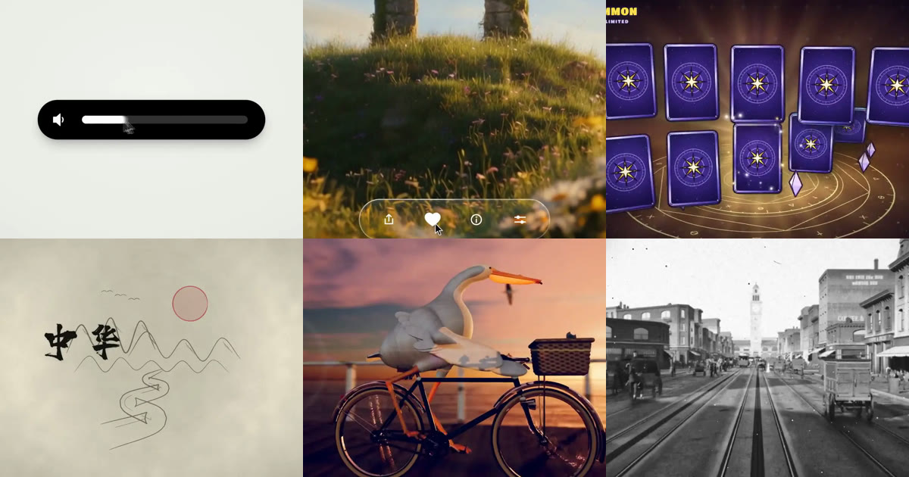

<div align="center">

<a href="https://apiko.app/ko/claude-opus-5-5-video-prompts?utm_source=github&utm_medium=banner&utm_campaign=awesome-claude-opus-5.5-video-prompts"></a>

[](LICENSE)
[](README_ko.md#menu)
[](https://apiko.app/ko/models/claude-opus-5-5?utm_source=github&utm_medium=badge&utm_campaign=awesome-claude-opus-5.5-video-prompts&utm_content=model_try)
[](https://apiko.app/docs/api-manual/text-series/claude?utm_source=github&utm_medium=badge&utm_campaign=awesome-claude-opus-5.5-video-prompts&utm_content=docs)

[](README.md)
[](README_zh-CN.md)
[](README_zh-TW.md)
[](README_ko.md)

</div>

# Awesome Claude Opus 5.5 영상 프롬프트

<a id="introduction"></a>
## 🌟 소개

**Claude Opus 5.5 영상 프롬프트 54개. HTML 한 파일부터 Remotion, Three.js, Blender까지 코드로 영상을 만드는 프롬프트와 제작 방법.**

Claude Opus 5.5 영상 프롬프트로 모델이 코드를 쓰고, 영상은 그 코드가 내 컴퓨터에서 렌더링합니다. 프롬프트를 복사하거나 제작 과정을 읽어 보세요. 결과 영상은 모두 GitHub에서 바로 재생됩니다.

검색과 필터는 [apiko.app/claude-opus-5-5-video-prompts](https://apiko.app/ko/claude-opus-5-5-video-prompts?utm_source=github&utm_medium=readme&utm_campaign=awesome-claude-opus-5.5-video-prompts&utm_content=intro).

> [!NOTE]
> 프롬프트는 작성자가 올린 원문 그대로라 대부분 영어입니다. 제목과 설명은 저희가 썼습니다. 모든 예시에 작성자와 원본 게시물 링크를 달았습니다.

<a id="quick-start"></a>
## 🚀 빠른 시작

**브라우저에서:** 모든 예시에 **APIKO에서 실행** 링크가 있습니다. [apiko.app](https://apiko.app/ko/claude-opus-5-5-video-prompts?utm_source=github&utm_medium=quickstart&utm_campaign=awesome-claude-opus-5.5-video-prompts&utm_content=browser)에서 해당 예시가 열리며, **사용**을 누르면 프롬프트가 Claude Opus 5.5 플레이그라운드에 채워집니다.

**API로:** [APIKO API 키](https://apiko.app/ko/dashboard/apikeys?utm_source=github&utm_medium=quickstart&utm_campaign=awesome-claude-opus-5.5-video-prompts&utm_content=api_key)를 만든 뒤 프롬프트를 Messages API로 보냅니다. Claude가 코드를 돌려주면, 그 코드를 내 컴퓨터에서 실행해 영상을 만듭니다.

```bash
export APIKO_API_KEY="your_key_here"

curl -s https://api.apiko.app/v1/messages \
  -H "Authorization: Bearer $APIKO_API_KEY" \
  -H "anthropic-version: 2023-06-01" \
  -H "Content-Type: application/json" \
  -d '{
  "model": "claude-opus-5-5",
  "max_tokens": 16000,
  "messages": [{
    "role": "user",
    "content": "Write one self-contained index.html that animates a paper boat crossing a lake at sunrise for 10 seconds at 1920x1080, plus the Playwright and FFmpeg commands that render it to boat.mp4."
  }]
}' | python3 -c 'import json,sys; print("".join(b.get("text","") for b in json.load(sys.stdin)["content"]))'
```

엔드포인트: `POST https://api.apiko.app/v1/messages` (프롬프트 전송)

<a id="how-to-write"></a>
## ✍️ Claude Opus 5.5 영상 프롬프트 쓰는 법

Claude가 내놓는 것은 영상이 아니라 코드입니다. 코드를 실행하면 렌더러가 프레임을 캡처하고 FFmpeg이 이어 붙입니다. 먼저 경로를 고르고 프롬프트에 이름을 적으세요.

- **HTML 한 파일, 헤드리스 브라우저, FFmpeg** · `HTML 한 파일 + seek(t) + 헤드리스 브라우저 + FFmpeg + 크기, 프레임레이트, 길이` — 이 카드들에서 가장 흔한 경로입니다. 모든 스타일을 시간으로 계산하는 index.html 하나를 Playwright 같은 헤드리스 브라우저로 프레임별 렌더링하고 FFmpeg으로 합칩니다. Canvas, CSS, SVG 애니메이션에 잘 맞습니다.
- **Remotion 또는 HyperFrames** · `프레임워크 이름 + 길이 + 대본 + 브랜드 색 + 프로젝트 폴더나 주소` — React 기반 영상 프로젝트를 원하면 Remotion이나 HyperFrames를 적어야 합니다. 안 적으면 모델은 의존성 없는 HTML을 고릅니다. 여러 카드가 주소나 프로젝트 폴더를 알려 주고 자료는 모델이 직접 가져오게 합니다.
- **Three.js와 셰이더** · `장면 + 카메라 + 색감 + 소리의 출처 + 프레임을 얻는 방식` — 3D 앱 없이 입체감을 내려고 Three.js나 WebGL 셰이더를 요청하고, 모든 픽셀을 코드로 계산합니다. 실시간 녹화인지 오프라인 프레임 렌더링인지 밝히세요.
- **Blender Python** · `주제 + 자료 먼저 + 재사용 생성기 + 렌더 길이` — Blender 카드는 모델이 자료나 생성기를 먼저 만들고, Blender Python으로 장면을 조립해 짧은 샷을 렌더링하게 합니다. 로컬에 Blender가 필요합니다.
- **매번 적어야 할 것** · `길이 + 해상도 + 프레임레이트 + 프레임워크 + 내가 줄 에셋` — 길이와 크기를 적은 카드는 그 길이로 나왔고, 안 적은 강의는 스스로 7.6분으로 짰습니다. 사진, 음악, 클립 등 내가 줄 에셋을 밝히고 프롬프트가 먼저 요청하게 하세요.

**Claude Opus 5.5 예시가 보여 주는 것**

- **한 줄 프롬프트는 환경 점검용** 15초 쇼릴 문장은 수천 번 실행되어 결과가 서로 닮았습니다. 렌더링 환경이 도는지 확인하는 데 쓰고, 그다음 내 아이디어를 쓰세요.
- **형용사보다 금지 목록과 주의점** 가장 긴 프롬프트들은 하지 말 것을 나열합니다. 튀는 이징, 글로우, CSS 트랜지션, 납작해지는 3D 플립 등이며, 각 금지는 실패한 렌더링에서 나왔습니다.
- **전체 렌더 전에 한 프레임 확인** 비트 싱크 템플릿은 긴 렌더링 전에 비트마다 한 프레임이나 여러 프레임을 점검해, 문제가 있을 때 몇 시간을 아낍니다.
- **긴 영상은 층으로 쌓기** 5분 이상 카드는 내레이션 박자, 샷 타이밍, 소리 순으로 계획하고 에이전트나 검토 라운드를 씁니다. 캐릭터 애니메이션은 몇 번 더 고쳐야 했습니다.
- **음악과 초상 권리 확인** 라이선스나 로열티 프리 곡을 쓴 카드는 그렇게 밝혀 둡니다. 일부 카드는 남의 노래나 팬 오마주를 쓰므로, 재사용 전에 표기를 읽으세요.
- **방법 카드는 프롬프트가 아닌 설명** 제작자가 프롬프트를 공개하지 않은 경우 카드는 도구 구성을 우리 말로 설명하고, 바꿔 쓸 수 있는 시작 문장으로 끝납니다.

<a id="menu"></a>
## 📑 목차

- [✨ 모션 그래픽](#motion-graphics) (8)
  - [한 줄로 만든 15초 모션 디자이너 쇼릴](#motion-graphics-01)
  - [기법을 하나씩 짚은 쇼릴 브리프](#motion-graphics-02)
  - [도형 하나가 UI 열두 가지로 변하는 영상](#motion-graphics-03)
  - [리퀴드 글래스 키노트풍 런칭 필름](#motion-graphics-04)
  - [비트에 맞춰 자르는 미니멀 제품 런칭](#motion-graphics-05)
  - [모바일 게임 보상 연출을 진짜 3D로](#motion-graphics-06)
  - [순수 Canvas로 그린 픽셀 마법사](#motion-graphics-07)
  - [UI 변형 템플릿의 컬러풀 리믹스](#motion-graphics-08)
- [🚀 제품 런칭](#product-launch) (10)
  - [한 줄로 만든 추론 스타트업 런칭 영상](#product-launch-01)
  - [HyperFrames로 만드는 3단계 홍보 영상](#product-launch-02)
  - [재사용하는 30초 비즈니스 설명 템플릿](#product-launch-03)
  - [아랍어 세로형 코딩 튜터 앱 홍보 영상](#product-launch-04)
  - [웹사이트만 보고 만든 Kotlin 홍보 영상](#product-launch-05)
  - [직접 설계한 DIN 레일 케이스 홍보 애니메이션](#product-launch-06)
  - [Remotion으로 만든 Notion 기능 트레일러](#product-launch-07)
  - [20분 안에 만든 앱 런칭 영상](#product-launch-08)
  - [프롬프트 두 개로 만든 Cosmos 홍보 영상](#product-launch-09)
  - [UX 설계 결정을 설명하는 애니메이션](#product-launch-10)
- [🧑‍🏫 설명 영상](#explainer) (10)
  - [Manim 미분 강의와 edge-tts 내레이션](#explainer-01)
  - [12분짜리 Transformer 해설 영상](#explainer-02)
  - [프레임 렌더링으로 만든 중국 문명사 대서사](#explainer-03)
  - [서로 다른 아홉 화풍으로 설명하는 재귀](#explainer-04)
  - [사진 한 장으로 만든 네그로니 레시피 영상](#explainer-05)
  - [분해해 볼 수 있는 래프터 3 로켓 엔진](#explainer-06)
  - [종이 오리기풍 쌍둥이 역설, Canvas 1395프레임](#explainer-07)
  - [3Blue1Brown 스타일 오토인코더 해설](#explainer-08)
  - [코드만으로 만든 3분짜리 AI 역사](#explainer-09)
  - [에이전트가 밤새 다듬은 블랙홀 렌즈 실험실](#explainer-10)
- [🗂️ 스토리보드에서 영상으로](#storyboard-to-video) (4)
  - [빈티지 콜라주 세계를 통과하는 무한 줌](#storyboard-to-video-01)
  - [Krea MCP로 10분 만에 만든 단편](#storyboard-to-video-02)
  - [일본어 세로 리뷰 쇼츠: 도해, 음성, 오프닝](#storyboard-to-video-03)
  - [두 시간 만에 만든 8스테이지 공성 게임과 예고편](#storyboard-to-video-04)
- [🎵 뮤직비디오](#music-video) (6)
  - ["Claude Pop" 뮤직비디오: 12시간 자율 실행](#music-video-01)
  - [C/C++와 OpenGL로 만든 90년대 데모씬](#music-video-02)
  - [p5.brush와 병렬 에이전트로 그린 뮤직비디오](#music-video-03)
  - [같은 브리프를 Midjourney와 무드보드로 다시](#music-video-04)
  - ["Stroke of a Pen" 에이전트 세로 MV](#music-video-05)
  - [p5.brush로 그린 추석 종이 콜라주 애니메이션](#music-video-06)
- [🎞️ 단편 영화](#short-film) (6)
  - [미국 250년을 담은 2분짜리 샌드 애니메이션](#short-film-01)
  - [직접 만든 GPU 레이마처의 자전거 타는 펠리컨](#short-film-02)
  - [추석 밤의 등왕각, 셰이더 하나로 그린 영상](#short-film-03)
  - [Three.js로 재현한 붉은 돼지풍 석양 공중전](#short-film-04)
  - [아우스터리츠 1805: 코드로 만든 5분 영화](#short-film-05)
  - [로우폴리 3D로 다시 쓴 "노산도사"](#short-film-06)
- [🧊 3D와 Blender](#3d-blender) (4)
  - [1906년 지진 전날의 샌프란시스코 마켓 스트리트](#3d-blender-01)
  - [같은 절차적 Blender 장면 비교 테스트](#3d-blender-02)
  - [GPU 유체 시뮬레이션 모닥불, 40번의 자기 검토](#3d-blender-04)
  - [15분 만에 만든 풍차: 모델링, 리깅, 애니메이션](#3d-blender-06)
- [✂️ 영상 편집](#video-editing) (6)
  - [원본 토킹헤드 영상을 경쾌하게 편집](#video-editing-01)
  - [Opus가 After Effects를 조작한 후반 작업](#video-editing-02)
  - [유튜브 영상 한 편을 통째로 편집](#video-editing-03)
  - [Opus 5.5가 다시 편집한 Grok 댄스 영상](#video-editing-04)
  - [Opus가 직접 게임을 하고 하이라이트를 편집](#video-editing-05)
  - [강체 11만 개 WebGPU 물리 솔버 데모 릴](#video-editing-06)
- [❓ 자주 묻는 질문](#faq)
- [🔗 관련 링크](#related)

<a id="motion-graphics"></a>
## ✨ 모션 그래픽

> 쇼릴, UI 변형, 런칭 필름을 HTML, Canvas, 셰이더로 프레임마다 그립니다. · 8개

<a id="motion-graphics-01"></a>
### 1. 한 줄로 만든 15초 모션 디자이너 쇼릴

작성자 [@stephanlivera](https://x.com/stephanlivera) · 15초 · 16:9 · **[▶ APIKO에서 실행](https://apiko.app/ko/claude-opus-5-5-video-prompts?utm_source=github&utm_medium=case&utm_campaign=awesome-claude-opus-5.5-video-prompts&utm_content=motion-graphics-01#motion-graphics-01)** · [원본 게시물](https://x.com/stephanlivera/status/2103315922098470926)

max 단계에서 한 문장만 쓴 프롬프트로, 아이디어보다 렌더링 환경이 도는지 확인하는 용도입니다.

https://github.com/user-attachments/assets/4fa680de-c11d-444d-adba-ba7b3d083de2

**프롬프트:**

```text
make a dynamic 15-second motion graphics video that shows what an incredible motion designer you are, like it's your showreel for a résumé. go all out.
```

<a id="motion-graphics-02"></a>
### 2. 기법을 하나씩 짚은 쇼릴 브리프

작성자 [@lukasersil](https://x.com/lukasersil) · 15초 · 16:9 · **[▶ APIKO에서 실행](https://apiko.app/ko/claude-opus-5-5-video-prompts?utm_source=github&utm_medium=case&utm_campaign=awesome-claude-opus-5.5-video-prompts&utm_content=motion-graphics-02#motion-graphics-02)** · [원본 게시물](https://x.com/lukasersil/status/2103742861971726495)

타이포, 파티클, 마스킹, 유체를 나열해 15초 안에 2D, 3D, 셰이더가 함께 나오게 합니다.

https://github.com/user-attachments/assets/6350570e-d7cf-4ce7-86f4-aa27c9d40cbb

**프롬프트:**

```text
Create a bold, dynamic 15-second motion graphics showreel that feels like the ultimate portfolio piece of an exceptionally talented motion designer. Showcase a wide range of advanced techniques: kinetic typography, smooth transitions, 2D and 3D animation, abstract geometry, fluid simulations, particles, distortion, creative masking, compositing, lighting, depth, and seamless camera movement. Keep the pacing fast, confident, and visually surprising, with every shot transitioning naturally into the next. Make it feel meticulously art-directed rather than like a random collection of effects. Push the creativity, polish, timing, and visual impact as far as possible. This should feel like the opening reel that gets a motion designer hired.
```

<a id="motion-graphics-03"></a>
### 3. 도형 하나가 UI 열두 가지로 변하는 영상

작성자 [@twoclipping](https://x.com/twoclipping) · 14초 · 1:1 · **[▶ APIKO에서 실행](https://apiko.app/ko/claude-opus-5-5-video-prompts?utm_source=github&utm_medium=case&utm_campaign=awesome-claude-opus-5.5-video-prompts&utm_content=motion-graphics-03#motion-graphics-03)** · [원본 게시물](https://x.com/twoclipping/status/2103273003555402193)

비트를 먼저 정하고 흔한 연출을 금지한 뒤, 시간 기반 seek(t)와 스프링, 루프 구조를 적었습니다.

https://github.com/user-attachments/assets/b411c3df-917a-4fbe-8531-eb0ae334998e

**프롬프트:**

```text
<inputs>
Ask me for: 8 to 12 UI states I want the shape to become (e.g. button, loader, player, slider, toggle, tabs, chart, command palette, toast), pure black and white or one accent color, and a royalty-free song around 120 BPM (e.g. Mixkit, free for commercial use).
</inputs>
<direction>
Dribbble-level UI motion. One shape, never cut: every state is the same element morphing its size, radius and color while its content swaps with a short blur. A cursor drives every change with real clicks and drags. Light warm-gray canvas, black and white components, one clean UI font (Geist). Springs everywhere, a tiny overshoot at most. The camera zooms so each state fills the frame. The last frame is the first frame, so it loops.
Banned: bouncy easing, particle bursts, glows, gradients on UI chrome, mismatched icon strokes, dead time, anything that looks like a template.
</direction>
<structure>
120 BPM, 7 bars, something happens on every beat.
Button → loader → check → dynamic island → music player with a play/pause morph → scrub the progress bar → it becomes a volume slider that stretches when dragged past max → a toggle flips on the beat → the knob becomes a liquid tab indicator → the tabs open into a chart that draws itself, with a tooltip on hover → it collapses into ⌘K → type to filter → enter → toast → back to the button.
</structure>
<build>
1. One HTML file, square 1440x1440. Every style is computed from time inside seek(t): no CSS transitions, no timers, no state carried between frames.
2. Springs are closed-form step responses. A value that changes target many times is the sum of one spring per change, so it stays a pure function of time.
3. The tab indicator's two edges ride different springs, so the leading edge stretches ahead of the trailing one. Same trick for the toggle knob.
4. Drags are direct manipulation: while the cursor is held, the value is computed from its position. On release it springs back from wherever it was.
5. Analyze the song with numpy for the beat grid and start on a downbeat. Place every UI sound by its measured peak.
6. Render with Playwright: 4 subframes per frame, blended with ffmpeg tmix for motion blur at 60fps.
7. Render one frame per beat before the full render. Fix anything off the grid, cramped or hard to read.
</build>
<gotchas>
Never put will-change on anything the camera scales or the text renders blurry. Text that swaps inside a morphing container needs its own enter and exit timing or it overlaps. Make the last frame identical to the first, cursor position and speed included, or the loop stutters.
</gotchas>
<start>
Ask me for the inputs, then show me the state list on the beat grid before you write any code.
</start>
```

<a id="motion-graphics-04"></a>
### 4. 리퀴드 글래스 키노트풍 런칭 필름

작성자 [@twoclipping](https://x.com/twoclipping) · 29초 · 1:1 · **[▶ APIKO에서 실행](https://apiko.app/ko/claude-opus-5-5-video-prompts?utm_source=github&utm_medium=case&utm_campaign=awesome-claude-opus-5.5-video-prompts&utm_content=motion-graphics-04#motion-graphics-04)** · [원본 게시물](https://x.com/twoclipping/status/2103835273813496100)

5천 자 넘는 연출서가 사진과 음악을 먼저 요청하고, 원테이크와 측정된 효과음 싱크를 고정합니다.

https://github.com/user-attachments/assets/e7bde3a8-cfea-4093-9763-8269b63eb47a

**프롬프트:**

```text
<inputs>
Ask me for: a one-word brand name for the wordmark (a verb works best), 9 to 12 high-res photos, a royalty-free song around 120 BPM with a drop and a quiet breakdown (Mixkit, free for commercial use), and a free stock clip of a plain wall with moving plant shadows (Pexels).
</inputs>
<direction>
An Apple-keynote launch film, 2D only, one continuous take. Every scene is made out of the previous one: nothing fades, blurs or cuts. Objects change shape instead: text rises out of a mask line, icons pop from zero on a spring, bars draw across, pages push, and a black shape floods the whole frame and contracts into the next scene. Warm off-white canvas, black UI, iOS 26 liquid glass over the photos. Archivo (wdth 125, weight 800) for the wordmark, Geist for UI. A cursor drives every change with real clicks, drags and long-presses. The camera zooms screen-studio style so each moment fills the square, and the cursor scales with it.
Banned: crossfades, blur-ins, brightness "developing", 3D flips, particles, glows, holds longer than 1s, anything that looks like a template.
</direction>
<structure>
120 BPM, 54 beats, something happens on every beat.
Open: the wordmark squeezes into its own period like an accordion, the dot grows into a black pill, a label rises inside it. Click: six iris blades close over the label and snap open onto a photo. The circle becomes a square, shrinks, the grid unfolds from behind it like a paper map (center, plus, corners), reflows into a bento, and a click zooms into one tile, landing exactly on the drop.
Glass: a glass word pops in letter by letter, melts into a droplet that stretches into a glass toolbar. The adjust icon turns it into a slider. Dragging relights the photo from day to golden hour (two aligned shots), and the knob turns into a glass lens while held. It lifts into a glass orb, the next photo opens inside it as a circle, and the orb expands into a lock screen: glass clock digits, date, and a home bar that stretches into a glass music player.
Stage: the lock screen pulls back into a phone (the bezel grows out of the screen edge). The Dynamic Island stretches like liquid, pinches off, flies over and grows into a Mac window that rolls up like a blind. Long-press the wallpaper, drag it onto a Safari tab, the page pushes in, drop it and it becomes the hero of a landing page. Scroll: the hero morphs into a framed print on a product card, with the mat and molding growing out of the photo's edge. Pick a frame color (it paints across) and a size, then the nav button flies down into "Order print".
Order: one black shape keeps morphing: Ordered ✓ → Printing % → On its way (a van on a route) → Delivered ✓.
Wall: the delivered circle floods the frame edge to edge, holds black for a beat, and contracts into the framed print hanging on the real wall footage. The same iris opens onto the print, closes again, the frame floods the screen and contracts into the pill → the dot → the letters spring back out, landing on the beat return. Last frame = first frame.
</structure>
<build>
1. One HTML file, square 1440x1440. Every style is computed from time inside an async seek(t): no CSS transitions, no timers, no state between frames.
2. Springs are closed-form step responses. A value with many targets is the sum of one spring per change, so it stays a pure function of time.
3. Liquid glass: each glass element holds its own clone of the scene behind it, filtered with an SVG feImage displacement map (a rounded-rect distance field) through three feDisplacementMaps at slightly different scales for chromatic edges, plus a rim light. Glass letters: a canvas distance field per glyph gives the map, mask and highlights.
4. Goo: blur + alpha threshold, then composite the source atop it so the glass stays sharp inside.
5. Iris: 6 blades around a hexagonal aperture. Each blade is its two vertices, both edge extensions and the SHORT arc between them.
6. Wordmark squeeze: every letter moves toward the dot by the same factor and its drawn width follows (narrow the wdth axis, scale the rest), so the letters stay touching.
7. Footage: re-encode all-intra (ffmpeg -g 1), load it as a blob URL, await 'seeked' before drawing each frame.
8. Sound: a downloaded SFX for every event (Mixkit), never synthesized, each placed by its measured peak. The song starts on a downbeat: the zoom lands on the drop, the wall sits in the breakdown, the wordmark returns with the beat. Loudnorm to -14 LUFS.
9. Render with Playwright: 4 subframes per frame blended with ffmpeg tmix, 60fps. Check one frame per beat, then scan for single-frame pops (frame-difference spikes 3x their neighbours).
</build>
<gotchas>
backdrop-filter: url() misreads displacement maps in Chromium, so clone the scene instead. A flood must overscale past the corners and take about 0.3s, or half the screen changes in one frame. A child with visibility: visible shows through a hidden parent, so use inherit. Text that swaps inside a morphing shape needs its own mask. python http.server can't range-seek video, so use the blob URL.
</gotchas>
<start>
Ask me for the inputs, then show me the beat map and 4 stills (open, glass, stage, wall) before you write the full film.
</start>
```

<a id="motion-graphics-05"></a>
### 5. 비트에 맞춰 자르는 미니멀 제품 런칭

작성자 [@twoclipping](https://x.com/twoclipping) · 20초 · 16:9 · **[▶ APIKO에서 실행](https://apiko.app/ko/claude-opus-5-5-video-prompts?utm_source=github&utm_medium=case&utm_campaign=awesome-claude-opus-5.5-video-prompts&utm_content=motion-graphics-05#motion-graphics-05)** · [원본 게시물](https://x.com/twoclipping/status/2102554209166000267)

샷마다 아이디어 하나, 강조색 하나, 서체 하나, 그리고 내 세로 영상이 벽을 훑습니다.

https://github.com/user-attachments/assets/0676b75d-adf7-4702-b3af-b72e6517a359

**프롬프트:**

```text
<inputs>
Ask me for: the product name and a one-line promise, 3 to 5 UI moments to show, one accent color, 10 to 20 real vertical clips I own, and a royalty-free song with a clear drop (e.g. Mixkit, free for commercial use).
</inputs>
<direction>
High-end minimal. One idea per shot, lots of empty space, one accent color, one clean sans (Geist or Inter) with tight tracking. Masked type reveals, match cuts, one smooth camera language. Real footage only, never placeholder cards. No full stops in on-screen text.
Banned: shockwave rings, particle bursts, RGB split, camera shake, lens flares, neon glows, grid floors, flashing backgrounds, bouncy easing.
</direction>
<structure>
10 bars at 120 BPM, 2 seconds each.
Bar 1: the hook lands word by word on the beats.
Bar 2: one hook word morphs into the product UI. A cursor types and clicks.
The drop: a circle opens out of the button into a dark scene.
Then one move per bar: a wall of real clips with a scan line and 3 winners, the key output as big type, a 3D carousel of real videos with floor reflections and a motion-blurred whip onto one hero clip, the hero in a phone next to a panel that flips into results, big stats on push cuts, a 3-word ticker, a logo reveal, a fade to black.
</structure>
<build>
1. One HTML file at 1920x1080. Every style is computed from time inside window.seek(t): no CSS animations, no timers, no state between frames.
2. Real video: extract clips to 30fps JPEG sequences with ffmpeg and swap img sources per frame. seek awaits the image decodes.
3. Analyze the song with numpy: tempo, beat grid, energy per bar, the drop. Calibrate the grid to the real kick hits. Every cut sits on a downbeat, every UI hit on a beat.
4. Render with Playwright: 3 subframes per frame at t minus, at, and plus 1/240s, then blend with ffmpeg tmix for real motion blur at 60fps.
5. Place each sound effect so its measured peak, not its file start, lands on the event. Keep the effects quiet under the music. Loudnorm to -14 LUFS.
6. Probe 20 or more frames before the full render. Fix anything cluttered, overlapping or hard to read.
</build>
<gotchas>
Never set opacity or filter on a preserve-3d element, because it flattens and both faces show. Fade its wrapper instead. Measure element positions at runtime for match cuts. Only use music and sound effects whose license allows commercial use.
</gotchas>
<start>
Ask me for the inputs, then show me a storyboard with every timing on the beat grid before you write any code.
</start>
```

<a id="motion-graphics-06"></a>
### 6. 모바일 게임 보상 연출을 진짜 3D로

작성자 [@op7418](https://x.com/op7418) · 18초 · 16:9 · **[▶ APIKO에서 실행](https://apiko.app/ko/claude-opus-5-5-video-prompts?utm_source=github&utm_medium=case&utm_campaign=awesome-claude-opus-5.5-video-prompts&utm_content=motion-graphics-06#motion-graphics-06)** · [원본 게시물](https://x.com/op7418/status/2104085484347818226)

등급별 색, 툰 셰이딩 3D, 긴 금지 목록이 들어간 채워 쓰는 템플릿입니다.

https://github.com/user-attachments/assets/dcfa9d92-a889-4c60-9a6c-8391d0438307

**프롬프트:**

```text
帮我做一个原创的手游「高光时刻」动效：[主体，例如：开宝箱 / 段位晋升 / 成就解锁 / Boss 掉落 / 角色升级]。
做成一个可以直接打开的单文件网页（HTML + CSS + JS），点一下就能完整播放，效果对标商业手游的结算 / 奖励演出。
【世界观与风格】
- 原创美术，不要模仿任何现有游戏的 IP、角色或 Logo。
- 卡通手游风：高饱和配色，统一的深色描边（例如 #1A1033），圆润厚重的造型。
- 配色随等级升级：[等级阶梯，例如：普通绿 → 稀有蓝 → 史诗紫 → 传说金]。每升一级都要切换主色、光效颜色和背景色调。
- 标题用圆胖的游戏字体（如 Titan One / Lilita One），描黑边，加投影；文字逐字「砸」进画面，带回弹。
【主体物：做成真 3D】
- 用 Three.js 建模，不要用平面 SVG 贴图。要有厚度、倒角，以及符合主体的结构细节（木板缝、铆钉、包边、宝石切面、锁扣等）；木板缝这类细节用真实几何体拼出来，不要贴黑线条。
- 着色用卡通分阶（MeshToonMaterial 加 3～4 阶的渐变贴图），配三种灯光：主光、天光、等级色的轮廓光。
- 描边用后期边缘检测：渲染法线图 + 深度图，再用着色器画线。外轮廓粗、零件交界细，粗细全程一致；另外做 1.5 倍超采样和多重采样抗锯齿。
不要用「放大一圈的黑色背面」那种描边，那样粗细不均、转角会断。
深度判断的阈值要放宽，接缝主要靠法线判断，否则斜着看的表面会冒出细碎斜纹。
- 活动部件要真实运动，比如箱盖绕铰链翻开、奖章绕竖轴旋转。
- 待机时主体缓慢左右转动，让人看到侧面和厚度，同时轻微上下浮动；脚下要有随高度变化的柔和投影。
【如果画面里有 2D 插画（卡面、奖励图标、角色）】
- 三层卡通着色：底色、成块的阴影色、高光色，不要只用一层渐变。
- 线条分粗细：外轮廓粗，内部结构线细。
- 每个角色或物件要有自己的表情和姿态，不要所有东西共用同一张脸。
- 脚下画投影，让主体「站」在画面里；背景按属性区分图案，不要全用同一套放射线。
【演出节奏：五个阶段，缺一不可】
1. 预备：主体待机浮动，每隔几秒抖一下提示可以点击，底部显示「点击」提示。
2. 升级：每点一次，主体跳起、在空中转一圈、落地时压扁再回弹；同时切换到下一等级的颜色，闪一下光，冒一圈粒子，标题更新。
3. 蓄力（约 1 秒）：主体越抖越剧烈，缝隙透出光，四周粒子往中心吸，音效音调持续上升；最后一刻猛地压扁。
4. 爆发：从爆点向外扩散的泛光闪白、屏幕震动、镜头往前一推、多层冲击波、细长流光迸射、闪光星点、金币和宝石（带旋转）。高等级的爆发要明显更强。彩带只在最高潮用一次，不要满屏彩带。
5. 揭晓与结算：
- 奖励卡片从主体里沿弧线飞出，落位时带超调和晃动收尾，数字滚动计数。
- 稀有物品带彩虹流光边框和「NEW!」角标。
- 点击领取后，金币和宝石沿贝塞尔曲线飞进右上角的余额，每到一个余额就跳一下。
【揭晓舞台：让主角独占画面】
- 最高稀有度揭晓时，其他元素收起或淡出，背后换成一层干净的渐变幕布加缓慢旋转的柔光，不要让主角压在杂乱的背景上。
- 幕布出现时，把场景里的其他 3D 物件隐藏掉，否则后期描边会把它们的轮廓线画在幕布上。
- 主角的外发光要放在主体背后，只从边缘溢出，不能盖在主体前面把它糊成一片白。
- 可以加一圈围绕主角盘旋的星尘拖尾，但轨道必须完整在主角轮廓外侧，不能从主体正面扫过。
【光效：必须柔和，不能有硬边】
- 背景光芒：用带渐变过渡的 conic-gradient，不要一刀切的色块边缘；叠 2～3 层不同密度、不同转速的光。
- 光柱：由 5～7 道带模糊的光束呈扇形散开，亮度各自轻微闪动；根部加一团柔光核心，光里有光尘缓慢上飘。
- 闪白：从爆点向外的径向泛光（mix-blend-mode: screen），强度不超过 0.8，不要整屏纯白过曝。
- 粒子：每个火花都带一圈低透明度的外晕；冲击波用三层描边（宽而淡、中等、细而亮）。
【材质与界面】
- 边框、名牌、按钮要有材质感：金属拉丝渐变、左上亮右下暗的倒角光、内阴影；按稀有度换镶嵌件（钢铆钉 → 银框宝石 → 金框钻石加小王冠）。
- 小卡片上不要塞小字数值；详细数值放到揭晓时的信息面板里，面板里的数字滚动上涨，并弹出「▲+数值」。
- 画在 Canvas 上的贴图，分辨率至少是屏幕上最大显示尺寸的 1.5 倍，否则放大时会发虚。
【动画原则】
- 用 GSAP 时间线编排。所有动作都要有挤压拉伸、超调和弹性回弹，不要匀速。
- 粒子系统用 Canvas 2D 自己写：重力、阻力、生命周期、叠加混合，以及「吸入」「曲线飞行」「环绕」三种运动。
- 不要用 CSS 3D 透视去翻转大尺寸元素，放大加侧翻时会被投影成铺满屏幕的平面，3D 翻转一律放在 WebGL 里做。
- 所有「抖动」「呼吸」类的循环补间，在状态切换时要先取消再归零，避免它比停止指令晚一帧结束，又把值设回去。
【音效】
- 全部用 Web Audio 实时合成，不用音频文件：跳起、落地、升级和弦、蓄力上升音、爆炸低频加噪声、弹出音、计数滴答、金币叮当、胜利号角。
- 第一次点击时才初始化音频；右上角放静音开关。
【界面与工程】
- 顶部 HUD：模式切换、金币和宝石余额、静音按钮。
- 手机宽度也要能用；遵守「减少动态效果」设置（关闭震屏，减少粒子）。
- 动画状态机要严谨：动画播放中忽略点击，不能出现点击被吞或状态错乱。
- 目标 60fps。第一次打开时就是完整的待机画面，不能是空白。
【交付前自检】
在蓄力、爆发、揭晓、结算这几个时刻各截一张图，逐张检查：
- 主角有没有被光晕、粒子或文字挡住？
- 有没有过曝成一片白？
- 背景是否杂乱，有没有穿帮的描边线？
- 小字是否能看清？
- 结算后是否还有东西在不该动的时候继续抖动？
最后告诉我：每个阶段的时长，以及哪些参数可以调整演出强度。
```

<a id="motion-graphics-07"></a>
### 7. 순수 Canvas로 그린 픽셀 마법사

작성자 [@majidmanzarpour](https://x.com/majidmanzarpour) · 11초 · 5:4 · **[▶ APIKO에서 실행](https://apiko.app/ko/claude-opus-5-5-video-prompts?utm_source=github&utm_medium=case&utm_campaign=awesome-claude-opus-5.5-video-prompts&utm_content=motion-graphics-07#motion-graphics-07)** · [원본 게시물](https://x.com/majidmanzarpour/status/2102476258948927543)

논리 해상도, 팔레트, 상태 머신, 파티클 풀을 고정해 픽셀 애니메이션 코드를 깔끔하게 유지합니다.

https://github.com/user-attachments/assets/1d707e18-89ad-4c80-ac4a-4aa6c3538f39

**프롬프트:**

```text
Create a single self-contained HTML file that renders an animated pixel art wizard casting a spell, using vanilla JavaScript and Canvas 2D. No external assets, libraries, or network requests.
RENDERING
- Draw everything to an offscreen canvas at a fixed logical resolution of 128x96, then blit to a fullscreen display canvas scaled by the largest integer factor that fits the window, centered, with imageSmoothingEnabled = false and CSS image-rendering: pixelated.
- All drawing snaps to integer coordinates on the logical canvas. No sub-pixel positions, anti-aliasing, gradients, or shadowBlur.
- Fixed palette of ~24 hex colors: deep blues/purples for night sky, warm robe tones, 3-4 bright magic colors. Every pixel comes from this palette.
CHARACTER
- Build the wizard procedurally from filled rects and pixel runs, ~24x32 logical pixels: pointed hat with a bend, long beard, two-shade robe with darker outline, staff with a gem at the tip.
- Parameterize the pose (staff angle, arm raise, head tilt, robe sway). Animate parameters smoothly, then quantize to the pixel grid each frame so motion reads at an 8-12 fps pixel animation feel even though the loop runs at 60fps.
ANIMATION
- Looping state machine: IDLE (2-frame bob, beard sway) -> CHARGE (staff raises, gem flickers, sparks spiral inward) -> CAST (bright burst, projectile fires across the scene, 1-2 pixel screen shake) -> RECOVER (settle back). Ease pose parameters between keyframes.
- Pooled allocation-free particle system: preallocate and reuse. Sparks orbit the gem during CHARGE, explode outward on CAST, each particle stepping its palette index from white to magic color to dark before despawn. Snap particle positions to the grid when drawing.
- Fixed 60hz timestep update with rAF rendering. Zero object allocation inside the loop.
SCENE
- Minimal background: dark sky, a few twinkling 1px stars, moon, stone floor line. Character silhouette must read clearly.
- Subtle 1px rim light on the wizard from the gem, brightening during CHARGE and CAST.
QUALITY BAR
- Crisp pixels at any window size, seamless loop, stable 60fps, readable silhouette. Should look like a polished 16-bit sprite animation, not vector shapes scaled down.
```

<a id="motion-graphics-08"></a>
### 8. UI 변형 템플릿의 컬러풀 리믹스

작성자 [@__morse](https://x.com/__morse) · 15초 · 1:1 · **[▶ APIKO에서 실행](https://apiko.app/ko/claude-opus-5-5-video-prompts?utm_source=github&utm_medium=case&utm_campaign=awesome-claude-opus-5.5-video-prompts&utm_content=motion-graphics-08#motion-graphics-08)** · [원본 게시물](https://x.com/__morse/status/2103485566570369333)

같은 템플릿에 색을 더 달라는 한 줄만 더해, 모델이 스스로 고른 렌더링 방식이 드러났습니다.

https://github.com/user-attachments/assets/73cf26b5-bb0b-4713-9aee-e90a580a2bc0

**만든 방법(작성자가 프롬프트를 공개하지 않음):**

작성자는 UI 변형 프롬프트를 그대로 쓰고 더 화려한 색만 요청했습니다. Claude는 코드를 index.html 하나에 담고, seek 함수로 헤드리스 Playwright 창에서 프레임을 하나씩 렌더링한 뒤 FFmpeg으로 MP4를 만들었습니다. 프레임워크를 지정하지 않으면 의존성 없이 처음부터 쓰는 편이었습니다. 바꿔 쓸 시작 문장: "같은 조건에서 색감을 더 풍부하게. HTML 한 파일로 유지하고 프레임 단위로 렌더링해 FFmpeg으로 합쳐 줘."

<a id="product-launch"></a>
## 🚀 제품 런칭

> 앱과 제품의 홍보 영상과 트레일러로, 대부분 Remotion이나 HyperFrames로 만들었습니다. · 10개

<a id="product-launch-01"></a>
### 9. 한 줄로 만든 추론 스타트업 런칭 영상

작성자 [@deedydas](https://x.com/deedydas) · 26초 · 16:9 · **[▶ APIKO에서 실행](https://apiko.app/ko/claude-opus-5-5-video-prompts?utm_source=github&utm_medium=case&utm_campaign=awesome-claude-opus-5.5-video-prompts&utm_content=product-launch-01#product-launch-01)** · [원본 게시물](https://x.com/deedydas/status/2102787937482252537)

한 문장으로 제품 유형과 톤을 알리면 장면, 문구, 속도는 모델이 채웁니다.

https://github.com/user-attachments/assets/e9c9bc7a-4785-4a78-8718-3ae61f5330e5

**프롬프트:**

```text
make a modern slick and punchy video for a modern startup that works on inference
```

<a id="product-launch-02"></a>
### 10. HyperFrames로 만드는 3단계 홍보 영상

작성자 [@thayto_dev](https://x.com/thayto_dev) · 15초 · 16:9 · **[▶ APIKO에서 실행](https://apiko.app/ko/claude-opus-5-5-video-prompts?utm_source=github&utm_medium=case&utm_campaign=awesome-claude-opus-5.5-video-prompts&utm_content=product-launch-02#product-launch-02)** · [원본 게시물](https://x.com/thayto_dev/status/2104200591278739735)

쇼릴 문장을 그대로 쓰고 프로젝트 폴더를 알려 줘 실제 자료를 가져오게 합니다.

https://github.com/user-attachments/assets/1f65db0e-ed59-4ab9-b074-bbc9b1435b29

**프롬프트:**

```text
make a dynamic 15-second motion graphics video that shows what an incredible motion designer you are, like it's your showreel for a résumé. go all out.
```

<a id="product-launch-03"></a>
### 11. 재사용하는 30초 비즈니스 설명 템플릿

작성자 [@alex_prompter](https://x.com/alex_prompter) · 35초 · 16:9 · **[▶ APIKO에서 실행](https://apiko.app/ko/claude-opus-5-5-video-prompts?utm_source=github&utm_medium=case&utm_campaign=awesome-claude-opus-5.5-video-prompts&utm_content=product-launch-03#product-launch-03)** · [원본 게시물](https://x.com/alex_prompter/status/2103499977632997524)

역할, 길이, 장면 구성, 브랜드 색을 정하고 내 사업을 넣을 괄호 하나만 남깁니다.

https://github.com/user-attachments/assets/fe995a4e-4904-45b8-93dd-4d12f7ceb41a

**프롬프트:**

```text
Adopt the role of an expert motion designer. Build a 30-second animated explainer for my business as a single HTML page. 5 scenes. The customer's problem, what I do, how it works in 3 steps, one proof point, and my name at the end. Bold text, smooth transitions, my brand colours. My business [DESCRIBE WHAT YOU SELL, WHO IT'S FOR AND YOUR COLOURS]
```

<a id="product-launch-04"></a>
### 12. 아랍어 세로형 코딩 튜터 앱 홍보 영상

작성자 [@YarHmm](https://x.com/YarHmm) · 56초 · 9:16 · **[▶ APIKO에서 실행](https://apiko.app/ko/claude-opus-5-5-video-prompts?utm_source=github&utm_medium=case&utm_campaign=awesome-claude-opus-5.5-video-prompts&utm_content=product-launch-04#product-launch-04)** · [원본 게시물](https://x.com/YarHmm/status/2103505435802341449)

Remotion과 합성 음성으로 만든 56초 세로 홍보 영상입니다.

https://github.com/user-attachments/assets/ea43a1ca-aa74-4686-b704-5217af2e46fa

**만든 방법(작성자가 프롬프트를 공개하지 않음):**

작성자는 Opus 5.5를 중간에서 높은 단계로 설정해 약 한 시간 반 동안 대화했고, 5시간 사용 한도의 약 4분의 1을 썼다고 합니다. 미리보기는 Remotion, 내레이션은 Gemini 음성 합성 모델을 썼고 결과물은 약 56초, 1080x1920 세로 영상입니다. 바꿔 쓸 시작 문장: "Remotion으로 내 앱의 55초 세로 홍보 영상을 만들어 줘. 1080x1920, 내레이션 대본은 교체할 수 있게."

<a id="product-launch-05"></a>
### 13. 웹사이트만 보고 만든 Kotlin 홍보 영상

작성자 [@JetBrains](https://x.com/jetbrains) · 35초 · 16:9 · **[▶ APIKO에서 실행](https://apiko.app/ko/claude-opus-5-5-video-prompts?utm_source=github&utm_medium=case&utm_campaign=awesome-claude-opus-5.5-video-prompts&utm_content=product-launch-05#product-launch-05)** · [원본 게시물](https://x.com/jetbrains/status/2102459650125754812)

사이트 주소와 HyperFrames 스킬만 주면 35초짜리 홍보 영상이 나옵니다.

https://github.com/user-attachments/assets/4384deb5-1edc-4ac4-872c-f446cbc2f0b9

**만든 방법(작성자가 프롬프트를 공개하지 않음):**

JetBrains 엔지니어가 Claude Opus 5.5에 HyperFrames 스킬을 주고 kotlinlang.org를 가리키자, 모델이 스스로 자료를 가져와 약 35초, 2560x1440 홍보 영상을 만들었습니다. JetBrains 공식 계정의 게시물이므로 벤치마크가 아니라 쇼케이스로 보는 편이 맞습니다. 바꿔 쓸 시작 문장: "HyperFrames 스킬로 이 주소의 제품 홍보 영상을 35초로 만들어 줘. 문구와 화면은 사이트에서 가져와."

<a id="product-launch-06"></a>
### 14. 직접 설계한 DIN 레일 케이스 홍보 애니메이션

작성자 [@VectorCrossProd](https://x.com/VectorCrossProd) · 10초 · 16:9 · **[▶ APIKO에서 실행](https://apiko.app/ko/claude-opus-5-5-video-prompts?utm_source=github&utm_medium=case&utm_campaign=awesome-claude-opus-5.5-video-prompts&utm_content=product-launch-06#product-launch-06)** · [원본 게시물](https://x.com/VectorCrossProd/status/2104093497561436573)

모델이 케이스를 설계한 다음 10초 홍보 애니메이션까지 만들었습니다.

https://github.com/user-attachments/assets/8a7f67f6-f39c-4d14-9868-fc5ac3b860d6

**만든 방법(작성자가 프롬프트를 공개하지 않음):**

작성자는 먼저 Claude Code에 기존 PCB용 3D 프린팅 케이스와 STL 파일을 설계시키고, 같은 부품의 홍보 애니메이션을 요청했습니다. 케이스, STL, 10초 1920x1080 영상이 모두 프롬프트에서 나왔습니다. 바꿔 쓸 시작 문장: "이 케이스의 10초 홍보 애니메이션을 만들어 줘. 1920x1080, 기판을 감싸며 조립되는 모습으로."

<a id="product-launch-07"></a>
### 15. Remotion으로 만든 Notion 기능 트레일러

작성자 [@wustep](https://x.com/wustep) · 32초 · 16:9 · **[▶ APIKO에서 실행](https://apiko.app/ko/claude-opus-5-5-video-prompts?utm_source=github&utm_medium=case&utm_campaign=awesome-claude-opus-5.5-video-prompts&utm_content=product-launch-07#product-launch-07)** · [원본 게시물](https://x.com/wustep/status/2104610435571884086)

트레일러 하나에 이틀, 33번의 수정이 들어갔습니다.

https://github.com/user-attachments/assets/16b5489f-039a-490f-9419-d1fbf53ae8a8

**만든 방법(작성자가 프롬프트를 공개하지 않음):**

Notion 직원이 주말 동안 Claude Opus 5.5(xhigh 단계)와 Remotion으로 새 기능 트레일러를 만들었습니다. 작성자는 최종본까지 33개 버전을 거쳤고 API 사용량도 상당했다고 하며, 제작 과정 문서를 공개했습니다. 영상은 약 32초, 1920x1080입니다. 바꿔 쓸 시작 문장: "Remotion으로 이 기능의 30초 트레일러를 만들어 줘. 버전마다 내가 검토할게."

<a id="product-launch-08"></a>
### 16. 20분 안에 만든 앱 런칭 영상

작성자 [@Miguel07Code](https://x.com/Miguel07Code) · 58초 · 16:9 · **[▶ APIKO에서 실행](https://apiko.app/ko/claude-opus-5-5-video-prompts?utm_source=github&utm_medium=case&utm_campaign=awesome-claude-opus-5.5-video-prompts&utm_content=product-launch-08#product-launch-08)** · [원본 게시물](https://x.com/Miguel07Code/status/2102441708395041170)

HyperFrames 스킬로 실제 앱의 런칭 영상을 한 번에 만들었습니다.

https://github.com/user-attachments/assets/b7bff036-6b23-4ce6-8f8a-5cb2b04035d7

**만든 방법(작성자가 프롬프트를 공개하지 않음):**

작성자는 Claude Opus 5.5가 HyperFrames로 Shotbase 앱의 런칭 영상을 20분 안에 한 번에 만들었다고 합니다. 영상은 약 58초, 1920x1080입니다. 원본 프롬프트는 여기에 싣지 않았습니다. 바꿔 쓸 시작 문장: "HyperFrames로 내 앱의 55초 런칭 영상을 만들어 줘. 기능 목록과 슬로건은 아래와 같아."

<a id="product-launch-09"></a>
### 17. 프롬프트 두 개로 만든 Cosmos 홍보 영상

작성자 [@kaolti](https://x.com/kaolti) · 40초 · 16:9 · **[▶ APIKO에서 실행](https://apiko.app/ko/claude-opus-5-5-video-prompts?utm_source=github&utm_medium=case&utm_campaign=awesome-claude-opus-5.5-video-prompts&utm_content=product-launch-09#product-launch-09)** · [원본 게시물](https://x.com/kaolti/status/2103481296018092204)

HyperFrames에서 참고 자료 없이 프롬프트 두 개로 만든 40초 영상입니다.

https://github.com/user-attachments/assets/c70459c7-be6a-44be-86a4-6e2e237eef9b

**만든 방법(작성자가 프롬프트를 공개하지 않음):**

작성자는 HyperFrames에서 참고 이미지 없이 프롬프트 두 개만으로 이 홍보 영상을 만들었고, 길이는 약 40초, 1920x1080입니다. 프롬프트는 원 게시물 스레드에 있고 여기에는 옮기지 않았습니다. 바꿔 쓸 시작 문장: "HyperFrames로 무드보드 앱의 40초 홍보 영상을 만들어 줘. 먼저 콘셉트와 대본, 그다음 애니메이션."

<a id="product-launch-10"></a>
### 18. UX 설계 결정을 설명하는 애니메이션

작성자 [@moguzbulbul](https://x.com/moguzbulbul) · 42초 · 4:3 · **[▶ APIKO에서 실행](https://apiko.app/ko/claude-opus-5-5-video-prompts?utm_source=github&utm_medium=case&utm_campaign=awesome-claude-opus-5.5-video-prompts&utm_content=product-launch-10#product-launch-10)** · [원본 게시물](https://x.com/moguzbulbul/status/2104206095313215591)

면접에서 설명하려고 만든 4:3 디자인 사례 애니메이션입니다.

https://github.com/user-attachments/assets/1a29ce3c-bf9d-4122-8e10-8c1af0d63734

**만든 방법(작성자가 프롬프트를 공개하지 않음):**

작성자는 면접에서 UX 결정을 설명하기 어려워 Opus 5.5로 애니메이션 사례를 만들었고, 쓴 스킬을 공유할지 물었습니다. 영상은 약 42초, 1600x1200입니다. 바꿔 쓸 시작 문장: "이 UX 사례를 4:3 애니메이션으로 만들어 줘. 문제, 설계 결정 세 가지의 전후 비교, 결과 순서로."

<a id="explainer"></a>
## 🧑‍🏫 설명 영상

> 30초 레시피부터 12분 강의까지 다양한 강의와 과학 해설입니다. · 10개

<a id="explainer-01"></a>
### 19. Manim 미분 강의와 edge-tts 내레이션

작성자 [@LinearUncle](https://x.com/LinearUncle) · 457초 · 16:9 · **[▶ APIKO에서 실행](https://apiko.app/ko/claude-opus-5-5-video-prompts?utm_source=github&utm_medium=case&utm_campaign=awesome-claude-opus-5.5-video-prompts&utm_content=explainer-01#explainer-01)** · [원본 게시물](https://x.com/LinearUncle/status/2103128559174971663)

도구(Manim)와 음성(edge-tts)을 지정하고 예시를 요구했으며, 길이를 안 줘서 7.6분으로 짰습니다.

https://github.com/user-attachments/assets/06ee4703-b1d8-4b89-9806-6ccfcc04e775

**프롬프트:**

```text
请用Manim给我制作一个导数概念学习的视频，要求通俗易懂，并且有例子，引人思考。配音使用edge-tts
```

<a id="explainer-02"></a>
### 20. 12분짜리 Transformer 해설 영상

작성자 [@dotey](https://x.com/dotey) · 732초 · 16:9 · **[▶ APIKO에서 실행](https://apiko.app/ko/claude-opus-5-5-video-prompts?utm_source=github&utm_medium=case&utm_campaign=awesome-claude-opus-5.5-video-prompts&utm_content=explainer-02#explainer-02)** · [원본 게시물](https://x.com/dotey/status/2103683057689522564)

대상(고등학생)과 깊이를 알리고 도구를 자유롭게 허용해 길이와 구성을 모델이 정했습니다.

https://github.com/user-attachments/assets/313fdcf3-12cc-4970-b641-6582f3e24cc1

<sub>앞 4분만 담았습니다. 전체 영상: [apiko.app](https://apiko.app/ko/claude-opus-5-5-video-prompts?utm_source=github&utm_medium=case&utm_campaign=awesome-claude-opus-5.5-video-prompts&utm_content=explainer-02#explainer-02)</sub>

**프롬프트:**

```text
帮我用js制作一个视频，主题是：什么是 Transformer
要深入浅出，让高中生也能看得懂，不仅high level说的清楚，也要有细节，包括注意力机制，甚至一些数学概念

你可以用任何工具或者安装工具，可以联网检索

请给我惊喜
```

<a id="explainer-03"></a>
### 21. 프레임 렌더링으로 만든 중국 문명사 대서사

작성자 [@dotey](https://x.com/dotey) · 217초 · 16:9 · **[▶ APIKO에서 실행](https://apiko.app/ko/claude-opus-5-5-video-prompts?utm_source=github&utm_medium=case&utm_campaign=awesome-claude-opus-5.5-video-prompts&utm_content=explainer-03#explainer-03)** · [원본 게시물](https://x.com/dotey/status/2103964025683927166)

감독 브리프식 요청: 음악이 시계, 박자 격자와 샷 표를 먼저, 연대는 검증 후 납품.

https://github.com/user-attachments/assets/9beec9a4-7735-4d36-9639-0bd007dfe4f0

**프롬프트:**

```text
做一支史诗编年片《中华文明史》，可以写代码逐帧渲染，再用 ffmpeg 合成。
配乐当时钟：五声调式，乐器从骨笛、编钟一路演进到管弦，BPM 随年代加快，所有切点踩拍。
宣纸白描和玄底泥金两种画风交替；每卷一个主色和一套随时代演变的纹样（彩陶纹 → 饕餮纹 → 云气纹 → 卷草纹 → 缠枝纹 → 回纹）。
每镜一个按词组出现的书法大字关键词，配一幅线稿。全片 HUD：左上朱印卷号，右侧竖排朝代名，底部卷轴时间尺和年份计数。
卷交界用朱印盖下、鼓钟重击的冲击转场。先定拍点网格和分镜表，再渲染。
地图只画示意，不画近现代真实人物，年代核对后再交付。
```

<a id="explainer-04"></a>
### 22. 서로 다른 아홉 화풍으로 설명하는 재귀

작성자 [@emollick](https://x.com/emollick) · 75초 · 16:9 · **[▶ APIKO에서 실행](https://apiko.app/ko/claude-opus-5-5-video-prompts?utm_source=github&utm_medium=case&utm_campaign=awesome-claude-opus-5.5-video-prompts&utm_content=explainer-04#explainer-04)** · [원본 게시물](https://x.com/emollick/status/2103688362960019567)

개념 하나와 구조 규칙 하나: 구간마다 화풍을 바꿉니다.

https://github.com/user-attachments/assets/4bc7e2c6-51f1-49da-be45-a9c38c69ca4c

**프롬프트:**

```text
A video explaining recursion, where every explanation about recursion has a radically different video style, make this self-referential & clever & fast moving.
```

<a id="explainer-05"></a>
### 23. 사진 한 장으로 만든 네그로니 레시피 영상

작성자 [@Ror_Fly](https://x.com/Ror_Fly) · 30초 · 1:1 · **[▶ APIKO에서 실행](https://apiko.app/ko/claude-opus-5-5-video-prompts?utm_source=github&utm_medium=case&utm_campaign=awesome-claude-opus-5.5-video-prompts&utm_content=explainer-05#explainer-05)** · [원본 게시물](https://x.com/Ror_Fly/status/2102853258582880547)

사진 한 장을 주고 30초짜리 HTML 레시피 애니메이션을 받는 평이한 요청입니다.

https://github.com/user-attachments/assets/c3f7b71d-0a82-42db-8b20-b4babda1ed6e

**프롬프트:**

```text
We're going to try a little test. Do you think you could render a recipe motion graphic animation using javascript or html (w/e you think will produce the best) to show the full recipe from start to finish (empty glass to completed cocktail) - Explainer video style - Showing the recipe ingreidents + measurements as they're going into the cup. Should be a 30s video.
```

<a id="explainer-06"></a>
### 24. 분해해 볼 수 있는 래프터 3 로켓 엔진

작성자 [@konstantinsaifo](https://x.com/konstantinsaifo) · 35초 · 16:9 · **[▶ APIKO에서 실행](https://apiko.app/ko/claude-opus-5-5-video-prompts?utm_source=github&utm_medium=case&utm_campaign=awesome-claude-opus-5.5-video-prompts&utm_content=explainer-06#explainer-06)** · [원본 게시물](https://x.com/konstantinsaifo/status/2104094723887501736)

단면을 열고 흐름을 따라가고 추력을 조절하는 웹 페이지를 35초로 화면 녹화했습니다.

https://github.com/user-attachments/assets/6f9b3002-f4d6-4e27-8d99-e205813de824

**만든 방법(작성자가 프롬프트를 공개하지 않음):**

작성자는 Claude Opus 5.5에게 로켓 엔진의 원리를 설명하는 인터랙티브 래프터 3 모델을 브라우저에서 만들게 했습니다. 단면을 열고, 두 추진제가 터보펌프를 지나는 길을 따라가고, 추력을 올려 충격 다이아몬드가 움직이는 모습을 볼 수 있습니다. 영상은 이 페이지의 화면 녹화로 약 35초입니다. 바꿔 쓸 시작 문장: "이 기계의 원리를 설명하는, 분해해 볼 수 있는 브라우저 인터랙티브 모델을 만들어 줘."

<a id="explainer-07"></a>
### 25. 종이 오리기풍 쌍둥이 역설, Canvas 1395프레임

작성자 [@masahirochaen](https://x.com/masahirochaen) · 47초 · 1:1 · **[▶ APIKO에서 실행](https://apiko.app/ko/claude-opus-5-5-video-prompts?utm_source=github&utm_medium=case&utm_campaign=awesome-claude-opus-5.5-video-prompts&utm_content=explainer-07#explainer-07)** · [원본 게시물](https://x.com/masahirochaen/status/2102722719502704941)

전부 Canvas로 그려 약 2분 만에 렌더링한 일본어 상대성이론 해설입니다.

https://github.com/user-attachments/assets/f79740bb-eb2c-4372-9b7d-fd24a53ca882

**만든 방법(작성자가 프롬프트를 공개하지 않음):**

프롬프트는 인기 예시 링크와 짧은 지시뿐이었습니다. Claude Code와 Opus 5.5가 Canvas로 종이 오리기풍 프레임 1395장을 그리고, JavaScript로 음악과 효과음을 만든 뒤 MP4로 변환했습니다. 렌더링은 약 2분, 영상은 46초, 1080x1080입니다. 바꿔 쓸 시작 문장: "특수상대성이론을 45초로 설명해 줘. 종이 오리기 스타일, 모든 프레임은 Canvas로, 소리도 코드로 만들어."

<a id="explainer-08"></a>
### 26. 3Blue1Brown 스타일 오토인코더 해설

작성자 [@ng169onX](https://x.com/ng169onX) · 335초 · 16:9 · **[▶ APIKO에서 실행](https://apiko.app/ko/claude-opus-5-5-video-prompts?utm_source=github&utm_medium=case&utm_campaign=awesome-claude-opus-5.5-video-prompts&utm_content=explainer-08#explainer-08)** · [원본 게시물](https://x.com/ng169onX/status/2103183904563998809)

Manim 애니메이션, 실제로 학습시킨 MNIST 모델, 복제한 내레이션이 든 약 5분 반짜리 영상입니다.

https://github.com/user-attachments/assets/028010a1-7874-44ad-a3a2-e88605d180c4

**만든 방법(작성자가 프롬프트를 공개하지 않음):**

작성자는 짧은 프롬프트 하나만 주었고, Manim 애니메이션과 MNIST로 실제 학습한 모델의 숫자, 로컬 음성 모델로 복제한 내레이션, 자체 음악이 들어간 약 5.5분 영상을 얻었다고 합니다. 게시물 도달 수가 낮아 공개된 세부 정보는 적습니다. 바꿔 쓸 시작 문장: "이 논문을 Manim으로 3Blue1Brown 스타일로 설명해 줘. 실제 학습한 예시와 내레이션 포함."

<a id="explainer-09"></a>
### 27. 코드만으로 만든 3분짜리 AI 역사

작성자 [@kimmonismus](https://x.com/kimmonismus) · 180초 · 16:9 · **[▶ APIKO에서 실행](https://apiko.app/ko/claude-opus-5-5-video-prompts?utm_source=github&utm_medium=case&utm_campaign=awesome-claude-opus-5.5-video-prompts&utm_content=explainer-09#explainer-09)** · [원본 게시물](https://x.com/kimmonismus/status/2102844654169575547)

React/TypeScript 약 7,400줄, 이미지는 모두 SVG와 Canvas, 오픈소스 음성을 썼습니다.

https://github.com/user-attachments/assets/644e1b2a-c2b0-45d1-8782-67055943c599

**만든 방법(작성자가 프롬프트를 공개하지 않음):**

영상 전체를 Claude Code가 Remotion으로 작성했습니다. React와 TypeScript 약 7,400줄, 모든 이미지는 SVG와 Canvas로 그렸고 내레이션은 오픈소스 음성, 음악은 Python으로 합성했습니다. 작성자는 약 한 시간, 주간 한도의 7%를 썼다고 하며 결과는 3분, 1920x1080입니다. 바꿔 쓸 시작 문장: "Remotion으로 AI 역사 3분 영상을 만들어 줘. 스톡 영상과 이미지 생성 없이 전부 코드로 그려."

<a id="explainer-10"></a>
### 28. 에이전트가 밤새 다듬은 블랙홀 렌즈 실험실

작성자 [@Voxyz_ai](https://x.com/Voxyz_ai) · 22초 · 16:9 · **[▶ APIKO에서 실행](https://apiko.app/ko/claude-opus-5-5-video-prompts?utm_source=github&utm_medium=case&utm_campaign=awesome-claude-opus-5.5-video-prompts&utm_content=explainer-10#explainer-10)** · [원본 게시물](https://x.com/Voxyz_ai/status/2103117246860345550)

작성자가 자는 동안 세 번의 검토와 수정이 돌았고, 검토자가 우선순위를 매기고 수정자가 고쳤습니다.

https://github.com/user-attachments/assets/da053832-0663-4fa0-be0c-2ca1cd5bbf7a

**만든 방법(작성자가 프롬프트를 공개하지 않음):**

프롬프트 하나로 인터랙티브 블랙홀 페이지 초판을 만든 뒤, 매 라운드마다 검토자 둘이 문제를 P0~P2로 매기고 한 에이전트가 고치는 워크플로를 세 번 돌렸습니다. 전체 과정은 약 5시간 반이고, 영상은 결과물을 22초, 4K로 녹화한 것입니다. 바꿔 쓸 시작 문장: "인터랙티브 페이지로 만들고, 검토자 둘이 등급별 문제를 적고 세 번째가 P0를 고치는 라운드를 세 번 돌려 줘."

<a id="storyboard-to-video"></a>
## 🗂️ 스토리보드에서 영상으로

> Claude가 샷을 기획하고 MCP나 스크립트로 이미지와 영상 도구를 조작합니다. · 4개

<a id="storyboard-to-video-01"></a>
### 29. 빈티지 콜라주 세계를 통과하는 무한 줌

작성자 [@koldo2k](https://x.com/koldo2k) · 20초 · 16:9 · **[▶ APIKO에서 실행](https://apiko.app/ko/claude-opus-5-5-video-prompts?utm_source=github&utm_medium=case&utm_campaign=awesome-claude-opus-5.5-video-prompts&utm_content=storyboard-to-video-01#storyboard-to-video-01)** · [원본 게시물](https://x.com/koldo2k/status/2103129343253778767)

생성한 이미지와 클립을 코드로 합성하고, 비용 관문(목록 제시 후 승인 대기)을 둡니다.

https://github.com/user-attachments/assets/68b77d3b-130e-4ff9-aefd-069d9e88ad22

**프롬프트:**

```text
Build a looping "infinite zoom" animation, After Effects style: the camera
travels from landscape to landscape by flying through vintage objects.
LOOK: vintage collage realistic photo landscapes + black & white newspaper
cutout objects (halftone, white paper border, soft shadow). Film grain,
vignette, light flicker.
WORLDS (loop): snowy mountains → pocket watch (swinging on its chain) →
sea cliffs → box camera lens → desert dunes → magnifying glass →
misty lake → hand mirror → back to start.
Extras: floating hat, phone, umbrella, gramophone, key; a 1950s man walking
toward the watch; a whale swimming across the cliffs sky.
HOW:
- Generate everything via the Magnific MCP (Seedream 5 Pro landscapes,
GPT 2.5 transparent cutouts, depth maps, Kling 2.5 animation, Lyria 3
music). List the generations + credit cost and wait for my OK first.
- Split each landscape into 3 depth layers from its depth map and fill the
hidden areas. Parallax: layer scale = camera^Z, Z between 0.45 and 1.22.
- Each portal's glass holds the next world; cut seamlessly when it fills
the frame.
- Constant speed: exponential zoom to a fixed point, each segment's duration
proportional to log(zoom). Verify the cuts frame by frame.
- Man & whale: generate on pure green (#00B140), animate in place with
Kling, key out every frame, build a seamless loop (ping-pong if needed).
- Cutouts animate at 15 fps (on twos).
- 20 s loop, 1920×1080, 30 fps. Music: 96 BPM, cut to exactly 8 bars = 20 s.
DELIVER: an interactive artifact (viewer, AE-style timeline, music +
MP4 download) and a rendered MP4 with music under 30 MB.
Show me screenshots before each expensive step.
```

<a id="storyboard-to-video-02"></a>
### 30. Krea MCP로 10분 만에 만든 단편

작성자 [@angrypenguinPNG](https://x.com/angrypenguinPNG) · 30초 · 16:9 · **[▶ APIKO에서 실행](https://apiko.app/ko/claude-opus-5-5-video-prompts?utm_source=github&utm_medium=case&utm_campaign=awesome-claude-opus-5.5-video-prompts&utm_content=storyboard-to-video-02#storyboard-to-video-02)** · [원본 게시물](https://x.com/angrypenguinPNG/status/2102829318875537683)

모델이 이미지와 영상 MCP를 직접 다뤄 30초 영상을 한 번에 만들었습니다.

https://github.com/user-attachments/assets/a95a6bb8-3940-4533-a5bf-af2226380d13

**만든 방법(작성자가 프롬프트를 공개하지 않음):**

작성자는 Krea MCP를 Claude에 연결했고, Opus 5.5가 약 10분 만에 30초, 1280x720 단편을 한 번에 만들었다고 합니다. 생성 비용은 게시물에 적혀 있습니다. 바꿔 쓸 시작 문장: "연결된 MCP로 30초 단편 대본을 쓰고 샷을 생성해 이어 붙여 줘. 먼저 계획부터 보여 줘."

<a id="storyboard-to-video-03"></a>
### 31. 일본어 세로 리뷰 쇼츠: 도해, 음성, 오프닝

작성자 [@masahirochaen](https://x.com/masahirochaen) · 57초 · 9:16 · **[▶ APIKO에서 실행](https://apiko.app/ko/claude-opus-5-5-video-prompts?utm_source=github&utm_medium=case&utm_campaign=awesome-claude-opus-5.5-video-prompts&utm_content=storyboard-to-video-03#storyboard-to-video-03)** · [원본 게시물](https://x.com/masahirochaen/status/2103872865770836012)

세 도구의 분업: Opus는 도해 애니메이션, TTS는 음성, Seedance는 얼굴.

https://github.com/user-attachments/assets/6a30d473-9d1c-44fb-9c00-b47a0ef18f56

**만든 방법(작성자가 프롬프트를 공개하지 않음):**

작성자는 도해 애니메이션에 Claude Opus 5.5, 복제한 목소리에 Gemini 3.8 Flash TTS, 오프닝의 얼굴과 목소리에 Seedance 2.5를 썼습니다. 결과는 57초, 1080x1920 쇼츠입니다. 바꿔 쓸 시작 문장: "이 대본을 9:16 깔끔한 도해 애니메이션으로 만들어 줘. 앞부분에 진행자 클립 자리를 비우고 음성에 맞추기 쉬운 타이밍으로."

<a id="storyboard-to-video-04"></a>
### 32. 두 시간 만에 만든 8스테이지 공성 게임과 예고편

작성자 [@KanaWorks_AI](https://x.com/KanaWorks_AI) · 60초 · 16:9 · **[▶ APIKO에서 실행](https://apiko.app/ko/claude-opus-5-5-video-prompts?utm_source=github&utm_medium=case&utm_campaign=awesome-claude-opus-5.5-video-prompts&utm_content=storyboard-to-video-04#storyboard-to-video-04)** · [원본 게시물](https://x.com/KanaWorks_AI/status/2102684116525437206)

게임은 Opus가 만들고 예고편 샷은 영상 모델이 만들었습니다.

https://github.com/user-attachments/assets/7d1a0114-a5da-4dc9-91d1-95ba0e9af13d

**만든 방법(작성자가 프롬프트를 공개하지 않음):**

작성자는 Opus 5.5로 웹사이트와 8스테이지 횡스크롤 공성 게임을 약 두 시간에 만들고, 플레이를 녹화해 60초 예고편으로 편집했으며 영상 소스에는 Seedance 2.5와 다른 영상 모델을 썼습니다. 코드는 Claude가, 영상 생성은 다른 모델이 맡았습니다. 바꿔 쓸 시작 문장: "녹화할 수 있는 짧은 횡스크롤 게임을 만들고, 60초 예고편 샷 리스트를 써 줘."

<a id="music-video"></a>
## 🎵 뮤직비디오

> 긴 자율 실행과 비트 싱크 영상으로, 에이전트가 챕터를 나눠 그리기도 합니다. · 6개

<a id="music-video-01"></a>
### 33. "Claude Pop" 뮤직비디오: 12시간 자율 실행

작성자 [@donaldjewkes](https://x.com/donaldjewkes) · 142초 · 16:9 · **[▶ APIKO에서 실행](https://apiko.app/ko/claude-opus-5-5-video-prompts?utm_source=github&utm_medium=case&utm_campaign=awesome-claude-opus-5.5-video-prompts&utm_content=music-video-01#music-video-01)** · [원본 게시물](https://x.com/donaldjewkes/status/2102801274173587569)

구술한 긴 브리프에 참고 파일, 이미지 API, 영상 모델, 지출 상한까지 갖춘 환경이 더해졌습니다.

https://github.com/user-attachments/assets/f41a5796-7258-412e-a0f2-96073aca6ff7

**프롬프트:**

```text
I've included an MP4 file and an original link to a video that is called "Claude Pop." It's a pop song that is about increasing rate of progress and the experience of the singularity approaching.
I want you to independently do an end-to-end complete pass on making an updated version of this video. Use the exact same audio track and think and feel very deeply about what is the best way to visually represent all of the lyrics on screen. You do not need to anchor to the current style, you can do truly anything that you think might best let you visually express yourself, including abstract motion graphics.
……
I think after that, what might be fun is if you use your visual reasoning skills and your ability to build animations in JavaScript, and then reconstruct the video from scratch as sort of an overlay, so that the visual continuity of the base is really there. It's like that animation technique where you shoot first in traditional film and then draw over top of it.
……
You're going to want to watch the entire video multiple times, take screenshots at individual parts, and think about if something is really up to the bar of quality that we need here.
……
make no mistakes.
```

<a id="music-video-02"></a>
### 34. C/C++와 OpenGL로 만든 90년대 데모씬

작성자 [@gandamu_ml](https://x.com/gandamu_ml) · 383초 · 16:9 · **[▶ APIKO에서 실행](https://apiko.app/ko/claude-opus-5-5-video-prompts?utm_source=github&utm_medium=case&utm_campaign=awesome-claude-opus-5.5-video-prompts&utm_content=music-video-02#music-video-02)** · [원본 게시물](https://x.com/gandamu_ml/status/2102919394775220530)

조사와 음악 분석을 먼저 시키고, S3M 곡에 맞춘 네이티브 OpenGL 데모를 요청합니다.

https://github.com/user-attachments/assets/8d769efe-1956-4dce-8458-fcb11386df05

<sub>앞 4분만 담았습니다. 전체 영상: [apiko.app](https://apiko.app/ko/claude-opus-5-5-video-prompts?utm_source=github&utm_medium=case&utm_campaign=awesome-claude-opus-5.5-video-prompts&utm_content=music-video-02#music-video-02)</sub>

**프롬프트:**

```text
I would like you to create a kickass, impressive 1990s style demoscene demo using this S3M track as the music. Prior to getting to work, please see how to best play and analyze the S3M track. This will be important since synchronization of effects and appropriateness of scenes to the musical vibe (and this song does have a variety of sections with different attitude) is essential to a great demoscene demo. Also prior to getting started, please research what kinds of effects, physics, etc. would be good to use in combination. Please use C/C++ -- with appropriate demoscene/embedded/console gamedev sensibilities to avoid needlessly bloating compile times -- with OpenGL. In some cases, blitting to surfaces in realtime may be appropriate.. while in others, using OpenGL or even shaders is appropriate as well. It should be planned and polished to be spectacular and shocking. This is Claude's way of really showing off to the world that it kicks ass.
```

<a id="music-video-03"></a>
### 35. p5.brush와 병렬 에이전트로 그린 뮤직비디오

작성자 [@other__reality](https://x.com/other__reality) · 157초 · 16:9 · **[▶ APIKO에서 실행](https://apiko.app/ko/claude-opus-5-5-video-prompts?utm_source=github&utm_medium=case&utm_campaign=awesome-claude-opus-5.5-video-prompts&utm_content=music-video-03#music-video-03)** · [원본 게시물](https://x.com/other__reality/status/2102514581684052169)

스토리보드 파일, 애니메이션 가이드, 챕터 아홉 개를 파일 아홉 개로 나눠 헤드리스 Chrome으로 렌더링.

https://github.com/user-attachments/assets/19ac1237-6adb-4482-ac44-5e96bab89bfd

**만든 방법(작성자가 프롬프트를 공개하지 않음):**

Claude는 병렬 서브에이전트용 애니메이션 가이드와 스토리보드를 쓰고, 영상을 챕터 아홉 개로 나눠 각각 파일 하나로 만들었습니다. p5.js와 p5.brush로 그린 프레임을 헤드리스 Chrome으로 렌더링해 FFmpeg으로 인코딩했습니다. 전체 애니메이션에 약 45분이 걸렸고 곡은 작성자의 것이 아닙니다. 영상은 약 157초, 1920x1080입니다. 바꿔 쓸 시작 문장: "스토리보드와 애니메이션 가이드를 먼저 쓰고, 병렬 에이전트가 챕터 하나씩 p5.brush로 그리게 한 뒤 헤드리스 Chrome과 FFmpeg으로 렌더링해 줘."

<a id="music-video-04"></a>
### 36. 같은 브리프를 Midjourney와 무드보드로 다시

작성자 [@anabology](https://x.com/anabology) · 307초 · 16:9 · **[▶ APIKO에서 실행](https://apiko.app/ko/claude-opus-5-5-video-prompts?utm_source=github&utm_medium=case&utm_campaign=awesome-claude-opus-5.5-video-prompts&utm_content=music-video-04#music-video-04)** · [원본 게시물](https://x.com/anabology/status/2103534482930491441)

브리프는 같고 참고 자료만 바꿨는데 완전히 다른 5분짜리 영상이 나왔습니다.

https://github.com/user-attachments/assets/f0162d5f-c9cc-40f0-ae40-f4cd1c5a7176

**만든 방법(작성자가 프롬프트를 공개하지 않음):**

작성자는 이미 유명한 브리프와 Midjourney 접근, 무드보드를 Opus 5.5에게 주고 밤새 돌렸으며 12시간 뒤 완성본이 나왔다고 합니다. 길이는 약 306초, 1920x1080이고 이 라이브러리에서 조회수가 가장 높은 사례입니다. 바꿔 쓸 시작 문장: "이 브리프대로 진행하되, Midjourney로 화면 룩을 잡고 첨부한 무드보드에 맞춰 줘."

<a id="music-video-05"></a>
### 37. "Stroke of a Pen" 에이전트 세로 MV

작성자 [@bradmillscan](https://x.com/bradmillscan) · 203초 · 9:16 · **[▶ APIKO에서 실행](https://apiko.app/ko/claude-opus-5-5-video-prompts?utm_source=github&utm_medium=case&utm_campaign=awesome-claude-opus-5.5-video-prompts&utm_content=music-video-05#music-video-05)** · [원본 게시물](https://x.com/bradmillscan/status/2103108967194833310)

비트에 맞춘 약 75개 샷, 막대 인간을 고치느라 두 번 수정했습니다.

https://github.com/user-attachments/assets/94e93850-505e-475c-b6d8-9d8a1f04dc3d

**만든 방법(작성자가 프롬프트를 공개하지 않음):**

작성자는 Opus 5.5에게 자신의 비트코인과 화폐사 위키를 읽게 하고 음성 도구로 곡을 만든 뒤, 에이전트 무리가 스토리보드를 짜고 약 75개 샷을 코딩해 3분 23초 세로 영상을 만들었습니다. 첫 라운드에서 두 번 수정이 필요했고 그중 한 번은 캐릭터 리그를 다시 짠 것이었습니다. 바꿔 쓸 시작 문장: "이 노트를 읽고 곡 브리프를 쓰고, 70개 샷 스토리보드를 짜서 9:16 코드 영상으로 비트에 맞춰 편집해 줘."

<a id="music-video-06"></a>
### 38. p5.brush로 그린 추석 종이 콜라주 애니메이션

작성자 [@ring_hyacinth](https://x.com/ring_hyacinth) · 40초 · 16:9 · **[▶ APIKO에서 실행](https://apiko.app/ko/claude-opus-5-5-video-prompts?utm_source=github&utm_medium=case&utm_campaign=awesome-claude-opus-5.5-video-prompts&utm_content=music-video-06#music-video-06)** · [원본 게시물](https://x.com/ring_hyacinth/status/2102986085328716066)

대본과 음악은 사람이, 모든 프레임은 모델이 JavaScript로 그렸습니다.

https://github.com/user-attachments/assets/57dcf36e-2875-4533-83e5-f3329420c4d2

**만든 방법(작성자가 프롬프트를 공개하지 않음):**

대본과 음악은 작성자가 제공했고, Opus 5.5가 JavaScript로 프레임을 하나씩 그렸습니다. 손그림 질감은 p5.js와 p5.brush, 배경은 이미지 모델, 효과음은 Node.js 프로그램으로 합성했습니다. 영상은 약 40초, 1920x1080입니다. 바꿔 쓸 시작 문장: "이 대본을 종이 콜라주 스타일로 p5.brush로 프레임별로 그려 애니메이션으로 만들고, 효과음은 코드로 합성해 줘."

<a id="short-film"></a>
## 🎞️ 단편 영화

> 샌드 애니메이션부터 레이마칭 셰이더까지, 코드로 쓴 이야기와 장면입니다. · 6개

<a id="short-film-01"></a>
### 39. 미국 250년을 담은 2분짜리 샌드 애니메이션

작성자 [@Michaelzsguo](https://x.com/Michaelzsguo) · 120초 · 16:9 · **[▶ APIKO에서 실행](https://apiko.app/ko/claude-opus-5-5-video-prompts?utm_source=github&utm_medium=case&utm_campaign=awesome-claude-opus-5.5-video-prompts&utm_content=short-film-01#short-film-01)** · [원본 게시물](https://x.com/Michaelzsguo/status/2102592355165782312)

한 문장에 길이, 이야기, 소리를 담았고 Blender와 Three.js는 쓰지 않았습니다.

https://github.com/user-attachments/assets/a5c86a65-2423-4b9b-89f6-bd50dc954906

**프롬프트:**

```text
Make a 2-minute sand animation that tells the story of 250 years of U.S. history. Keep it lively, engaging, and tasteful. Add appropriate background music and sound design.
```

<a id="short-film-02"></a>
### 40. 직접 만든 GPU 레이마처의 자전거 타는 펠리컨

작성자 [@AxtonLiu](https://x.com/AxtonLiu) · 38초 · 16:9 · **[▶ APIKO에서 실행](https://apiko.app/ko/claude-opus-5-5-video-prompts?utm_source=github&utm_medium=case&utm_campaign=awesome-claude-opus-5.5-video-prompts&utm_content=short-film-02#short-film-02)** · [원본 게시물](https://x.com/AxtonLiu/status/2103119648271290566)

어떤 기술이든 좋고 시간 제한 없이 가장 정교한 결과를 요구합니다.

https://github.com/user-attachments/assets/97793470-430e-4132-840e-fa590babcded

**프롬프트:**

```text
每次一个新的模型出来呢，大家都让它去画 "鹈鹕骑自行车" 来判断这个模型的空间能力，基本上都是用 HTML、SVG 来画动画。当我实在看得都有审美疲劳了，我希望你能画一个最复杂、最精细、最精美的 "鹈鹕骑自行车"的动画视频，你可以用任何的技术，不用着急，画一天都可以。
```

<a id="short-film-03"></a>
### 41. 추석 밤의 등왕각, 셰이더 하나로 그린 영상

작성자 [@DemitiyaGeekzen](https://x.com/DemitiyaGeekzen) · 30초 · 16:9 · **[▶ APIKO에서 실행](https://apiko.app/ko/claude-opus-5-5-video-prompts?utm_source=github&utm_medium=case&utm_campaign=awesome-claude-opus-5.5-video-prompts&utm_content=short-film-03#short-film-03)** · [원본 게시물](https://x.com/DemitiyaGeekzen/status/2103517910274818523)

주제는 모델이 직접 골랐고 모든 픽셀은 셰이더 하나, 소리는 Web Audio에서 나옵니다.

https://github.com/user-attachments/assets/f066e58e-c1a1-455d-a24e-436e72145c5d

**프롬프트:**

```text
用你最强的思维和能力，根据对我的了解，自行寻找我可能喜欢的主题，制作一个30s的视频还有互动html，尽可能的展示你的前端能力！
```

<a id="short-film-04"></a>
### 42. Three.js로 재현한 붉은 돼지풍 석양 공중전

작성자 [@NFT_Chen](https://x.com/NFT_Chen) · 14초 · 16:9 · **[▶ APIKO에서 실행](https://apiko.app/ko/claude-opus-5-5-video-prompts?utm_source=github&utm_medium=case&utm_campaign=awesome-claude-opus-5.5-video-prompts&utm_content=short-film-04#short-film-04)** · [원본 게시물](https://x.com/NFT_Chen/status/2103401780117938683)

한 줄에 장면, 기체 도색, 하늘, 분위기를 담은 팬 오마주입니다.

https://github.com/user-attachments/assets/7159116d-018b-43d7-8975-8adf4c4fc0e8

**프롬프트:**

```text
用 web3D 复刻宫崎骏《红猪》日落海面上的经典空战：白绿红涂装战斗机、紫色积云、海面反光、吉卜力运镜，画面写 just breathe.
```

<a id="short-film-05"></a>
### 43. 아우스터리츠 1805: 코드로 만든 5분 영화

작성자 [@WinterArc2125](https://x.com/WinterArc2125) · 301초 · 16:9 · **[▶ APIKO에서 실행](https://apiko.app/ko/claude-opus-5-5-video-prompts?utm_source=github&utm_medium=case&utm_campaign=awesome-claude-opus-5.5-video-prompts&utm_content=short-film-05#short-film-05)** · [원본 게시물](https://x.com/WinterArc2125/status/2103116235009347650)

실제 지형과 태양 위치, 직접 쓴 엔진과 음악, 내레이션.

https://github.com/user-attachments/assets/1c0e28d6-23a9-473c-9e5d-4f4b14624b8e

**만든 방법(작성자가 프롬프트를 공개하지 않음):**

작성자는 Opus 5.5에게 엔진, 병사, 음악, 내레이션을 직접 쓰게 해 5분 영화를 만들었습니다. 언덕은 위성 고도 데이터, 일출 위치는 그날의 실제 값을 썼습니다. 준비에 약 90분, 렌더링에 약 4시간이 걸렸고 코드는 공개되어 있습니다. 바꿔 쓸 시작 문장: "이 전투를 코드로 5분 영화로 만들어 줘. 실제 지형, 정확한 태양 위치, 오리지널 음악과 내레이션으로."

<a id="short-film-06"></a>
### 44. 로우폴리 3D로 다시 쓴 "노산도사"

작성자 [@wshuyi](https://x.com/wshuyi) · 359초 · 16:9 · **[▶ APIKO에서 실행](https://apiko.app/ko/claude-opus-5-5-video-prompts?utm_source=github&utm_medium=case&utm_campaign=awesome-claude-opus-5.5-video-prompts&utm_content=short-film-06#short-film-06)** · [원본 게시물](https://x.com/wshuyi/status/2103308292613345504)

콘티도 기존 영상 스킬도 없이, 복제한 목소리만 제공했습니다.

https://github.com/user-attachments/assets/e385a9b4-ab11-46d2-acfd-e08ee0a62990

**만든 방법(작성자가 프롬프트를 공개하지 않음):**

작성자는 Claude Code에서 Opus 5.5를 쓰며 콘티나 기존 영상 스킬 없이 자신의 복제 음성만 제공해, 모델이 이야기를 끝까지 스스로 "촬영"하는지 시험했습니다. 결과는 약 6분의 3D 재구성이고 1920x1080입니다. 바꿔 쓸 시작 문장: "이 단편 소설을 로우폴리 3D 영상으로 만들어 줘. 내 내레이션을 쓰고 샷은 네가 계획해."

<a id="3d-blender"></a>
## 🧊 3D와 Blender

> Blender Python이나 MCP로 만든 장면과 JavaScript로 짠 시뮬레이션입니다. · 4개

<a id="3d-blender-01"></a>
### 45. 1906년 지진 전날의 샌프란시스코 마켓 스트리트

작성자 [@alexalbert__](https://x.com/alexalbert__) · 8초 · 4:3 · **[▶ APIKO에서 실행](https://apiko.app/ko/claude-opus-5-5-video-prompts?utm_source=github&utm_medium=case&utm_campaign=awesome-claude-opus-5.5-video-prompts&utm_content=3d-blender-01#3d-blender-01)** · [원본 게시물](https://x.com/alexalbert__/status/2102466523164274839)

출처가 붙은 데이터 파일을 먼저 만들고 Blender 생성기를 짜서 모든 건물이 출처로 이어집니다.

https://github.com/user-attachments/assets/c9b677e6-2f2b-4ff3-b3a9-9ada3865005b

**프롬프트:**

```text
Recreate Market Street, San Francisco as it stood on April 17, 1906, the afternoon before the earthquake, in Blender.
Scope: the Ferry Building up Market to Fifth Street, including the Palace Hotel, the Call Building, the Chronicle Building, Lotta's Fountain and the Emporium.
Before modeling anything, build a source file from: the 1899-1905 Sanborn fire insurance maps (footprints, heights, materials, occupants), the Miles Brothers film "A Trip Down Market Street" (April 1906), period photographs from OpenSFHistory, the Library of Congress and the David Rumsey collection, and USGS topography. Record every building with footprint, height, facade material, occupant, and the source for each fact with a confidence level.
Build everything in Blender Python. No downloaded meshes, textures or HDRIs. Write reusable generators (Victorian commercial facade, mansard roof, bay windows, awnings, painted signage, gas and electric street lamps, cable car, horse-drawn wagon, early automobile) and assemble the street from the source file, so every building traces back to data.
Provide a 10 second video up the street.
```

<a id="3d-blender-02"></a>
### 46. 같은 절차적 Blender 장면 비교 테스트

작성자 [@Stefan_3D_AI](https://x.com/Stefan_3D_AI) · 46초 · 16:9 · **[▶ APIKO에서 실행](https://apiko.app/ko/claude-opus-5-5-video-prompts?utm_source=github&utm_medium=case&utm_campaign=awesome-claude-opus-5.5-video-prompts&utm_content=3d-blender-02#3d-blender-02)** · [원본 게시물](https://x.com/Stefan_3D_AI/status/2102471841046786153)

프롬프트 하나, Blender만, 10초 샷 렌더와 제작 타임랩스.

https://github.com/user-attachments/assets/52f1dedf-18d3-4dc3-8ba6-3539154e35bc

**만든 방법(작성자가 프롬프트를 공개하지 않음):**

작성자는 두 모델에게 같은 프롬프트를 주었습니다. 전부 절차적으로 Blender에서 만들고, 10초 샷을 렌더하고, 제작 타임랩스를 녹화하라는 내용입니다. Opus 5.5는 35분이 걸렸고 상대보다 출력 토큰이 훨씬 많았습니다. 영상은 46초, 1920x1080입니다. 바꿔 쓸 시작 문장: "Blender Python만으로 장면을 절차적으로 만들고 10초 샷을 렌더한 뒤, 제작 과정 타임랩스를 녹화해 줘."

<a id="3d-blender-04"></a>
### 47. GPU 유체 시뮬레이션 모닥불, 40번의 자기 검토

작성자 [@NathanWilbanks_](https://x.com/NathanWilbanks_) · 38초 · 16:9 · **[▶ APIKO에서 실행](https://apiko.app/ko/claude-opus-5-5-video-prompts?utm_source=github&utm_medium=case&utm_campaign=awesome-claude-opus-5.5-video-prompts&utm_content=3d-blender-04#3d-blender-04)** · [원본 게시물](https://x.com/NathanWilbanks_/status/2103881538592981110)

JavaScript로 만든 진짜 불 시뮬레이션과 렌더, 비평 루프.

https://github.com/user-attachments/assets/a3613517-128c-46eb-8cc2-4139b731e710

**만든 방법(작성자가 프롬프트를 공개하지 않음):**

작성자는 JavaScript만으로 가장 사실적인 불을 요청했습니다. Claude는 흑체 복사 기반의 불꽃 색을 갖춘 GPU 유체 시뮬레이션을 쓰고, 프레임을 오프라인 렌더링해 비전 모델이 VFX 슈퍼바이저처럼 약 40번 비평하게 했으며, 소리는 불꽃 밝기로 구동했습니다. 결과는 HTML 파일 하나로 만든 38초 1080p 영상입니다. 바꿔 쓸 시작 문장: "JavaScript로 가장 사실적인 모닥불을 만들어 줘. 한 프레임 렌더, VFX 슈퍼바이저처럼 지적, 수정, 반복."

<a id="3d-blender-06"></a>
### 48. 15분 만에 만든 풍차: 모델링, 리깅, 애니메이션

작성자 [@Higgsfield](https://x.com/higgsfield_ai) · 21초 · 9:16 · **[▶ APIKO에서 실행](https://apiko.app/ko/claude-opus-5-5-video-prompts?utm_source=github&utm_medium=case&utm_campaign=awesome-claude-opus-5.5-video-prompts&utm_content=3d-blender-06#3d-blender-06)** · [원본 게시물](https://x.com/higgsfield_ai/status/2102453658889953717)

MCP 연결로 Blender를 조작해 만든 세로형 클립입니다.

https://github.com/user-attachments/assets/76e7d3fa-0892-4d73-8007-f710bccaa3f9

**만든 방법(작성자가 프롬프트를 공개하지 않음):**

벤더 측은 Claude Opus 5.5가 MCP 연결로 Blender에서 풍차의 모델링, 리깅, 텍스처, 애니메이션을 15분에 끝냈다고 밝힙니다. 영상은 21초, 1080x1920 세로형이고 게시물에 더 긴 튜토리얼 링크가 있습니다. 바꿔 쓸 시작 문장: "MCP로 Blender에서 풍차를 만들어 줘. 날개를 리깅하고 텍스처를 입혀 돌아가는 애니메이션을 넣어."

<a id="video-editing"></a>
## ✂️ 영상 편집

> Claude를 편집자로 쓰는 사례: 컷 편집, After Effects와 Resolve 조작, 데모 릴 제작. · 6개

<a id="video-editing-01"></a>
### 49. 원본 토킹헤드 영상을 경쾌하게 편집

작성자 [@sab8a](https://x.com/sab8a) · 37초 · 16:9 · **[▶ APIKO에서 실행](https://apiko.app/ko/claude-opus-5-5-video-prompts?utm_source=github&utm_medium=case&utm_campaign=awesome-claude-opus-5.5-video-prompts&utm_content=video-editing-01#video-editing-01)** · [원본 게시물](https://x.com/sab8a/status/2103144778481475686)

자막, 그래픽, 음악을 요청한 한 줄짜리 편집 브리프입니다.

https://github.com/user-attachments/assets/47a6a27f-677a-4fe6-b4ca-5e3026a69301

**프롬프트:**

```text
Cut a raw talking-head clip into a punchy, fun edit with subtitles, graphics and music
```

<a id="video-editing-02"></a>
### 50. Opus가 After Effects를 조작한 후반 작업

작성자 [@aicreataro](https://x.com/aicreataro) · 32초 · 16:9 · **[▶ APIKO에서 실행](https://apiko.app/ko/claude-opus-5-5-video-prompts?utm_source=github&utm_medium=case&utm_campaign=awesome-claude-opus-5.5-video-prompts&utm_content=video-editing-02#video-editing-02)** · [원본 게시물](https://x.com/aicreataro/status/2103757144789221819)

댄스 영상의 스켈레톤 데이터로 글자, 빛, 카메라를 움직였습니다.

https://github.com/user-attachments/assets/b73b7c64-9b33-478f-adfc-74c279a7d01e

**만든 방법(작성자가 프롬프트를 공개하지 않음):**

작성자는 노래와 15초 댄스 영상 두 편을 생성한 뒤 Opus 5.5에게 After Effects를 조작하게 했습니다. 프레임별로 댄서의 스켈레톤을 뽑아 글자, 빛, 카메라를 움직였고, 결과는 사람이 이어서 고칠 수 있는 .aep 프로젝트입니다. 바꿔 쓸 시작 문장: "이 영상에서 스켈레톤을 추출해 After Effects에서 가사와 빛을 댄서에게 붙이고 챕터마다 다른 효과를 써 줘."

<a id="video-editing-03"></a>
### 51. 유튜브 영상 한 편을 통째로 편집

작성자 [@NickSpisak_](https://x.com/NickSpisak_) · 539초 · 16:9 · **[▶ APIKO에서 실행](https://apiko.app/ko/claude-opus-5-5-video-prompts?utm_source=github&utm_medium=case&utm_campaign=awesome-claude-opus-5.5-video-prompts&utm_content=video-editing-03#video-editing-03)** · [원본 게시물](https://x.com/NickSpisak_/status/2103511092043628807)

Claude가 편집자, Resolve는 MCP로 조작, B-roll은 HyperFrames.

https://github.com/user-attachments/assets/05ff9091-c704-4686-a40b-baf8f4c1a09b

**만든 방법(작성자가 프롬프트를 공개하지 않음):**

작성자는 녹화 도구의 원본 클립, MCP로 제어한 DaVinci Resolve, B-roll과 애니메이션용 HyperFrames, 편집자 역할의 Claude Opus 5.5를 조합했습니다. 결과는 9분, 4K 영상이고 프롬프트는 게시물의 영상과 글에 있습니다. 바꿔 쓸 시작 문장: "Resolve에서 이 원본 클립을 9분 영상으로 편집해 줘. 공백은 자르고 B-roll 카드와 자막을 넣어."

<a id="video-editing-04"></a>
### 52. Opus 5.5가 다시 편집한 Grok 댄스 영상

작성자 [@Gorden_Sun](https://x.com/Gorden_Sun) · 15초 · 16:9 · **[▶ APIKO에서 실행](https://apiko.app/ko/claude-opus-5-5-video-prompts?utm_source=github&utm_medium=case&utm_campaign=awesome-claude-opus-5.5-video-prompts&utm_content=video-editing-04#video-editing-04)** · [원본 게시물](https://x.com/Gorden_Sun/status/2104009748874141941)

생성 원본과 재편집본을 나란히 보여 줍니다.

https://github.com/user-attachments/assets/bea453e6-d1d3-4ddd-98b6-77beee2f5718

**만든 방법(작성자가 프롬프트를 공개하지 않음):**

작성자는 영상 모델이 만든 원본과 Opus 5.5가 다시 편집해 패키징한 버전을 나란히 올리며 편집 앱이 위협받을 수 있다고 적었습니다. 두 영상 모두 약 15초입니다. 바꿔 쓸 시작 문장: "이 클립을 비트에 맞춘 컷, 자막, 타이틀 카드로 다시 편집하고 원래 소리는 그대로 둬 줘."

<a id="video-editing-05"></a>
### 53. Opus가 직접 게임을 하고 하이라이트를 편집

작성자 [@rehan_shei](https://x.com/rehan_shei) · 30초 · 16:9 · **[▶ APIKO에서 실행](https://apiko.app/ko/claude-opus-5-5-video-prompts?utm_source=github&utm_medium=case&utm_campaign=awesome-claude-opus-5.5-video-prompts&utm_content=video-editing-05#video-editing-05)** · [원본 게시물](https://x.com/rehan_shei/status/2103755997533839416)

Unity 게임, 플레이 영상, 30초 데모 릴을 모델이 모두 처리했습니다.

https://github.com/user-attachments/assets/096b166c-7f68-4f0f-800b-26d2ef99d838

**만든 방법(작성자가 프롬프트를 공개하지 않음):**

작성자는 Unity 명령줄과 Opus 5.5로 게임을 만든 다음, 모델이 여러 캐릭터로 플레이하며 가장 좋은 장면을 이어 붙여 데모 영상을 만들게 했습니다. 게임은 브라우저에서 해 볼 수 있고 영상은 약 30초, 1920x1080입니다. 바꿔 쓸 시작 문장: "캐릭터마다 이 게임을 플레이하고 녹화해, 가장 좋은 장면으로 30초 데모 릴을 편집해 줘."

<a id="video-editing-06"></a>
### 54. 강체 11만 개 WebGPU 물리 솔버 데모 릴

작성자 [@nybobs](https://x.com/nybobs) · 26초 · 16:9 · **[▶ APIKO에서 실행](https://apiko.app/ko/claude-opus-5-5-video-prompts?utm_source=github&utm_medium=case&utm_campaign=awesome-claude-opus-5.5-video-prompts&utm_content=video-editing-06#video-editing-06)** · [원본 게시물](https://x.com/nybobs/status/2103385835328680050)

솔버도 데모 릴도 모델이 프롬프트 하나로 만들었습니다.

https://github.com/user-attachments/assets/77298e62-d2b7-4ffd-80a3-eda1314366c0

**만든 방법(작성자가 프롬프트를 공개하지 않음):**

작성자는 Opus 5.5로 발표된 물리 솔버를 WebGPU와 Three.js로 구현했고, 모델이 Claude Code에서 프롬프트 하나로 이 26초 데모 릴까지 조립했다고 합니다. 코드는 MIT 라이선스로 공개되어 있습니다. 바꿔 쓸 시작 문장: "이 프로젝트의 25초 데모 릴을 만들어 줘. 카메라 움직임, 타이틀 카드, 자막 포함."

<a id="faq"></a>
## ❓ 자주 묻는 질문

<details>
<summary><b>Claude Opus 5.5가 영상을 직접 만들 수 있나요?</b></summary>

HTML 파일, Remotion 프로젝트, Blender 스크립트 같은 코드를 씁니다. 영상은 내 컴퓨터의 브라우저, Remotion, Blender가 렌더링하고 FFmpeg으로 합칩니다.

</details>

<details>
<summary><b>Claude Opus 5.5 영상 프롬프트를 실행하려면 무엇을 설치해야 하나요?</b></summary>

카드마다 다릅니다. HTML 경로는 Node, Playwright, FFmpeg, Remotion과 HyperFrames 카드는 각 프레임워크, Blender 카드는 Blender가 필요합니다. 여러 제작자가 Claude Code에서 Claude Opus 5.5를 실행해 모델이 도구를 직접 설치하게 했습니다.

</details>

<details>
<summary><b>Claude Opus 5.5 프롬프트는 무료로 쓸 수 있나요? 결과물은 누구 것인가요?</b></summary>

프롬프트와 영상은 각 카드에 표시된 제작자의 것이며 모든 카드가 원 게시물로 연결됩니다. 출발점으로 쓰되, 다시 게시하기 전에 제작자의 조건을 확인하세요.

</details>

<details>
<summary><b>Claude Opus 5.5에는 어떤 언어로 프롬프트를 써야 하나요?</b></summary>

여기 프롬프트는 작성자의 원래 언어이고, Claude Opus 5.5는 영어와 중국어를 받습니다. 편한 언어로 요청을 쓰고, 화면에 나올 글자는 영상에 필요한 언어로 적으세요.

</details>

<details>
<summary><b>API로 이 Claude Opus 5.5 프롬프트를 실행하려면요?</b></summary>

프롬프트를 claude-opus-5-5 모델의 Messages 엔드포인트로 보내고 돌아온 코드를 저장하면 됩니다. 엔드포인트와 헤더는 API 문서에 있습니다.

</details>

<details>
<summary><b>내 Claude Opus 5.5 결과가 영상과 다른 이유는요?</b></summary>

모델 출력은 매번 같지 않고, 제작자가 다른 추론 단계, 도구, 음악을 쓰거나 여러 번 수정했을 수 있습니다. 예컨대 Notion 트레일러는 33번 수정했습니다.

</details>

<details>
<summary><b>Claude Opus 5.5는 어떤 추론 단계를 써야 하나요?</b></summary>

단계를 밝힌 제작자는 max, xhigh, 또는 중간에서 높음을 썼습니다. API는 low, medium, high, xhigh, max를 받으며 사고 토큰도 max_tokens에 포함되니 코드를 위한 여유를 두세요.

</details>

<details>
<summary><b>Claude Opus 5.5로 얼마나 긴 영상을 만들 수 있나요?</b></summary>

상한은 명시되지 않았고, 카드에는 약 8초부터 12분이 넘는 것까지 있습니다. 길이를 적지 않은 강의가 7.6분이 되었으니 프롬프트에 길이를 쓰세요.

</details>

<details>
<summary><b>Claude Opus 5.5가 음악과 음성도 만들어 주나요?</b></summary>

코드로 소리를 합성한 카드도 있고, 음성 합성, 음악 생성기, 라이선스 곡을 가져온 카드도 있습니다. 각 카드 설명에 나와 있습니다.

</details>

<details>
<summary><b>이런 작업에는 Claude Opus 5.5와 Opus 5 중 무엇이 좋나요?</b></summary>

여기 예시는 모두 Opus 5.5로 만든 것입니다. 두 모델을 비교하려면 APIKO의 비교 글을 보세요.

</details>


<a id="related"></a>
## 🔗 관련 링크

- [Claude Opus 5.5 영상 프롬프트 · apiko.app](https://apiko.app/ko/claude-opus-5-5-video-prompts?utm_source=github&utm_medium=related&utm_campaign=awesome-claude-opus-5.5-video-prompts)
- [Claude Opus 5.5 모델 페이지](https://apiko.app/ko/models/claude-opus-5-5?utm_source=github&utm_medium=related&utm_campaign=awesome-claude-opus-5.5-video-prompts)
- [Claude API 문서](https://apiko.app/docs/api-manual/text-series/claude?utm_source=github&utm_medium=related&utm_campaign=awesome-claude-opus-5.5-video-prompts)
- [Claude Opus 5.5 vs Opus 5](https://apiko.app/ko/blog/claude-opus-5-5-vs-claude-opus-5?utm_source=github&utm_medium=related&utm_campaign=awesome-claude-opus-5.5-video-prompts)
- [APIKO 채팅](https://apiko.app/ko/chat?utm_source=github&utm_medium=related&utm_campaign=awesome-claude-opus-5.5-video-prompts)
- [Seedance 2.5 프롬프트](https://apiko.app/ko/seedance-2-5-prompts?utm_source=github&utm_medium=related&utm_campaign=awesome-claude-opus-5.5-video-prompts)
- [APIKO API 코드 예시](https://github.com/tong0619453646-dev/apiko-ai-api-examples)

**다른 프롬프트 모음**

- [Awesome Seedance 2.5 Prompts](https://github.com/tong0619453646-dev/awesome-seedance-2.5-prompts/blob/main/README_ko.md)
- [Awesome GPT Image 2.6 Prompts](https://github.com/tong0619453646-dev/awesome-gpt-image-2.6-prompts/blob/main/README_ko.md)
- [Awesome Nano Banana 2.1 Prompts](https://github.com/tong0619453646-dev/awesome-nano-banana-2.1-prompts/blob/main/README_ko.md)
- [Awesome GPT Image 2.5 Prompts](https://github.com/tong0619453646-dev/awesome-gpt-image-2.5-prompts/blob/main/README_ko.md)
- [Awesome GPT Image 2 Prompts](https://github.com/tong0619453646-dev/awesome-gpt-image-2-prompts/blob/main/README_ko.md)
- [Awesome Wan 3.0 Prompts](https://github.com/tong0619453646-dev/awesome-wan-3.0-prompts/blob/main/README_ko.md)

<a id="license"></a>
## 📄 라이선스와 출처

프롬프트와 영상은 각 카드에 표시된 제작자의 것이며, 모든 카드는 원 게시물로 연결됩니다. 제목, 설명, 번역, 빌드 스크립트는 [CC BY 4.0](LICENSE)으로 배포합니다.

이 목록이 도움이 됐다면 ⭐ 를 눌러 다른 사람도 찾을 수 있게 해 주세요.
