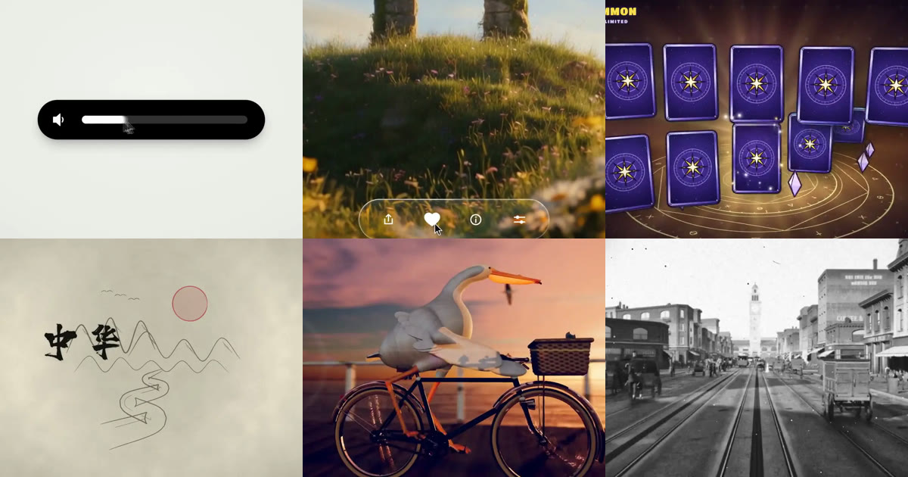

<div align="center">

<a href="https://apiko.app/zh/claude-opus-5-5-video-prompts?utm_source=github&utm_medium=banner&utm_campaign=awesome-claude-opus-5.5-video-prompts"></a>

[](LICENSE)
[](README_zh-CN.md#menu)
[](https://apiko.app/zh/models/claude-opus-5-5?utm_source=github&utm_medium=badge&utm_campaign=awesome-claude-opus-5.5-video-prompts&utm_content=model_try)
[](https://apiko.app/zh/docs/api-manual/text-series/claude?utm_source=github&utm_medium=badge&utm_campaign=awesome-claude-opus-5.5-video-prompts&utm_content=docs)

[](README.md)
[](README_zh-CN.md)
[](README_zh-TW.md)
[](README_ko.md)

</div>

# Awesome Claude Opus 5.5 视频提示词

<a id="introduction"></a>
## 🌟 简介

**Claude Opus 5.5 视频提示词：54 条用代码做视频的提示词与做法，从单个 HTML 到 Remotion、Blender。**

Claude Opus 5.5 视频提示词让模型写代码，视频由代码在你的电脑上渲染出来。可以直接复制提示词，也可以看创作者是怎么做的。 所有成片都能在 GitHub 页面上直接播放。

在线搜索和筛选： [apiko.app/claude-opus-5-5-video-prompts](https://apiko.app/zh/claude-opus-5-5-video-prompts?utm_source=github&utm_medium=readme&utm_campaign=awesome-claude-opus-5.5-video-prompts&utm_content=intro).

> [!NOTE]
> 提示词保持作者发布时的原文，所以大多是英文；标题和简介是我们写的。每条都署名作者并链接原帖。

<a id="quick-start"></a>
## 🚀 快速开始

**网页上用：** 每条都有「在 APIKO 运行」链接，会在 [apiko.app](https://apiko.app/zh/claude-opus-5-5-video-prompts?utm_source=github&utm_medium=quickstart&utm_campaign=awesome-claude-opus-5.5-video-prompts&utm_content=browser) 打开这条示例；点「使用」，提示词就会填进 Claude Opus 5.5 试用台。

**用 API：** 先创建 [APIKO API Key](https://apiko.app/zh/dashboard/apikeys?utm_source=github&utm_medium=quickstart&utm_campaign=awesome-claude-opus-5.5-video-prompts&utm_content=api_key)，把提示词发到 Messages API。Claude 返回代码，在你的电脑上运行它来渲染视频。

```bash
export APIKO_API_KEY="your_key_here"

curl -s https://api.apiko.app/v1/messages \
  -H "Authorization: Bearer $APIKO_API_KEY" \
  -H "anthropic-version: 2023-06-01" \
  -H "Content-Type: application/json" \
  -d '{
  "model": "claude-opus-5-5",
  "max_tokens": 16000,
  "messages": [{
    "role": "user",
    "content": "Write one self-contained index.html that animates a paper boat crossing a lake at sunrise for 10 seconds at 1920x1080, plus the Playwright and FFmpeg commands that render it to boat.mp4."
  }]
}' | python3 -c 'import json,sys; print("".join(b.get("text","") for b in json.load(sys.stdin)["content"]))'
```

接口: `POST https://api.apiko.app/v1/messages` (发送提示词)

<a id="how-to-write"></a>
## ✍️ 怎样写 Claude Opus 5.5 视频提示词

Claude 输出的是代码而不是视频：你运行代码，渲染器截取画面，再由 FFmpeg 合成。先选好路线，并在提示词里点名。

- **单个 HTML、无头浏览器、FFmpeg** · `单个 HTML + seek(t) + 无头浏览器 + FFmpeg + 尺寸、帧率、时长` — 这批卡片里最常见的路线：一个 index.html，所有样式都由时间算出，用 Playwright 之类的无头浏览器逐帧渲染，再由 FFmpeg 合成。适合 Canvas、CSS 和 SVG 动画。
- **Remotion 或 HyperFrames** · `框架名 + 时长 + 脚本 + 品牌色 + 项目目录或网址` — 想要基于 React 的视频工程，就在提示词里写明 Remotion 或 HyperFrames，否则模型会选零依赖的 HTML。好几张卡片把网址或项目目录交给模型，让它自己取素材。
- **Three.js 与着色器** · `场景 + 镜头 + 色调 + 声音来源 + 取帧方式` — 不用 3D 软件也想要立体效果，卡片会要求 Three.js 或 WebGL 着色器，让每个像素都由代码算出。要说明是实时录屏还是离线逐帧渲染。
- **Blender Python** · `主题 + 先建资料 + 可复用生成器 + 渲染时长` — Blender 类卡片先让模型建资料或生成器，再用 Blender Python 搭场景，最后渲染一段短镜头。需要本机装有 Blender。
- **每次都要写明的内容** · `时长 + 分辨率 + 帧率 + 框架 + 你提供的素材` — 写了时长和尺寸的卡片就得到对应长度；没写的那张自己排出了 7.6 分钟的课。说明你会提供哪些素材（照片、音乐、片段），并让提示词来向你索取。

**Claude Opus 5.5 示例给出的经验**

- **一句话用来测环境** 那句 15 秒作品集提示词被跑了成千上万次，结果彼此相似。先用它确认渲染环境能跑，再写自己的创意。
- **禁止清单比形容词有用** 最长的提示词都在列不要做什么：弹跳缓动、发光、CSS 过渡、被压扁的 3D 翻转。每条禁令都来自一次失败的渲染。
- **整片渲染前先验一帧** 踩点模板会在长时间渲染前，按每拍一帧或抽查若干帧，出问题时能省下数小时。
- **长片要分层** 五分钟以上的卡片先排旁白节拍，再排镜头时间，最后做声音，并借助智能体或评审轮次。角色动画多改了几轮才像样。
- **留意音乐与肖像权** 用授权或免版税曲目的卡片都有说明。少数卡片用了他人的歌曲或同人致敬，复用前请先看署名。
- **方法卡是说明，不是提示词** 创作者没有公开提示词的，卡片用我们自己的话描述工具链，并以一句可改写的起手句收尾。

<a id="menu"></a>
## 📑 目录

- [✨ 动态图形](#motion-graphics) (8)
  - [一句话做 15 秒动效作品集](#motion-graphics-01)
  - [逐项点名技法的作品集简报](#motion-graphics-02)
  - [一个图形连变十几种 UI 状态](#motion-graphics-03)
  - [苹果发布会风格的液态玻璃发布片](#motion-graphics-04)
  - [踩着鼓点切的极简产品发布片](#motion-graphics-05)
  - [手游开箱奖励演出，真 3D 渲染](#motion-graphics-06)
  - [纯 Canvas 像素风法师施法](#motion-graphics-07)
  - [UI 变形模板的缤纷重混版](#motion-graphics-08)
- [🚀 产品发布](#product-launch) (10)
  - [一句话生成推理创业公司发布片](#product-launch-01)
  - [HyperFrames 三步做宣传片](#product-launch-02)
  - [可复用的 30 秒业务讲解模板](#product-launch-03)
  - [阿拉伯语竖屏编程辅导 App 宣传片](#product-launch-04)
  - [从官网直接生成的 Kotlin 宣传片](#product-launch-05)
  - [为自己设计的导轨外壳做宣传动画](#product-launch-06)
  - [Remotion 做 Notion 功能预告片](#product-launch-07)
  - [20 分钟做出的 App 发布片](#product-launch-08)
  - [两条提示词做出 Cosmos 宣传片](#product-launch-09)
  - [用动画讲清 UX 设计决策](#product-launch-10)
- [🧑‍🏫 讲解视频](#explainer) (10)
  - [Manim 导数课，edge-tts 配音](#explainer-01)
  - [12 分钟讲透 Transformer](#explainer-02)
  - [逐帧渲染的中华文明史诗编年片](#explainer-03)
  - [用九种迥异画风讲递归](#explainer-04)
  - [一张照片生成内格罗尼食谱动画](#explainer-05)
  - [可拆解的 Raptor 3 火箭发动机](#explainer-06)
  - [剪纸风双生子佯谬，1395 帧 Canvas](#explainer-07)
  - [3Blue1Brown 风格的自编码器讲解](#explainer-08)
  - [全用代码做的 3 分钟 AI 简史](#explainer-09)
  - [智能体通宵打磨的黑洞透镜实验室](#explainer-10)
- [🗂️ 分镜成片](#storyboard-to-video) (4)
  - [穿过复古拼贴世界的无限缩放](#storyboard-to-video-01)
  - [10 分钟用 Krea MCP 拍出的短片](#storyboard-to-video-02)
  - [日语竖屏评测短视频：图解、配音、开场](#storyboard-to-video-03)
  - [两小时八关攻城游戏和 60 秒预告片](#storyboard-to-video-04)
- [🎵 音乐视频](#music-video) (6)
  - [《Claude Pop》MV：12 小时自主运行](#music-video-01)
  - [90 年代风 OpenGL 演示作品](#music-video-02)
  - [p5.brush 手绘、多智能体并行的 MV](#music-video-03)
  - [同一份简报换成 Midjourney 与情绪板](#music-video-04)
  - [《一笔之间》：智能体群做的竖屏 MV](#music-video-05)
  - [p5.brush 画的中秋拼贴动画](#music-video-06)
- [🎞️ 短片](#short-film) (6)
  - [两分钟沙画讲美国 250 年](#short-film-01)
  - [自研 GPU 光线步进的鹈鹕骑车影片](#short-film-02)
  - [滕王阁中秋夜，单个 WebGL2 着色器](#short-film-03)
  - [Three.js 复刻《红猪》日落空战](#short-film-04)
  - [奥斯特里茨 1805：全代码 5 分钟片](#short-film-05)
  - [低多边形 3D 版《崂山道士》](#short-film-06)
- [🧊 3D 与 Blender](#3d-blender) (4)
  - [1906 年地震前一天的旧金山市场街](#3d-blender-01)
  - [同题程序化 Blender 对比测试](#3d-blender-02)
  - [GPU 流体模拟篝火，自我评审约 40 次](#3d-blender-04)
  - [15 分钟做好的风车：建模、绑定、动画](#3d-blender-06)
- [✂️ 视频剪辑](#video-editing) (6)
  - [把原始口播素材剪成有节奏的成片](#video-editing-01)
  - [让 Opus 操作 After Effects 后期](#video-editing-02)
  - [整支 YouTube 视频交给它剪](#video-editing-03)
  - [Opus 5.5 重剪 Grok 生成的舞蹈片](#video-editing-04)
  - [Opus 自己玩游戏并剪出精彩集锦](#video-editing-05)
  - [11 万刚体 WebGPU 物理求解器的演示片](#video-editing-06)
- [❓ 常见问题](#faq)
- [🔗 相关链接](#related)

<a id="motion-graphics"></a>
## ✨ 动态图形

> 作品集、UI 变形和发布片，用 HTML、Canvas 和着色器逐帧画出来。 · 8 条

<a id="motion-graphics-01"></a>
### 1. 一句话做 15 秒动效作品集

作者 [@stephanlivera](https://x.com/stephanlivera) · 15 秒 · 16:9 · **[▶ 在 APIKO 运行](https://apiko.app/zh/claude-opus-5-5-video-prompts?utm_source=github&utm_medium=case&utm_campaign=awesome-claude-opus-5.5-video-prompts&utm_content=motion-graphics-01#motion-graphics-01)** · [原帖](https://x.com/stephanlivera/status/2103315922098470926)

max 档一句话，用来检验渲染环境是否跑得通，而不是一个创意。

https://github.com/user-attachments/assets/4fa680de-c11d-444d-adba-ba7b3d083de2

**提示词:**

```text
make a dynamic 15-second motion graphics video that shows what an incredible motion designer you are, like it's your showreel for a résumé. go all out.
```

<a id="motion-graphics-02"></a>
### 2. 逐项点名技法的作品集简报

作者 [@lukasersil](https://x.com/lukasersil) · 15 秒 · 16:9 · **[▶ 在 APIKO 运行](https://apiko.app/zh/claude-opus-5-5-video-prompts?utm_source=github&utm_medium=case&utm_campaign=awesome-claude-opus-5.5-video-prompts&utm_content=motion-graphics-02#motion-graphics-02)** · [原帖](https://x.com/lukasersil/status/2103742861971726495)

把字效、粒子、遮罩、流体逐项列出，让 15 秒里同时出现 2D、3D 和着色器。

https://github.com/user-attachments/assets/6350570e-d7cf-4ce7-86f4-aa27c9d40cbb

**提示词:**

```text
Create a bold, dynamic 15-second motion graphics showreel that feels like the ultimate portfolio piece of an exceptionally talented motion designer. Showcase a wide range of advanced techniques: kinetic typography, smooth transitions, 2D and 3D animation, abstract geometry, fluid simulations, particles, distortion, creative masking, compositing, lighting, depth, and seamless camera movement. Keep the pacing fast, confident, and visually surprising, with every shot transitioning naturally into the next. Make it feel meticulously art-directed rather than like a random collection of effects. Push the creativity, polish, timing, and visual impact as far as possible. This should feel like the opening reel that gets a motion designer hired.
```

<a id="motion-graphics-03"></a>
### 3. 一个图形连变十几种 UI 状态

作者 [@twoclipping](https://x.com/twoclipping) · 14 秒 · 1:1 · **[▶ 在 APIKO 运行](https://apiko.app/zh/claude-opus-5-5-video-prompts?utm_source=github&utm_medium=case&utm_campaign=awesome-claude-opus-5.5-video-prompts&utm_content=motion-graphics-03#motion-graphics-03)** · [原帖](https://x.com/twoclipping/status/2103273003555402193)

先定节拍，再禁掉常见套路，并写明按时间驱动的 seek(t)、弹簧曲线和首尾相接。

https://github.com/user-attachments/assets/b411c3df-917a-4fbe-8531-eb0ae334998e

**提示词:**

```text
<inputs>
Ask me for: 8 to 12 UI states I want the shape to become (e.g. button, loader, player, slider, toggle, tabs, chart, command palette, toast), pure black and white or one accent color, and a royalty-free song around 120 BPM (e.g. Mixkit, free for commercial use).
</inputs>
<direction>
Dribbble-level UI motion. One shape, never cut: every state is the same element morphing its size, radius and color while its content swaps with a short blur. A cursor drives every change with real clicks and drags. Light warm-gray canvas, black and white components, one clean UI font (Geist). Springs everywhere, a tiny overshoot at most. The camera zooms so each state fills the frame. The last frame is the first frame, so it loops.
Banned: bouncy easing, particle bursts, glows, gradients on UI chrome, mismatched icon strokes, dead time, anything that looks like a template.
</direction>
<structure>
120 BPM, 7 bars, something happens on every beat.
Button → loader → check → dynamic island → music player with a play/pause morph → scrub the progress bar → it becomes a volume slider that stretches when dragged past max → a toggle flips on the beat → the knob becomes a liquid tab indicator → the tabs open into a chart that draws itself, with a tooltip on hover → it collapses into ⌘K → type to filter → enter → toast → back to the button.
</structure>
<build>
1. One HTML file, square 1440x1440. Every style is computed from time inside seek(t): no CSS transitions, no timers, no state carried between frames.
2. Springs are closed-form step responses. A value that changes target many times is the sum of one spring per change, so it stays a pure function of time.
3. The tab indicator's two edges ride different springs, so the leading edge stretches ahead of the trailing one. Same trick for the toggle knob.
4. Drags are direct manipulation: while the cursor is held, the value is computed from its position. On release it springs back from wherever it was.
5. Analyze the song with numpy for the beat grid and start on a downbeat. Place every UI sound by its measured peak.
6. Render with Playwright: 4 subframes per frame, blended with ffmpeg tmix for motion blur at 60fps.
7. Render one frame per beat before the full render. Fix anything off the grid, cramped or hard to read.
</build>
<gotchas>
Never put will-change on anything the camera scales or the text renders blurry. Text that swaps inside a morphing container needs its own enter and exit timing or it overlaps. Make the last frame identical to the first, cursor position and speed included, or the loop stutters.
</gotchas>
<start>
Ask me for the inputs, then show me the state list on the beat grid before you write any code.
</start>
```

<a id="motion-graphics-04"></a>
### 4. 苹果发布会风格的液态玻璃发布片

作者 [@twoclipping](https://x.com/twoclipping) · 29 秒 · 1:1 · **[▶ 在 APIKO 运行](https://apiko.app/zh/claude-opus-5-5-video-prompts?utm_source=github&utm_medium=case&utm_campaign=awesome-claude-opus-5.5-video-prompts&utm_content=motion-graphics-04#motion-graphics-04)** · [原帖](https://x.com/twoclipping/status/2103835273813496100)

五千多字的导演稿，先向你要照片和配乐，再锁定一镜到底和按峰值对齐的音效。

https://github.com/user-attachments/assets/e7bde3a8-cfea-4093-9763-8269b63eb47a

**提示词:**

```text
<inputs>
Ask me for: a one-word brand name for the wordmark (a verb works best), 9 to 12 high-res photos, a royalty-free song around 120 BPM with a drop and a quiet breakdown (Mixkit, free for commercial use), and a free stock clip of a plain wall with moving plant shadows (Pexels).
</inputs>
<direction>
An Apple-keynote launch film, 2D only, one continuous take. Every scene is made out of the previous one: nothing fades, blurs or cuts. Objects change shape instead: text rises out of a mask line, icons pop from zero on a spring, bars draw across, pages push, and a black shape floods the whole frame and contracts into the next scene. Warm off-white canvas, black UI, iOS 26 liquid glass over the photos. Archivo (wdth 125, weight 800) for the wordmark, Geist for UI. A cursor drives every change with real clicks, drags and long-presses. The camera zooms screen-studio style so each moment fills the square, and the cursor scales with it.
Banned: crossfades, blur-ins, brightness "developing", 3D flips, particles, glows, holds longer than 1s, anything that looks like a template.
</direction>
<structure>
120 BPM, 54 beats, something happens on every beat.
Open: the wordmark squeezes into its own period like an accordion, the dot grows into a black pill, a label rises inside it. Click: six iris blades close over the label and snap open onto a photo. The circle becomes a square, shrinks, the grid unfolds from behind it like a paper map (center, plus, corners), reflows into a bento, and a click zooms into one tile, landing exactly on the drop.
Glass: a glass word pops in letter by letter, melts into a droplet that stretches into a glass toolbar. The adjust icon turns it into a slider. Dragging relights the photo from day to golden hour (two aligned shots), and the knob turns into a glass lens while held. It lifts into a glass orb, the next photo opens inside it as a circle, and the orb expands into a lock screen: glass clock digits, date, and a home bar that stretches into a glass music player.
Stage: the lock screen pulls back into a phone (the bezel grows out of the screen edge). The Dynamic Island stretches like liquid, pinches off, flies over and grows into a Mac window that rolls up like a blind. Long-press the wallpaper, drag it onto a Safari tab, the page pushes in, drop it and it becomes the hero of a landing page. Scroll: the hero morphs into a framed print on a product card, with the mat and molding growing out of the photo's edge. Pick a frame color (it paints across) and a size, then the nav button flies down into "Order print".
Order: one black shape keeps morphing: Ordered ✓ → Printing % → On its way (a van on a route) → Delivered ✓.
Wall: the delivered circle floods the frame edge to edge, holds black for a beat, and contracts into the framed print hanging on the real wall footage. The same iris opens onto the print, closes again, the frame floods the screen and contracts into the pill → the dot → the letters spring back out, landing on the beat return. Last frame = first frame.
</structure>
<build>
1. One HTML file, square 1440x1440. Every style is computed from time inside an async seek(t): no CSS transitions, no timers, no state between frames.
2. Springs are closed-form step responses. A value with many targets is the sum of one spring per change, so it stays a pure function of time.
3. Liquid glass: each glass element holds its own clone of the scene behind it, filtered with an SVG feImage displacement map (a rounded-rect distance field) through three feDisplacementMaps at slightly different scales for chromatic edges, plus a rim light. Glass letters: a canvas distance field per glyph gives the map, mask and highlights.
4. Goo: blur + alpha threshold, then composite the source atop it so the glass stays sharp inside.
5. Iris: 6 blades around a hexagonal aperture. Each blade is its two vertices, both edge extensions and the SHORT arc between them.
6. Wordmark squeeze: every letter moves toward the dot by the same factor and its drawn width follows (narrow the wdth axis, scale the rest), so the letters stay touching.
7. Footage: re-encode all-intra (ffmpeg -g 1), load it as a blob URL, await 'seeked' before drawing each frame.
8. Sound: a downloaded SFX for every event (Mixkit), never synthesized, each placed by its measured peak. The song starts on a downbeat: the zoom lands on the drop, the wall sits in the breakdown, the wordmark returns with the beat. Loudnorm to -14 LUFS.
9. Render with Playwright: 4 subframes per frame blended with ffmpeg tmix, 60fps. Check one frame per beat, then scan for single-frame pops (frame-difference spikes 3x their neighbours).
</build>
<gotchas>
backdrop-filter: url() misreads displacement maps in Chromium, so clone the scene instead. A flood must overscale past the corners and take about 0.3s, or half the screen changes in one frame. A child with visibility: visible shows through a hidden parent, so use inherit. Text that swaps inside a morphing shape needs its own mask. python http.server can't range-seek video, so use the blob URL.
</gotchas>
<start>
Ask me for the inputs, then show me the beat map and 4 stills (open, glass, stage, wall) before you write the full film.
</start>
```

<a id="motion-graphics-05"></a>
### 5. 踩着鼓点切的极简产品发布片

作者 [@twoclipping](https://x.com/twoclipping) · 20 秒 · 16:9 · **[▶ 在 APIKO 运行](https://apiko.app/zh/claude-opus-5-5-video-prompts?utm_source=github&utm_medium=case&utm_campaign=awesome-claude-opus-5.5-video-prompts&utm_content=motion-graphics-05#motion-graphics-05)** · [原帖](https://x.com/twoclipping/status/2102554209166000267)

每镜一个想法、一种强调色、一款字体，再用你自己的竖屏素材刷过一面墙。

https://github.com/user-attachments/assets/0676b75d-adf7-4702-b3af-b72e6517a359

**提示词:**

```text
<inputs>
Ask me for: the product name and a one-line promise, 3 to 5 UI moments to show, one accent color, 10 to 20 real vertical clips I own, and a royalty-free song with a clear drop (e.g. Mixkit, free for commercial use).
</inputs>
<direction>
High-end minimal. One idea per shot, lots of empty space, one accent color, one clean sans (Geist or Inter) with tight tracking. Masked type reveals, match cuts, one smooth camera language. Real footage only, never placeholder cards. No full stops in on-screen text.
Banned: shockwave rings, particle bursts, RGB split, camera shake, lens flares, neon glows, grid floors, flashing backgrounds, bouncy easing.
</direction>
<structure>
10 bars at 120 BPM, 2 seconds each.
Bar 1: the hook lands word by word on the beats.
Bar 2: one hook word morphs into the product UI. A cursor types and clicks.
The drop: a circle opens out of the button into a dark scene.
Then one move per bar: a wall of real clips with a scan line and 3 winners, the key output as big type, a 3D carousel of real videos with floor reflections and a motion-blurred whip onto one hero clip, the hero in a phone next to a panel that flips into results, big stats on push cuts, a 3-word ticker, a logo reveal, a fade to black.
</structure>
<build>
1. One HTML file at 1920x1080. Every style is computed from time inside window.seek(t): no CSS animations, no timers, no state between frames.
2. Real video: extract clips to 30fps JPEG sequences with ffmpeg and swap img sources per frame. seek awaits the image decodes.
3. Analyze the song with numpy: tempo, beat grid, energy per bar, the drop. Calibrate the grid to the real kick hits. Every cut sits on a downbeat, every UI hit on a beat.
4. Render with Playwright: 3 subframes per frame at t minus, at, and plus 1/240s, then blend with ffmpeg tmix for real motion blur at 60fps.
5. Place each sound effect so its measured peak, not its file start, lands on the event. Keep the effects quiet under the music. Loudnorm to -14 LUFS.
6. Probe 20 or more frames before the full render. Fix anything cluttered, overlapping or hard to read.
</build>
<gotchas>
Never set opacity or filter on a preserve-3d element, because it flattens and both faces show. Fade its wrapper instead. Measure element positions at runtime for match cuts. Only use music and sound effects whose license allows commercial use.
</gotchas>
<start>
Ask me for the inputs, then show me a storyboard with every timing on the beat grid before you write any code.
</start>
```

<a id="motion-graphics-06"></a>
### 6. 手游开箱奖励演出，真 3D 渲染

作者 [@op7418](https://x.com/op7418) · 18 秒 · 16:9 · **[▶ 在 APIKO 运行](https://apiko.app/zh/claude-opus-5-5-video-prompts?utm_source=github&utm_medium=case&utm_campaign=awesome-claude-opus-5.5-video-prompts&utm_content=motion-graphics-06#motion-graphics-06)** · [原帖](https://x.com/op7418/status/2104085484347818226)

可填空的模板：等级配色、卡通着色 3D，外加一长串禁止事项。

https://github.com/user-attachments/assets/dcfa9d92-a889-4c60-9a6c-8391d0438307

**提示词:**

```text
帮我做一个原创的手游「高光时刻」动效：[主体，例如：开宝箱 / 段位晋升 / 成就解锁 / Boss 掉落 / 角色升级]。
做成一个可以直接打开的单文件网页（HTML + CSS + JS），点一下就能完整播放，效果对标商业手游的结算 / 奖励演出。
【世界观与风格】
- 原创美术，不要模仿任何现有游戏的 IP、角色或 Logo。
- 卡通手游风：高饱和配色，统一的深色描边（例如 #1A1033），圆润厚重的造型。
- 配色随等级升级：[等级阶梯，例如：普通绿 → 稀有蓝 → 史诗紫 → 传说金]。每升一级都要切换主色、光效颜色和背景色调。
- 标题用圆胖的游戏字体（如 Titan One / Lilita One），描黑边，加投影；文字逐字「砸」进画面，带回弹。
【主体物：做成真 3D】
- 用 Three.js 建模，不要用平面 SVG 贴图。要有厚度、倒角，以及符合主体的结构细节（木板缝、铆钉、包边、宝石切面、锁扣等）；木板缝这类细节用真实几何体拼出来，不要贴黑线条。
- 着色用卡通分阶（MeshToonMaterial 加 3～4 阶的渐变贴图），配三种灯光：主光、天光、等级色的轮廓光。
- 描边用后期边缘检测：渲染法线图 + 深度图，再用着色器画线。外轮廓粗、零件交界细，粗细全程一致；另外做 1.5 倍超采样和多重采样抗锯齿。
不要用「放大一圈的黑色背面」那种描边，那样粗细不均、转角会断。
深度判断的阈值要放宽，接缝主要靠法线判断，否则斜着看的表面会冒出细碎斜纹。
- 活动部件要真实运动，比如箱盖绕铰链翻开、奖章绕竖轴旋转。
- 待机时主体缓慢左右转动，让人看到侧面和厚度，同时轻微上下浮动；脚下要有随高度变化的柔和投影。
【如果画面里有 2D 插画（卡面、奖励图标、角色）】
- 三层卡通着色：底色、成块的阴影色、高光色，不要只用一层渐变。
- 线条分粗细：外轮廓粗，内部结构线细。
- 每个角色或物件要有自己的表情和姿态，不要所有东西共用同一张脸。
- 脚下画投影，让主体「站」在画面里；背景按属性区分图案，不要全用同一套放射线。
【演出节奏：五个阶段，缺一不可】
1. 预备：主体待机浮动，每隔几秒抖一下提示可以点击，底部显示「点击」提示。
2. 升级：每点一次，主体跳起、在空中转一圈、落地时压扁再回弹；同时切换到下一等级的颜色，闪一下光，冒一圈粒子，标题更新。
3. 蓄力（约 1 秒）：主体越抖越剧烈，缝隙透出光，四周粒子往中心吸，音效音调持续上升；最后一刻猛地压扁。
4. 爆发：从爆点向外扩散的泛光闪白、屏幕震动、镜头往前一推、多层冲击波、细长流光迸射、闪光星点、金币和宝石（带旋转）。高等级的爆发要明显更强。彩带只在最高潮用一次，不要满屏彩带。
5. 揭晓与结算：
- 奖励卡片从主体里沿弧线飞出，落位时带超调和晃动收尾，数字滚动计数。
- 稀有物品带彩虹流光边框和「NEW!」角标。
- 点击领取后，金币和宝石沿贝塞尔曲线飞进右上角的余额，每到一个余额就跳一下。
【揭晓舞台：让主角独占画面】
- 最高稀有度揭晓时，其他元素收起或淡出，背后换成一层干净的渐变幕布加缓慢旋转的柔光，不要让主角压在杂乱的背景上。
- 幕布出现时，把场景里的其他 3D 物件隐藏掉，否则后期描边会把它们的轮廓线画在幕布上。
- 主角的外发光要放在主体背后，只从边缘溢出，不能盖在主体前面把它糊成一片白。
- 可以加一圈围绕主角盘旋的星尘拖尾，但轨道必须完整在主角轮廓外侧，不能从主体正面扫过。
【光效：必须柔和，不能有硬边】
- 背景光芒：用带渐变过渡的 conic-gradient，不要一刀切的色块边缘；叠 2～3 层不同密度、不同转速的光。
- 光柱：由 5～7 道带模糊的光束呈扇形散开，亮度各自轻微闪动；根部加一团柔光核心，光里有光尘缓慢上飘。
- 闪白：从爆点向外的径向泛光（mix-blend-mode: screen），强度不超过 0.8，不要整屏纯白过曝。
- 粒子：每个火花都带一圈低透明度的外晕；冲击波用三层描边（宽而淡、中等、细而亮）。
【材质与界面】
- 边框、名牌、按钮要有材质感：金属拉丝渐变、左上亮右下暗的倒角光、内阴影；按稀有度换镶嵌件（钢铆钉 → 银框宝石 → 金框钻石加小王冠）。
- 小卡片上不要塞小字数值；详细数值放到揭晓时的信息面板里，面板里的数字滚动上涨，并弹出「▲+数值」。
- 画在 Canvas 上的贴图，分辨率至少是屏幕上最大显示尺寸的 1.5 倍，否则放大时会发虚。
【动画原则】
- 用 GSAP 时间线编排。所有动作都要有挤压拉伸、超调和弹性回弹，不要匀速。
- 粒子系统用 Canvas 2D 自己写：重力、阻力、生命周期、叠加混合，以及「吸入」「曲线飞行」「环绕」三种运动。
- 不要用 CSS 3D 透视去翻转大尺寸元素，放大加侧翻时会被投影成铺满屏幕的平面，3D 翻转一律放在 WebGL 里做。
- 所有「抖动」「呼吸」类的循环补间，在状态切换时要先取消再归零，避免它比停止指令晚一帧结束，又把值设回去。
【音效】
- 全部用 Web Audio 实时合成，不用音频文件：跳起、落地、升级和弦、蓄力上升音、爆炸低频加噪声、弹出音、计数滴答、金币叮当、胜利号角。
- 第一次点击时才初始化音频；右上角放静音开关。
【界面与工程】
- 顶部 HUD：模式切换、金币和宝石余额、静音按钮。
- 手机宽度也要能用；遵守「减少动态效果」设置（关闭震屏，减少粒子）。
- 动画状态机要严谨：动画播放中忽略点击，不能出现点击被吞或状态错乱。
- 目标 60fps。第一次打开时就是完整的待机画面，不能是空白。
【交付前自检】
在蓄力、爆发、揭晓、结算这几个时刻各截一张图，逐张检查：
- 主角有没有被光晕、粒子或文字挡住？
- 有没有过曝成一片白？
- 背景是否杂乱，有没有穿帮的描边线？
- 小字是否能看清？
- 结算后是否还有东西在不该动的时候继续抖动？
最后告诉我：每个阶段的时长，以及哪些参数可以调整演出强度。
```

<a id="motion-graphics-07"></a>
### 7. 纯 Canvas 像素风法师施法

作者 [@majidmanzarpour](https://x.com/majidmanzarpour) · 11 秒 · 5:4 · **[▶ 在 APIKO 运行](https://apiko.app/zh/claude-opus-5-5-video-prompts?utm_source=github&utm_medium=case&utm_campaign=awesome-claude-opus-5.5-video-prompts&utm_content=motion-graphics-07#motion-graphics-07)** · [原帖](https://x.com/majidmanzarpour/status/2102476258948927543)

固定逻辑分辨率、调色板、状态机和粒子池，让像素动画代码保持整洁。

https://github.com/user-attachments/assets/1d707e18-89ad-4c80-ac4a-4aa6c3538f39

**提示词:**

```text
Create a single self-contained HTML file that renders an animated pixel art wizard casting a spell, using vanilla JavaScript and Canvas 2D. No external assets, libraries, or network requests.
RENDERING
- Draw everything to an offscreen canvas at a fixed logical resolution of 128x96, then blit to a fullscreen display canvas scaled by the largest integer factor that fits the window, centered, with imageSmoothingEnabled = false and CSS image-rendering: pixelated.
- All drawing snaps to integer coordinates on the logical canvas. No sub-pixel positions, anti-aliasing, gradients, or shadowBlur.
- Fixed palette of ~24 hex colors: deep blues/purples for night sky, warm robe tones, 3-4 bright magic colors. Every pixel comes from this palette.
CHARACTER
- Build the wizard procedurally from filled rects and pixel runs, ~24x32 logical pixels: pointed hat with a bend, long beard, two-shade robe with darker outline, staff with a gem at the tip.
- Parameterize the pose (staff angle, arm raise, head tilt, robe sway). Animate parameters smoothly, then quantize to the pixel grid each frame so motion reads at an 8-12 fps pixel animation feel even though the loop runs at 60fps.
ANIMATION
- Looping state machine: IDLE (2-frame bob, beard sway) -> CHARGE (staff raises, gem flickers, sparks spiral inward) -> CAST (bright burst, projectile fires across the scene, 1-2 pixel screen shake) -> RECOVER (settle back). Ease pose parameters between keyframes.
- Pooled allocation-free particle system: preallocate and reuse. Sparks orbit the gem during CHARGE, explode outward on CAST, each particle stepping its palette index from white to magic color to dark before despawn. Snap particle positions to the grid when drawing.
- Fixed 60hz timestep update with rAF rendering. Zero object allocation inside the loop.
SCENE
- Minimal background: dark sky, a few twinkling 1px stars, moon, stone floor line. Character silhouette must read clearly.
- Subtle 1px rim light on the wizard from the gem, brightening during CHARGE and CAST.
QUALITY BAR
- Crisp pixels at any window size, seamless loop, stable 60fps, readable silhouette. Should look like a polished 16-bit sprite animation, not vector shapes scaled down.
```

<a id="motion-graphics-08"></a>
### 8. UI 变形模板的缤纷重混版

作者 [@__morse](https://x.com/__morse) · 15 秒 · 1:1 · **[▶ 在 APIKO 运行](https://apiko.app/zh/claude-opus-5-5-video-prompts?utm_source=github&utm_medium=case&utm_campaign=awesome-claude-opus-5.5-video-prompts&utm_content=motion-graphics-08#motion-graphics-08)** · [原帖](https://x.com/__morse/status/2103485566570369333)

同一套模板只加一句要更多色彩，作者借此看到了模型自选的渲染流程。

https://github.com/user-attachments/assets/73cf26b5-bb0b-4713-9aee-e90a580a2bc0

**做法（作者没有公开提示词）:**

作者沿用 UI 变形的提示词，只补了一句要更丰富的色彩。Claude 把全部代码写进一个 index.html，用 seek 函数在无头 Playwright 窗口里逐帧渲染，再交给 FFmpeg 合成 MP4。没有指定框架时，它倾向于零依赖、全部从头写。可改写的起手句：「同样的要求，但色彩更丰富；保持单个 HTML 文件，逐帧渲染后用 FFmpeg 合成。」

<a id="product-launch"></a>
## 🚀 产品发布

> App 和产品的宣传片、预告片，多数用 Remotion 或 HyperFrames 制作。 · 10 条

<a id="product-launch-01"></a>
### 9. 一句话生成推理创业公司发布片

作者 [@deedydas](https://x.com/deedydas) · 26 秒 · 16:9 · **[▶ 在 APIKO 运行](https://apiko.app/zh/claude-opus-5-5-video-prompts?utm_source=github&utm_medium=case&utm_campaign=awesome-claude-opus-5.5-video-prompts&utm_content=product-launch-01#product-launch-01)** · [原帖](https://x.com/deedydas/status/2102787937482252537)

一句话交代产品类型和语气，场景、文案和节奏交给模型。

https://github.com/user-attachments/assets/e9c9bc7a-4785-4a78-8718-3ae61f5330e5

**提示词:**

```text
make a modern slick and punchy video for a modern startup that works on inference
```

<a id="product-launch-02"></a>
### 10. HyperFrames 三步做宣传片

作者 [@thayto_dev](https://x.com/thayto_dev) · 15 秒 · 16:9 · **[▶ 在 APIKO 运行](https://apiko.app/zh/claude-opus-5-5-video-prompts?utm_source=github&utm_medium=case&utm_campaign=awesome-claude-opus-5.5-video-prompts&utm_content=product-launch-02#product-launch-02)** · [原帖](https://x.com/thayto_dev/status/2104200591278739735)

沿用作品集那句话，再把项目目录指给模型，让它取真实素材。

https://github.com/user-attachments/assets/1f65db0e-ed59-4ab9-b074-bbc9b1435b29

**提示词:**

```text
make a dynamic 15-second motion graphics video that shows what an incredible motion designer you are, like it's your showreel for a résumé. go all out.
```

<a id="product-launch-03"></a>
### 11. 可复用的 30 秒业务讲解模板

作者 [@alex_prompter](https://x.com/alex_prompter) · 35 秒 · 16:9 · **[▶ 在 APIKO 运行](https://apiko.app/zh/claude-opus-5-5-video-prompts?utm_source=github&utm_medium=case&utm_campaign=awesome-claude-opus-5.5-video-prompts&utm_content=product-launch-03#product-launch-03)** · [原帖](https://x.com/alex_prompter/status/2103499977632997524)

限定角色、时长、分场和品牌色，只留一处括号填你的业务。

https://github.com/user-attachments/assets/fe995a4e-4904-45b8-93dd-4d12f7ceb41a

**提示词:**

```text
Adopt the role of an expert motion designer. Build a 30-second animated explainer for my business as a single HTML page. 5 scenes. The customer's problem, what I do, how it works in 3 steps, one proof point, and my name at the end. Bold text, smooth transitions, my brand colours. My business [DESCRIBE WHAT YOU SELL, WHO IT'S FOR AND YOUR COLOURS]
```

<a id="product-launch-04"></a>
### 12. 阿拉伯语竖屏编程辅导 App 宣传片

作者 [@YarHmm](https://x.com/YarHmm) · 56 秒 · 9:16 · **[▶ 在 APIKO 运行](https://apiko.app/zh/claude-opus-5-5-video-prompts?utm_source=github&utm_medium=case&utm_campaign=awesome-claude-opus-5.5-video-prompts&utm_content=product-launch-04#product-launch-04)** · [原帖](https://x.com/YarHmm/status/2103505435802341449)

用 Remotion 加合成配音做的 56 秒竖屏宣传片。

https://github.com/user-attachments/assets/ea43a1ca-aa74-4686-b704-5217af2e46fa

**做法（作者没有公开提示词）:**

作者用 Opus 5.5 的中高档位聊了约一个半小时，用掉约五小时额度窗口的四分之一。预览用 Remotion，配音用 Gemini 的语音合成模型，成片约 56 秒、1080x1920 竖屏。可改写的起手句：「用 Remotion 给我的 App 做一支 55 秒竖屏宣传片，1080x1920，配音脚本可替换。」

<a id="product-launch-05"></a>
### 13. 从官网直接生成的 Kotlin 宣传片

作者 [@JetBrains](https://x.com/jetbrains) · 35 秒 · 16:9 · **[▶ 在 APIKO 运行](https://apiko.app/zh/claude-opus-5-5-video-prompts?utm_source=github&utm_medium=case&utm_campaign=awesome-claude-opus-5.5-video-prompts&utm_content=product-launch-05#product-launch-05)** · [原帖](https://x.com/jetbrains/status/2102459650125754812)

给模型一个网址和 HyperFrames 技能，就能出 35 秒宣传片。

https://github.com/user-attachments/assets/4384deb5-1edc-4ac4-872c-f446cbc2f0b9

**做法（作者没有公开提示词）:**

JetBrains 的工程师把 HyperFrames 技能交给 Claude Opus 5.5，再指向 kotlinlang.org，模型自己抓取素材，做出约 35 秒、2560x1440 的宣传片。这条来自 JetBrains 官方账号，宜当作展示而非评测。可改写的起手句：「用 HyperFrames 技能，为这个网址的产品做一支 35 秒宣传片，文案和画面从网站里取。」

<a id="product-launch-06"></a>
### 14. 为自己设计的导轨外壳做宣传动画

作者 [@VectorCrossProd](https://x.com/VectorCrossProd) · 10 秒 · 16:9 · **[▶ 在 APIKO 运行](https://apiko.app/zh/claude-opus-5-5-video-prompts?utm_source=github&utm_medium=case&utm_campaign=awesome-claude-opus-5.5-video-prompts&utm_content=product-launch-06#product-launch-06)** · [原帖](https://x.com/VectorCrossProd/status/2104093497561436573)

模型先设计外壳，再为它做 10 秒宣传动画，全在 Claude Code 里完成。

https://github.com/user-attachments/assets/8a7f67f6-f39c-4d14-9868-fc5ac3b860d6

**做法（作者没有公开提示词）:**

作者先让 Claude Code 为一块现成的 PCB 设计可 3D 打印的外壳并输出 STL，再让它给同一个零件做宣传动画。外壳、STL 和这段 10 秒、1920x1080 的片子都来自提示词。可改写的起手句：「再为这个外壳做一段 10 秒宣传动画，1920x1080，展示它如何包裹电路板。」

<a id="product-launch-07"></a>
### 15. Remotion 做 Notion 功能预告片

作者 [@wustep](https://x.com/wustep) · 32 秒 · 16:9 · **[▶ 在 APIKO 运行](https://apiko.app/zh/claude-opus-5-5-video-prompts?utm_source=github&utm_medium=case&utm_campaign=awesome-claude-opus-5.5-video-prompts&utm_content=product-launch-07#product-launch-07)** · [原帖](https://x.com/wustep/status/2104610435571884086)

一支预告片做了两天、改了 33 版才定稿。

https://github.com/user-attachments/assets/16b5489f-039a-490f-9419-d1fbf53ae8a8

**做法（作者没有公开提示词）:**

一位 Notion 员工周末用 Claude Opus 5.5（xhigh 档）和 Remotion 为新功能做预告片，据作者说改了 33 版才通过，用掉了大量 API 额度，并公开了制作过程文档。成片约 32 秒、1920x1080。可改写的起手句：「用 Remotion 为这个功能做一支 30 秒预告片，我会逐版审阅。」

<a id="product-launch-08"></a>
### 16. 20 分钟做出的 App 发布片

作者 [@Miguel07Code](https://x.com/Miguel07Code) · 58 秒 · 16:9 · **[▶ 在 APIKO 运行](https://apiko.app/zh/claude-opus-5-5-video-prompts?utm_source=github&utm_medium=case&utm_campaign=awesome-claude-opus-5.5-video-prompts&utm_content=product-launch-08#product-launch-08)** · [原帖](https://x.com/Miguel07Code/status/2102441708395041170)

为真实 App 一次生成的发布视频，用到 HyperFrames 技能。

https://github.com/user-attachments/assets/b7bff036-6b23-4ce6-8f8a-5cb2b04035d7

**做法（作者没有公开提示词）:**

作者称 Claude Opus 5.5 用 HyperFrames 框架在 20 分钟内一次做完了 Shotbase 应用的发布视频，成片约 58 秒、1920x1080。这里不收录原提示词。可改写的起手句：「用 HyperFrames 给我的 App 做一支 55 秒发布视频，功能清单和口号如下。」

<a id="product-launch-09"></a>
### 17. 两条提示词做出 Cosmos 宣传片

作者 [@kaolti](https://x.com/kaolti) · 40 秒 · 16:9 · **[▶ 在 APIKO 运行](https://apiko.app/zh/claude-opus-5-5-video-prompts?utm_source=github&utm_medium=case&utm_campaign=awesome-claude-opus-5.5-video-prompts&utm_content=product-launch-09#product-launch-09)** · [原帖](https://x.com/kaolti/status/2103481296018092204)

在 HyperFrames 里用两条提示词、没有任何参考做出的 40 秒宣传片。

https://github.com/user-attachments/assets/c70459c7-be6a-44be-86a4-6e2e237eef9b

**做法（作者没有公开提示词）:**

作者在 HyperFrames 里只用两条提示词、不带参考图做出这支宣传片，约 40 秒、1920x1080。提示词在原帖串里，这里不转载。可改写的起手句：「在 HyperFrames 里为一款灵感板 App 做 40 秒宣传片，先出概念和脚本，再做动画。」

<a id="product-launch-10"></a>
### 18. 用动画讲清 UX 设计决策

作者 [@moguzbulbul](https://x.com/moguzbulbul) · 42 秒 · 4:3 · **[▶ 在 APIKO 运行](https://apiko.app/zh/claude-opus-5-5-video-prompts?utm_source=github&utm_medium=case&utm_campaign=awesome-claude-opus-5.5-video-prompts&utm_content=product-launch-10#product-launch-10)** · [原帖](https://x.com/moguzbulbul/status/2104206095313215591)

4:3 画幅的设计案例动画，为面试讲解而做。

https://github.com/user-attachments/assets/1a29ce3c-bf9d-4122-8e10-8c1af0d63734

**做法（作者没有公开提示词）:**

作者为了在面试里讲清 UX 决策，让 Opus 5.5 做成动画案例，并问大家要不要他用的技能。成片约 42 秒、1600x1200。可改写的起手句：「把这个 UX 案例做成 4:3 动画：问题、三个设计决策的前后对比，以及结果。」

<a id="explainer"></a>
## 🧑‍🏫 讲解视频

> 从 30 秒的食谱到 12 分钟的讲座，各类课程与科普讲解。 · 10 条

<a id="explainer-01"></a>
### 19. Manim 导数课，edge-tts 配音

作者 [@LinearUncle](https://x.com/LinearUncle) · 457 秒 · 16:9 · **[▶ 在 APIKO 运行](https://apiko.app/zh/claude-opus-5-5-video-prompts?utm_source=github&utm_medium=case&utm_campaign=awesome-claude-opus-5.5-video-prompts&utm_content=explainer-01#explainer-01)** · [原帖](https://x.com/LinearUncle/status/2103128559174971663)

点名工具 Manim 和配音 edge-tts，要求有例子；没给时长，它排了 7.6 分钟。

https://github.com/user-attachments/assets/06ee4703-b1d8-4b89-9806-6ccfcc04e775

**提示词:**

```text
请用Manim给我制作一个导数概念学习的视频，要求通俗易懂，并且有例子，引人思考。配音使用edge-tts
```

<a id="explainer-02"></a>
### 20. 12 分钟讲透 Transformer

作者 [@dotey](https://x.com/dotey) · 732 秒 · 16:9 · **[▶ 在 APIKO 运行](https://apiko.app/zh/claude-opus-5-5-video-prompts?utm_source=github&utm_medium=case&utm_campaign=awesome-claude-opus-5.5-video-prompts&utm_content=explainer-02#explainer-02)** · [原帖](https://x.com/dotey/status/2103683057689522564)

说明受众是高中生、要有细节，并给足工具自由，时长和结构由模型定。

https://github.com/user-attachments/assets/313fdcf3-12cc-4970-b641-6582f3e24cc1

<sub>这里只放前 4 分钟，完整视频见 [apiko.app](https://apiko.app/zh/claude-opus-5-5-video-prompts?utm_source=github&utm_medium=case&utm_campaign=awesome-claude-opus-5.5-video-prompts&utm_content=explainer-02#explainer-02)</sub>

**提示词:**

```text
帮我用js制作一个视频，主题是：什么是 Transformer
要深入浅出，让高中生也能看得懂，不仅high level说的清楚，也要有细节，包括注意力机制，甚至一些数学概念

你可以用任何工具或者安装工具，可以联网检索

请给我惊喜
```

<a id="explainer-03"></a>
### 21. 逐帧渲染的中华文明史诗编年片

作者 [@dotey](https://x.com/dotey) · 217 秒 · 16:9 · **[▶ 在 APIKO 运行](https://apiko.app/zh/claude-opus-5-5-video-prompts?utm_source=github&utm_medium=case&utm_campaign=awesome-claude-opus-5.5-video-prompts&utm_content=explainer-03#explainer-03)** · [原帖](https://x.com/dotey/status/2103964025683927166)

导演式简报：配乐当时钟，先定拍点和分镜表再渲染，年代先核对。

https://github.com/user-attachments/assets/9beec9a4-7735-4d36-9639-0bd007dfe4f0

**提示词:**

```text
做一支史诗编年片《中华文明史》，可以写代码逐帧渲染，再用 ffmpeg 合成。
配乐当时钟：五声调式，乐器从骨笛、编钟一路演进到管弦，BPM 随年代加快，所有切点踩拍。
宣纸白描和玄底泥金两种画风交替；每卷一个主色和一套随时代演变的纹样（彩陶纹 → 饕餮纹 → 云气纹 → 卷草纹 → 缠枝纹 → 回纹）。
每镜一个按词组出现的书法大字关键词，配一幅线稿。全片 HUD：左上朱印卷号，右侧竖排朝代名，底部卷轴时间尺和年份计数。
卷交界用朱印盖下、鼓钟重击的冲击转场。先定拍点网格和分镜表，再渲染。
地图只画示意，不画近现代真实人物，年代核对后再交付。
```

<a id="explainer-04"></a>
### 22. 用九种迥异画风讲递归

作者 [@emollick](https://x.com/emollick) · 75 秒 · 16:9 · **[▶ 在 APIKO 运行](https://apiko.app/zh/claude-opus-5-5-video-prompts?utm_source=github&utm_medium=case&utm_campaign=awesome-claude-opus-5.5-video-prompts&utm_content=explainer-04#explainer-04)** · [原帖](https://x.com/emollick/status/2103688362960019567)

一个概念加一条结构规则：每一段换一种画风。

https://github.com/user-attachments/assets/4bc7e2c6-51f1-49da-be45-a9c38c69ca4c

**提示词:**

```text
A video explaining recursion, where every explanation about recursion has a radically different video style, make this self-referential & clever & fast moving.
```

<a id="explainer-05"></a>
### 23. 一张照片生成内格罗尼食谱动画

作者 [@Ror_Fly](https://x.com/Ror_Fly) · 30 秒 · 1:1 · **[▶ 在 APIKO 运行](https://apiko.app/zh/claude-opus-5-5-video-prompts?utm_source=github&utm_medium=case&utm_campaign=awesome-claude-opus-5.5-video-prompts&utm_content=explainer-05#explainer-05)** · [原帖](https://x.com/Ror_Fly/status/2102853258582880547)

直白的请求：输入一张照片，输出 30 秒 HTML 食谱动画。

https://github.com/user-attachments/assets/c3f7b71d-0a82-42db-8b20-b4babda1ed6e

**提示词:**

```text
We're going to try a little test. Do you think you could render a recipe motion graphic animation using javascript or html (w/e you think will produce the best) to show the full recipe from start to finish (empty glass to completed cocktail) - Explainer video style - Showing the recipe ingreidents + measurements as they're going into the cup. Should be a 30s video.
```

<a id="explainer-06"></a>
### 24. 可拆解的 Raptor 3 火箭发动机

作者 [@konstantinsaifo](https://x.com/konstantinsaifo) · 35 秒 · 16:9 · **[▶ 在 APIKO 运行](https://apiko.app/zh/claude-opus-5-5-video-prompts?utm_source=github&utm_medium=case&utm_campaign=awesome-claude-opus-5.5-video-prompts&utm_content=explainer-06#explainer-06)** · [原帖](https://x.com/konstantinsaifo/status/2104094723887501736)

浏览器里能剖开、追踪流路、调节推力的页面，录屏成 35 秒讲解。

https://github.com/user-attachments/assets/6f9b3002-f4d6-4e27-8d99-e205813de824

**做法（作者没有公开提示词）:**

作者让 Claude Opus 5.5 做一个可交互的猛禽 3 发动机模型来讲原理：能剖开、跟随两种推进剂穿过涡轮泵、调推力看激波菱形移动。视频是这个页面的录屏，约 35 秒。可改写的起手句：「请做一个可以拆开的浏览器交互模型，来讲清这台机器的原理。」

<a id="explainer-07"></a>
### 25. 剪纸风双生子佯谬，1395 帧 Canvas

作者 [@masahirochaen](https://x.com/masahirochaen) · 47 秒 · 1:1 · **[▶ 在 APIKO 运行](https://apiko.app/zh/claude-opus-5-5-video-prompts?utm_source=github&utm_medium=case&utm_campaign=awesome-claude-opus-5.5-video-prompts&utm_content=explainer-07#explainer-07)** · [原帖](https://x.com/masahirochaen/status/2102722719502704941)

全程 Canvas 绘制、约两分钟渲染完的日语相对论讲解。

https://github.com/user-attachments/assets/f79740bb-eb2c-4372-9b7d-fd24a53ca882

**做法（作者没有公开提示词）:**

提示词只有一个热门案例的链接加简短说明。Claude Code 配 Opus 5.5 用 Canvas 画出 1395 帧剪纸风画面，用 JavaScript 生成音乐和音效，再转成 MP4；渲染约两分钟，成片 46 秒、1080x1080。可改写的起手句：「用 45 秒讲清狭义相对论，剪纸风，每一帧用 Canvas 绘制，声音也由代码生成。」

<a id="explainer-08"></a>
### 26. 3Blue1Brown 风格的自编码器讲解

作者 [@ng169onX](https://x.com/ng169onX) · 335 秒 · 16:9 · **[▶ 在 APIKO 运行](https://apiko.app/zh/claude-opus-5-5-video-prompts?utm_source=github&utm_medium=case&utm_campaign=awesome-claude-opus-5.5-video-prompts&utm_content=explainer-08#explainer-08)** · [原帖](https://x.com/ng169onX/status/2103183904563998809)

Manim 动画、真训练的 MNIST 模型和克隆旁白，约五分半钟。

https://github.com/user-attachments/assets/028010a1-7874-44ad-a3a2-e88605d180c4

**做法（作者没有公开提示词）:**

作者只给了一条短提示词，称得到约 5.5 分钟的视频：Manim 动画、真实在 MNIST 上训练出的数字、用本地语音模型克隆的旁白和原创配乐。该帖曝光很低，公开细节有限。可改写的起手句：「用 Manim 做一支 3Blue1Brown 风格的论文讲解，含真实训练的例子和旁白。」

<a id="explainer-09"></a>
### 27. 全用代码做的 3 分钟 AI 简史

作者 [@kimmonismus](https://x.com/kimmonismus) · 180 秒 · 16:9 · **[▶ 在 APIKO 运行](https://apiko.app/zh/claude-opus-5-5-video-prompts?utm_source=github&utm_medium=case&utm_campaign=awesome-claude-opus-5.5-video-prompts&utm_content=explainer-09#explainer-09)** · [原帖](https://x.com/kimmonismus/status/2102844654169575547)

约 7400 行 React/TypeScript，图像全部用 SVG 与 Canvas 绘制，配开源语音。

https://github.com/user-attachments/assets/644e1b2a-c2b0-45d1-8782-67055943c599

**做法（作者没有公开提示词）:**

整部片子由 Claude Code 用 Remotion 写成：约 7400 行 React 和 TypeScript，每张图都用 SVG 与 Canvas 画，旁白用开源语音，配乐用 Python 合成。作者称约一小时、用掉 7% 的周额度，成片 3 分钟、1920x1080。可改写的起手句：「用 Remotion 做一支 3 分钟的 AI 简史，不用素材库和图像生成，全部用代码绘制。」

<a id="explainer-10"></a>
### 28. 智能体通宵打磨的黑洞透镜实验室

作者 [@Voxyz_ai](https://x.com/Voxyz_ai) · 22 秒 · 16:9 · **[▶ 在 APIKO 运行](https://apiko.app/zh/claude-opus-5-5-video-prompts?utm_source=github&utm_medium=case&utm_campaign=awesome-claude-opus-5.5-video-prompts&utm_content=explainer-10#explainer-10)** · [原帖](https://x.com/Voxyz_ai/status/2103117246860345550)

三轮评审加修复在作者睡觉时跑完：评审排优先级，修复者动手。

https://github.com/user-attachments/assets/da053832-0663-4fa0-be0c-2ca1cd5bbf7a

**做法（作者没有公开提示词）:**

一条提示词生成交互式黑洞页面的初版，之后的工作流跑三轮，每轮两名评审按 P0 到 P2 排问题，另一名负责修复。整个过程约五个半小时，视频是 22 秒的 4K 录屏。可改写的起手句：「先做成交互页面，再跑三轮评审：两名评审列出分级问题，第三位修掉所有 P0。」

<a id="storyboard-to-video"></a>
## 🗂️ 分镜成片

> Claude 规划镜头，并通过 MCP 或脚本调用图像、视频工具。 · 4 条

<a id="storyboard-to-video-01"></a>
### 29. 穿过复古拼贴世界的无限缩放

作者 [@koldo2k](https://x.com/koldo2k) · 20 秒 · 16:9 · **[▶ 在 APIKO 运行](https://apiko.app/zh/claude-opus-5-5-video-prompts?utm_source=github&utm_medium=case&utm_campaign=awesome-claude-opus-5.5-video-prompts&utm_content=storyboard-to-video-01#storyboard-to-video-01)** · [原帖](https://x.com/koldo2k/status/2103129343253778767)

生成的图片和片段在代码里合成，并设有费用关卡：先列清单等你确认。

https://github.com/user-attachments/assets/68b77d3b-130e-4ff9-aefd-069d9e88ad22

**提示词:**

```text
Build a looping "infinite zoom" animation, After Effects style: the camera
travels from landscape to landscape by flying through vintage objects.
LOOK: vintage collage realistic photo landscapes + black & white newspaper
cutout objects (halftone, white paper border, soft shadow). Film grain,
vignette, light flicker.
WORLDS (loop): snowy mountains → pocket watch (swinging on its chain) →
sea cliffs → box camera lens → desert dunes → magnifying glass →
misty lake → hand mirror → back to start.
Extras: floating hat, phone, umbrella, gramophone, key; a 1950s man walking
toward the watch; a whale swimming across the cliffs sky.
HOW:
- Generate everything via the Magnific MCP (Seedream 5 Pro landscapes,
GPT 2.5 transparent cutouts, depth maps, Kling 2.5 animation, Lyria 3
music). List the generations + credit cost and wait for my OK first.
- Split each landscape into 3 depth layers from its depth map and fill the
hidden areas. Parallax: layer scale = camera^Z, Z between 0.45 and 1.22.
- Each portal's glass holds the next world; cut seamlessly when it fills
the frame.
- Constant speed: exponential zoom to a fixed point, each segment's duration
proportional to log(zoom). Verify the cuts frame by frame.
- Man & whale: generate on pure green (#00B140), animate in place with
Kling, key out every frame, build a seamless loop (ping-pong if needed).
- Cutouts animate at 15 fps (on twos).
- 20 s loop, 1920×1080, 30 fps. Music: 96 BPM, cut to exactly 8 bars = 20 s.
DELIVER: an interactive artifact (viewer, AE-style timeline, music +
MP4 download) and a rendered MP4 with music under 30 MB.
Show me screenshots before each expensive step.
```

<a id="storyboard-to-video-02"></a>
### 30. 10 分钟用 Krea MCP 拍出的短片

作者 [@angrypenguinPNG](https://x.com/angrypenguinPNG) · 30 秒 · 16:9 · **[▶ 在 APIKO 运行](https://apiko.app/zh/claude-opus-5-5-video-prompts?utm_source=github&utm_medium=case&utm_campaign=awesome-claude-opus-5.5-video-prompts&utm_content=storyboard-to-video-02#storyboard-to-video-02)** · [原帖](https://x.com/angrypenguinPNG/status/2102829318875537683)

模型驱动图像与视频 MCP，一次做出 30 秒短片。

https://github.com/user-attachments/assets/a95a6bb8-3940-4533-a5bf-af2226380d13

**做法（作者没有公开提示词）:**

作者把 Krea MCP 接给 Claude，称 Opus 5.5 约十分钟一次做完这支 30 秒、1280x720 的短片，生成费用在帖子里。可改写的起手句：「用已连接的 MCP 写一个 30 秒短片脚本，生成镜头并剪成片，先把方案给我看。」

<a id="storyboard-to-video-03"></a>
### 31. 日语竖屏评测短视频：图解、配音、开场

作者 [@masahirochaen](https://x.com/masahirochaen) · 57 秒 · 9:16 · **[▶ 在 APIKO 运行](https://apiko.app/zh/claude-opus-5-5-video-prompts?utm_source=github&utm_medium=case&utm_campaign=awesome-claude-opus-5.5-video-prompts&utm_content=storyboard-to-video-03#storyboard-to-video-03)** · [原帖](https://x.com/masahirochaen/status/2103872865770836012)

三个工具分工：Opus 做图解动画，语音模型配音，Seedance 做开场人脸。

https://github.com/user-attachments/assets/6a30d473-9d1c-44fb-9c00-b47a0ef18f56

**做法（作者没有公开提示词）:**

创作者用 Claude Opus 5.5 做图解动画，用 Gemini 3.8 Flash TTS 克隆自己的声音，开场的脸和声音来自 Seedance 2.5。成片 57 秒、1080x1920。可改写的起手句：「把这份脚本做成 9:16 的清爽图解动画，开头留出主持人片段的位置，时间轴方便对配音。」

<a id="storyboard-to-video-04"></a>
### 32. 两小时八关攻城游戏和 60 秒预告片

作者 [@KanaWorks_AI](https://x.com/KanaWorks_AI) · 60 秒 · 16:9 · **[▶ 在 APIKO 运行](https://apiko.app/zh/claude-opus-5-5-video-prompts?utm_source=github&utm_medium=case&utm_campaign=awesome-claude-opus-5.5-video-prompts&utm_content=storyboard-to-video-04#storyboard-to-video-04)** · [原帖](https://x.com/KanaWorks_AI/status/2102684116525437206)

Opus 写游戏，视频模型生成预告片镜头。

https://github.com/user-attachments/assets/7d1a0114-a5da-4dc9-91d1-95ba0e9af13d

**做法（作者没有公开提示词）:**

作者让 Opus 5.5 约两小时做出网站和八关横版攻城游戏，再录屏剪成 60 秒预告片，素材用到 Seedance 2.5 和另一款视频模型。代码是 Claude 写的，视频生成不是。可改写的起手句：「做一个可以录屏的横版小游戏，再写一份 60 秒预告片的分镜表。」

<a id="music-video"></a>
## 🎵 音乐视频

> 长时间自主运行和踩点成片，有的让智能体各画一章。 · 6 条

<a id="music-video-01"></a>
### 33. 《Claude Pop》MV：12 小时自主运行

作者 [@donaldjewkes](https://x.com/donaldjewkes) · 142 秒 · 16:9 · **[▶ 在 APIKO 运行](https://apiko.app/zh/claude-opus-5-5-video-prompts?utm_source=github&utm_medium=case&utm_campaign=awesome-claude-opus-5.5-video-prompts&utm_content=music-video-01#music-video-01)** · [原帖](https://x.com/donaldjewkes/status/2102801274173587569)

口述的长简报加完整环境：参考资料、图像接口、视频模型和花费上限。

https://github.com/user-attachments/assets/f41a5796-7258-412e-a0f2-96073aca6ff7

**提示词:**

```text
I've included an MP4 file and an original link to a video that is called "Claude Pop." It's a pop song that is about increasing rate of progress and the experience of the singularity approaching.
I want you to independently do an end-to-end complete pass on making an updated version of this video. Use the exact same audio track and think and feel very deeply about what is the best way to visually represent all of the lyrics on screen. You do not need to anchor to the current style, you can do truly anything that you think might best let you visually express yourself, including abstract motion graphics.
……
I think after that, what might be fun is if you use your visual reasoning skills and your ability to build animations in JavaScript, and then reconstruct the video from scratch as sort of an overlay, so that the visual continuity of the base is really there. It's like that animation technique where you shoot first in traditional film and then draw over top of it.
……
You're going to want to watch the entire video multiple times, take screenshots at individual parts, and think about if something is really up to the bar of quality that we need here.
……
make no mistakes.
```

<a id="music-video-02"></a>
### 34. 90 年代风 OpenGL 演示作品

作者 [@gandamu_ml](https://x.com/gandamu_ml) · 383 秒 · 16:9 · **[▶ 在 APIKO 运行](https://apiko.app/zh/claude-opus-5-5-video-prompts?utm_source=github&utm_medium=case&utm_campaign=awesome-claude-opus-5.5-video-prompts&utm_content=music-video-02#music-video-02)** · [原帖](https://x.com/gandamu_ml/status/2102919394775220530)

先要求调研和分析音乐，再写出与 S3M 曲目同步的原生 OpenGL 演示。

https://github.com/user-attachments/assets/8d769efe-1956-4dce-8458-fcb11386df05

<sub>这里只放前 4 分钟，完整视频见 [apiko.app](https://apiko.app/zh/claude-opus-5-5-video-prompts?utm_source=github&utm_medium=case&utm_campaign=awesome-claude-opus-5.5-video-prompts&utm_content=music-video-02#music-video-02)</sub>

**提示词:**

```text
I would like you to create a kickass, impressive 1990s style demoscene demo using this S3M track as the music. Prior to getting to work, please see how to best play and analyze the S3M track. This will be important since synchronization of effects and appropriateness of scenes to the musical vibe (and this song does have a variety of sections with different attitude) is essential to a great demoscene demo. Also prior to getting started, please research what kinds of effects, physics, etc. would be good to use in combination. Please use C/C++ -- with appropriate demoscene/embedded/console gamedev sensibilities to avoid needlessly bloating compile times -- with OpenGL. In some cases, blitting to surfaces in realtime may be appropriate.. while in others, using OpenGL or even shaders is appropriate as well. It should be planned and polished to be spectacular and shocking. This is Claude's way of really showing off to the world that it kicks ass.
```

<a id="music-video-03"></a>
### 35. p5.brush 手绘、多智能体并行的 MV

作者 [@other__reality](https://x.com/other__reality) · 157 秒 · 16:9 · **[▶ 在 APIKO 运行](https://apiko.app/zh/claude-opus-5-5-video-prompts?utm_source=github&utm_medium=case&utm_campaign=awesome-claude-opus-5.5-video-prompts&utm_content=music-video-03#music-video-03)** · [原帖](https://x.com/other__reality/status/2102514581684052169)

一份分镜文件、一份动画指南、九章九个文件，再用无头 Chrome 渲染。

https://github.com/user-attachments/assets/19ac1237-6adb-4482-ac44-5e96bab89bfd

**做法（作者没有公开提示词）:**

Claude 先写出给并行子智能体的动画指南和分镜，把整支 MV 拆成九章，各自一个文件，用 p5.js 和 p5.brush 绘制，再用无头 Chrome 逐帧渲染并交给 FFmpeg。全部动画约 45 分钟；歌曲来自别处，不是作者自己的。成片约 157 秒、1920x1080。可改写的起手句：「先写分镜和动画指南，再让并行智能体各画一章，用 p5.brush 绘制，无头 Chrome 加 FFmpeg 渲染。」

<a id="music-video-04"></a>
### 36. 同一份简报换成 Midjourney 与情绪板

作者 [@anabology](https://x.com/anabology) · 307 秒 · 16:9 · **[▶ 在 APIKO 运行](https://apiko.app/zh/claude-opus-5-5-video-prompts?utm_source=github&utm_medium=case&utm_campaign=awesome-claude-opus-5.5-video-prompts&utm_content=music-video-04#music-video-04)** · [原帖](https://x.com/anabology/status/2103534482930491441)

简报不变，参考素材一换，出来完全不同的 5 分钟片子。

https://github.com/user-attachments/assets/f0162d5f-c9cc-40f0-ae40-f4cd1c5a7176

**做法（作者没有公开提示词）:**

作者把一份已流行的简报、Midjourney 权限和一块情绪板交给 Opus 5.5，让它跑了一整夜，称 12 小时后成片。片长约 306 秒、1920x1080，是本库中播放量最高的一条。可改写的起手句：「按这份简报来，用 Midjourney 定画面风格，并对齐我附上的情绪板。」

<a id="music-video-05"></a>
### 37. 《一笔之间》：智能体群做的竖屏 MV

作者 [@bradmillscan](https://x.com/bradmillscan) · 203 秒 · 9:16 · **[▶ 在 APIKO 运行](https://apiko.app/zh/claude-opus-5-5-video-prompts?utm_source=github&utm_medium=case&utm_campaign=awesome-claude-opus-5.5-video-prompts&utm_content=music-video-05#music-video-05)** · [原帖](https://x.com/bradmillscan/status/2103108967194833310)

约 75 个踩点镜头，返工两次才把火柴人修成像样的角色。

https://github.com/user-attachments/assets/94e93850-505e-475c-b6d8-9d8a1f04dc3d

**做法（作者没有公开提示词）:**

作者让 Opus 5.5 读自己整理的比特币与货币史笔记，用语音工具生成歌曲，再由一组智能体做分镜并写代码，得到约 75 个镜头、3 分 23 秒的竖屏片。第一轮改了两次，其中一次重写了角色骨骼。可改写的起手句：「读这些笔记，写歌曲简报，做 70 个镜头的分镜，用代码做成 9:16 并踩点剪辑。」

<a id="music-video-06"></a>
### 38. p5.brush 画的中秋拼贴动画

作者 [@ring_hyacinth](https://x.com/ring_hyacinth) · 40 秒 · 16:9 · **[▶ 在 APIKO 运行](https://apiko.app/zh/claude-opus-5-5-video-prompts?utm_source=github&utm_medium=case&utm_campaign=awesome-claude-opus-5.5-video-prompts&utm_content=music-video-06#music-video-06)** · [原帖](https://x.com/ring_hyacinth/status/2102986085328716066)

脚本和音乐由人提供，每一帧由模型用 JavaScript 画出。

https://github.com/user-attachments/assets/57dcf36e-2875-4533-83e5-f3329420c4d2

**做法（作者没有公开提示词）:**

脚本和音乐是作者给的；Opus 5.5 用 JavaScript 逐帧画出动画，手绘质感来自 p5.js 加 p5.brush，底图由图像模型生成，音效由 Node.js 程序合成。成片约 40 秒、1920x1080。可改写的起手句：「把这份脚本做成纸张拼贴风动画，用 p5.brush 逐帧绘制，音效用代码合成。」

<a id="short-film"></a>
## 🎞️ 短片

> 用代码写成的故事和场景，从沙画动画到光线步进着色器。 · 6 条

<a id="short-film-01"></a>
### 39. 两分钟沙画讲美国 250 年

作者 [@Michaelzsguo](https://x.com/Michaelzsguo) · 120 秒 · 16:9 · **[▶ 在 APIKO 运行](https://apiko.app/zh/claude-opus-5-5-video-prompts?utm_source=github&utm_medium=case&utm_campaign=awesome-claude-opus-5.5-video-prompts&utm_content=short-film-01#short-film-01)** · [原帖](https://x.com/Michaelzsguo/status/2102592355165782312)

一句话交代时长、故事和声音；没有用 Blender 或 Three.js。

https://github.com/user-attachments/assets/a5c86a65-2423-4b9b-89f6-bd50dc954906

**提示词:**

```text
Make a 2-minute sand animation that tells the story of 250 years of U.S. history. Keep it lively, engaging, and tasteful. Add appropriate background music and sound design.
```

<a id="short-film-02"></a>
### 40. 自研 GPU 光线步进的鹈鹕骑车影片

作者 [@AxtonLiu](https://x.com/AxtonLiu) · 38 秒 · 16:9 · **[▶ 在 APIKO 运行](https://apiko.app/zh/claude-opus-5-5-video-prompts?utm_source=github&utm_medium=case&utm_campaign=awesome-claude-opus-5.5-video-prompts&utm_content=short-film-02#short-film-02)** · [原帖](https://x.com/AxtonLiu/status/2103119648271290566)

要求最精细的版本、不限技术、时间随便用。

https://github.com/user-attachments/assets/97793470-430e-4132-840e-fa590babcded

**提示词:**

```text
每次一个新的模型出来呢，大家都让它去画 "鹈鹕骑自行车" 来判断这个模型的空间能力，基本上都是用 HTML、SVG 来画动画。当我实在看得都有审美疲劳了，我希望你能画一个最复杂、最精细、最精美的 "鹈鹕骑自行车"的动画视频，你可以用任何的技术，不用着急，画一天都可以。
```

<a id="short-film-03"></a>
### 41. 滕王阁中秋夜，单个 WebGL2 着色器

作者 [@DemitiyaGeekzen](https://x.com/DemitiyaGeekzen) · 30 秒 · 16:9 · **[▶ 在 APIKO 运行](https://apiko.app/zh/claude-opus-5-5-video-prompts?utm_source=github&utm_medium=case&utm_campaign=awesome-claude-opus-5.5-video-prompts&utm_content=short-film-03#short-film-03)** · [原帖](https://x.com/DemitiyaGeekzen/status/2103517910274818523)

题材由模型自选，每个像素出自一个着色器，声音来自 Web Audio。

https://github.com/user-attachments/assets/f066e58e-c1a1-455d-a24e-436e72145c5d

**提示词:**

```text
用你最强的思维和能力，根据对我的了解，自行寻找我可能喜欢的主题，制作一个30s的视频还有互动html，尽可能的展示你的前端能力！
```

<a id="short-film-04"></a>
### 42. Three.js 复刻《红猪》日落空战

作者 [@NFT_Chen](https://x.com/NFT_Chen) · 14 秒 · 16:9 · **[▶ 在 APIKO 运行](https://apiko.app/zh/claude-opus-5-5-video-prompts?utm_source=github&utm_medium=case&utm_campaign=awesome-claude-opus-5.5-video-prompts&utm_content=short-film-04#short-film-04)** · [原帖](https://x.com/NFT_Chen/status/2103401780117938683)

一句话写清场景、战机涂装、天空和气氛，属于同人致敬。

https://github.com/user-attachments/assets/7159116d-018b-43d7-8975-8adf4c4fc0e8

**提示词:**

```text
用 web3D 复刻宫崎骏《红猪》日落海面上的经典空战：白绿红涂装战斗机、紫色积云、海面反光、吉卜力运镜，画面写 just breathe.
```

<a id="short-film-05"></a>
### 43. 奥斯特里茨 1805：全代码 5 分钟片

作者 [@WinterArc2125](https://x.com/WinterArc2125) · 301 秒 · 16:9 · **[▶ 在 APIKO 运行](https://apiko.app/zh/claude-opus-5-5-video-prompts?utm_source=github&utm_medium=case&utm_campaign=awesome-claude-opus-5.5-video-prompts&utm_content=short-film-05#short-film-05)** · [原帖](https://x.com/WinterArc2125/status/2103116235009347650)

真实地形和太阳位置，自写引擎、配乐与旁白。

https://github.com/user-attachments/assets/1c0e28d6-23a9-473c-9e5d-4f4b14624b8e

**做法（作者没有公开提示词）:**

作者让 Opus 5.5 自己写引擎、士兵、配乐和旁白，做出 5 分钟影片：山丘用卫星高程数据，日出位置按当天实际计算。准备约 90 分钟，渲染约 4 小时，代码已公开。可改写的起手句：「用代码做一支这场战役的 5 分钟影片：真实地形、正确的太阳位置、原创配乐和旁白。」

<a id="short-film-06"></a>
### 44. 低多边形 3D 版《崂山道士》

作者 [@wshuyi](https://x.com/wshuyi) · 359 秒 · 16:9 · **[▶ 在 APIKO 运行](https://apiko.app/zh/claude-opus-5-5-video-prompts?utm_source=github&utm_medium=case&utm_campaign=awesome-claude-opus-5.5-video-prompts&utm_content=short-film-06#short-film-06)** · [原帖](https://x.com/wshuyi/status/2103308292613345504)

不写分镜，不套现成视频技能，只提供克隆声音。

https://github.com/user-attachments/assets/e385a9b4-ab11-46d2-acfd-e08ee0a62990

**做法（作者没有公开提示词）:**

作者用 Claude Code 挂 Opus 5.5，只提供自己的声音克隆，不写分镜、不用现成视频技能，想测试模型能否端到端把故事拍出来。成片是约六分钟的 3D 讲述，1920x1080。可改写的起手句：「把这个短篇故事做成低多边形 3D 影片，配我的旁白，镜头自己规划。」

<a id="3d-blender"></a>
## 🧊 3D 与 Blender

> 用 Blender Python 或 MCP 搭建的场景，以及 JavaScript 写的模拟。 · 4 条

<a id="3d-blender-01"></a>
### 45. 1906 年地震前一天的旧金山市场街

作者 [@alexalbert__](https://x.com/alexalbert__) · 8 秒 · 4:3 · **[▶ 在 APIKO 运行](https://apiko.app/zh/claude-opus-5-5-video-prompts?utm_source=github&utm_medium=case&utm_campaign=awesome-claude-opus-5.5-video-prompts&utm_content=3d-blender-01#3d-blender-01)** · [原帖](https://x.com/alexalbert__/status/2102466523164274839)

先建带出处的数据文件，再写 Blender 生成器，每栋楼都能追溯到来源。

https://github.com/user-attachments/assets/c9b677e6-2f2b-4ff3-b3a9-9ada3865005b

**提示词:**

```text
Recreate Market Street, San Francisco as it stood on April 17, 1906, the afternoon before the earthquake, in Blender.
Scope: the Ferry Building up Market to Fifth Street, including the Palace Hotel, the Call Building, the Chronicle Building, Lotta's Fountain and the Emporium.
Before modeling anything, build a source file from: the 1899-1905 Sanborn fire insurance maps (footprints, heights, materials, occupants), the Miles Brothers film "A Trip Down Market Street" (April 1906), period photographs from OpenSFHistory, the Library of Congress and the David Rumsey collection, and USGS topography. Record every building with footprint, height, facade material, occupant, and the source for each fact with a confidence level.
Build everything in Blender Python. No downloaded meshes, textures or HDRIs. Write reusable generators (Victorian commercial facade, mansard roof, bay windows, awnings, painted signage, gas and electric street lamps, cable car, horse-drawn wagon, early automobile) and assemble the street from the source file, so every building traces back to data.
Provide a 10 second video up the street.
```

<a id="3d-blender-02"></a>
### 46. 同题程序化 Blender 对比测试

作者 [@Stefan_3D_AI](https://x.com/Stefan_3D_AI) · 46 秒 · 16:9 · **[▶ 在 APIKO 运行](https://apiko.app/zh/claude-opus-5-5-video-prompts?utm_source=github&utm_medium=case&utm_campaign=awesome-claude-opus-5.5-video-prompts&utm_content=3d-blender-02#3d-blender-02)** · [原帖](https://x.com/Stefan_3D_AI/status/2102471841046786153)

一条提示词，只用 Blender，渲染 10 秒镜头并录建模延时。

https://github.com/user-attachments/assets/52f1dedf-18d3-4dc3-8ba6-3539154e35bc

**做法（作者没有公开提示词）:**

作者给两个模型同一条提示词：全部程序化建模、渲染 10 秒镜头并录制建模延时。Opus 5.5 用了 35 分钟，输出 token 比对手多得多。片长 46 秒、1920x1080。可改写的起手句：「只用 Blender Python 程序化搭一个场景，渲染 10 秒镜头，并录下搭建过程的延时。」

<a id="3d-blender-04"></a>
### 47. GPU 流体模拟篝火，自我评审约 40 次

作者 [@NathanWilbanks_](https://x.com/NathanWilbanks_) · 38 秒 · 16:9 · **[▶ 在 APIKO 运行](https://apiko.app/zh/claude-opus-5-5-video-prompts?utm_source=github&utm_medium=case&utm_campaign=awesome-claude-opus-5.5-video-prompts&utm_content=3d-blender-04#3d-blender-04)** · [原帖](https://x.com/NathanWilbanks_/status/2103881538592981110)

用 JavaScript 写真实火焰模拟，带渲染、评审的循环。

https://github.com/user-attachments/assets/a3613517-128c-46eb-8cc2-4139b731e710

**做法（作者没有公开提示词）:**

作者要求只用 JavaScript 做出最逼真的火。Claude 写了 GPU 流体模拟，火焰颜色按黑体辐射，离线渲染帧，让视觉模型像特效总监一样评审约 40 次，声音由火焰亮度驱动。成果是一个 HTML 文件做出的 38 秒 1080p 短片。可改写的起手句：「用 JavaScript 做最逼真的篝火，渲染一帧，像特效总监一样挑毛病、修好，再重复。」

<a id="3d-blender-06"></a>
### 48. 15 分钟做好的风车：建模、绑定、动画

作者 [@Higgsfield](https://x.com/higgsfield_ai) · 21 秒 · 9:16 · **[▶ 在 APIKO 运行](https://apiko.app/zh/claude-opus-5-5-video-prompts?utm_source=github&utm_medium=case&utm_campaign=awesome-claude-opus-5.5-video-prompts&utm_content=3d-blender-06#3d-blender-06)** · [原帖](https://x.com/higgsfield_ai/status/2102453658889953717)

通过 MCP 连接驱动 Blender，做出竖屏短片。

https://github.com/user-attachments/assets/76e7d3fa-0892-4d73-8007-f710bccaa3f9

**做法（作者没有公开提示词）:**

厂商称 Claude Opus 5.5 通过 MCP 连接在 Blender 里 15 分钟完成风车的建模、绑定、贴图和动画。成片 21 秒、1080x1920 竖屏，帖子里还链接了更长的教程。可改写的起手句：「通过 MCP 在 Blender 里建一座风车，绑定叶片、贴图，并做出转动动画。」

<a id="video-editing"></a>
## ✂️ 视频剪辑

> 让 Claude 当剪辑师：剪素材、操作 After Effects 或 Resolve、拼接集锦。 · 6 条

<a id="video-editing-01"></a>
### 49. 把原始口播素材剪成有节奏的成片

作者 [@sab8a](https://x.com/sab8a) · 37 秒 · 16:9 · **[▶ 在 APIKO 运行](https://apiko.app/zh/claude-opus-5-5-video-prompts?utm_source=github&utm_medium=case&utm_campaign=awesome-claude-opus-5.5-video-prompts&utm_content=video-editing-01#video-editing-01)** · [原帖](https://x.com/sab8a/status/2103144778481475686)

一句话的剪辑简报：字幕、图形和配乐。

https://github.com/user-attachments/assets/47a6a27f-677a-4fe6-b4ca-5e3026a69301

**提示词:**

```text
Cut a raw talking-head clip into a punchy, fun edit with subtitles, graphics and music
```

<a id="video-editing-02"></a>
### 50. 让 Opus 操作 After Effects 后期

作者 [@aicreataro](https://x.com/aicreataro) · 32 秒 · 16:9 · **[▶ 在 APIKO 运行](https://apiko.app/zh/claude-opus-5-5-video-prompts?utm_source=github&utm_medium=case&utm_campaign=awesome-claude-opus-5.5-video-prompts&utm_content=video-editing-02#video-editing-02)** · [原帖](https://x.com/aicreataro/status/2103757144789221819)

用舞蹈视频的骨骼数据驱动文字、光线和镜头。

https://github.com/user-attachments/assets/b73b7c64-9b33-478f-adfc-74c279a7d01e

**做法（作者没有公开提示词）:**

作者生成了歌曲和两段 15 秒舞蹈片，让 Opus 5.5 操作 After Effects：逐帧提取舞者骨骼，用它驱动文字、光线和镜头。输出是人还能继续编辑的 .aep 工程。可改写的起手句：「从这段视频里提取骨骼，在 After Effects 里把歌词和光效挂到舞者身上，每章用不同的效果。」

<a id="video-editing-03"></a>
### 51. 整支 YouTube 视频交给它剪

作者 [@NickSpisak_](https://x.com/NickSpisak_) · 539 秒 · 16:9 · **[▶ 在 APIKO 运行](https://apiko.app/zh/claude-opus-5-5-video-prompts?utm_source=github&utm_medium=case&utm_campaign=awesome-claude-opus-5.5-video-prompts&utm_content=video-editing-03#video-editing-03)** · [原帖](https://x.com/NickSpisak_/status/2103511092043628807)

Claude 当剪辑师，Resolve 经 MCP 驱动，HyperFrames 做转场素材。

https://github.com/user-attachments/assets/05ff9091-c704-4686-a40b-baf8f4c1a09b

**做法（作者没有公开提示词）:**

创作者用录制软件的原始素材、经 MCP 控制的 DaVinci Resolve、做 B-roll 的 HyperFrames，再让 Claude Opus 5.5 当剪辑师。成片 9 分钟、4K；提示词在帖中的视频与文章里。可改写的起手句：「在 Resolve 里把这些原始素材剪成 9 分钟视频，剪掉停顿，加 B-roll 卡片和字幕。」

<a id="video-editing-04"></a>
### 52. Opus 5.5 重剪 Grok 生成的舞蹈片

作者 [@Gorden_Sun](https://x.com/Gorden_Sun) · 15 秒 · 16:9 · **[▶ 在 APIKO 运行](https://apiko.app/zh/claude-opus-5-5-video-prompts?utm_source=github&utm_medium=case&utm_campaign=awesome-claude-opus-5.5-video-prompts&utm_content=video-editing-04#video-editing-04)** · [原帖](https://x.com/Gorden_Sun/status/2104009748874141941)

原始生成片与重剪版并排对比。

https://github.com/user-attachments/assets/bea453e6-d1d3-4ddd-98b6-77beee2f5718

**做法（作者没有公开提示词）:**

作者把视频模型生成的原片和 Opus 5.5 重剪包装后的版本放在一起，并感叹剪辑软件可能被取代。两段都约 15 秒。可改写的起手句：「重剪这段视频：按节拍卡点，加字幕和标题卡，保留原声。」

<a id="video-editing-05"></a>
### 53. Opus 自己玩游戏并剪出精彩集锦

作者 [@rehan_shei](https://x.com/rehan_shei) · 30 秒 · 16:9 · **[▶ 在 APIKO 运行](https://apiko.app/zh/claude-opus-5-5-video-prompts?utm_source=github&utm_medium=case&utm_campaign=awesome-claude-opus-5.5-video-prompts&utm_content=video-editing-05#video-editing-05)** · [原帖](https://x.com/rehan_shei/status/2103755997533839416)

Unity 游戏、通关录像和 30 秒集锦，全由模型完成。

https://github.com/user-attachments/assets/096b166c-7f68-4f0f-800b-26d2ef99d838

**做法（作者没有公开提示词）:**

作者用 Unity 命令行加 Opus 5.5 做了一款游戏，又让模型用多个角色玩一遍，把精彩片段拼成演示视频。游戏可在浏览器试玩，片长约 30 秒、1920x1080。可改写的起手句：「用每个角色玩一遍这个游戏并录屏，剪出一支 30 秒的精彩集锦。」

<a id="video-editing-06"></a>
### 54. 11 万刚体 WebGPU 物理求解器的演示片

作者 [@nybobs](https://x.com/nybobs) · 26 秒 · 16:9 · **[▶ 在 APIKO 运行](https://apiko.app/zh/claude-opus-5-5-video-prompts?utm_source=github&utm_medium=case&utm_campaign=awesome-claude-opus-5.5-video-prompts&utm_content=video-editing-06#video-editing-06)** · [原帖](https://x.com/nybobs/status/2103385835328680050)

求解器和演示片都由模型从一条提示词做出。

https://github.com/user-attachments/assets/77298e62-d2b7-4ffd-80a3-eda1314366c0

**做法（作者没有公开提示词）:**

作者用 Opus 5.5 在 WebGPU 和 Three.js 里实现了一篇已发表的物理求解器，并称模型在 Claude Code 里也是从一条提示词拼出了这支 26 秒演示片。代码以 MIT 协议公开。可改写的起手句：「为这个项目做一支 25 秒的演示片：镜头运动、标题卡和字幕。」

<a id="faq"></a>
## ❓ 常见问题

<details>
<summary><b>Claude Opus 5.5 能直接做视频吗？</b></summary>

它写的是代码，比如 HTML 文件、Remotion 工程或 Blender 脚本。视频由你电脑上的浏览器、Remotion 或 Blender 渲染，再用 FFmpeg 合成。

</details>

<details>
<summary><b>运行 Claude Opus 5.5 视频提示词需要装什么？</b></summary>

看卡片而定：HTML 路线需要 Node、Playwright 和 FFmpeg，Remotion 与 HyperFrames 卡片要装对应框架，Blender 卡片要装 Blender。不少创作者在 Claude Code 里运行 Claude Opus 5.5，让模型自己安装工具。

</details>

<details>
<summary><b>这些 Claude Opus 5.5 提示词可以免费用吗？结果归谁？</b></summary>

提示词和视频归各卡片署名的创作者，每张卡片都链接到原帖。可以当作起点，转发前请先确认创作者的使用条款。

</details>

<details>
<summary><b>用什么语言给 Claude Opus 5.5 写提示词？</b></summary>

这里的提示词保留作者的原语言，Claude Opus 5.5 能读英文和中文。用你最顺手的语言写需求，画面文字则按视频需要的语言写。

</details>

<details>
<summary><b>怎样用 API 运行这些 Claude Opus 5.5 提示词？</b></summary>

把提示词发给 claude-opus-5-5 模型的 Messages 接口，保存返回的代码即可。接口地址和请求头见 API 文档。

</details>

<details>
<summary><b>为什么我用 Claude Opus 5.5 做出来的和视频不一样？</b></summary>

模型输出并不固定，创作者也可能用了别的推理档位、工具、音乐或改了很多版。比如 Notion 预告片就改了 33 版。

</details>

<details>
<summary><b>用 Claude Opus 5.5 该选哪个推理档位？</b></summary>

写明档位的创作者用的是 max、xhigh，或中到高档。API 接受 low、medium、high、xhigh、max；思考也计入 max_tokens，要给代码留足余量。

</details>

<details>
<summary><b>Claude Opus 5.5 能做多长的视频？</b></summary>

没有说明上限；这些卡片从约 8 秒到 12 分钟以上都有。请在提示词里写明时长，因为没写时长的那堂课被排成了 7.6 分钟。

</details>

<details>
<summary><b>Claude Opus 5.5 连配乐和配音也一起做吗？</b></summary>

有的卡片用代码合成声音，有的接入语音合成、音乐生成器或授权曲目，具体见各卡片说明。

</details>

<details>
<summary><b>做这些该选 Claude Opus 5.5 还是 Opus 5？</b></summary>

这里的示例都出自 Opus 5.5。想比较两个模型，可以看 APIKO 的对比文章。

</details>


<a id="related"></a>
## 🔗 相关链接

- [Claude Opus 5.5 视频提示词 · apiko.app](https://apiko.app/zh/claude-opus-5-5-video-prompts?utm_source=github&utm_medium=related&utm_campaign=awesome-claude-opus-5.5-video-prompts)
- [Claude Opus 5.5 模型页](https://apiko.app/zh/models/claude-opus-5-5?utm_source=github&utm_medium=related&utm_campaign=awesome-claude-opus-5.5-video-prompts)
- [Claude API 文档](https://apiko.app/zh/docs/api-manual/text-series/claude?utm_source=github&utm_medium=related&utm_campaign=awesome-claude-opus-5.5-video-prompts)
- [Claude Opus 5.5 与 Opus 5 对比](https://apiko.app/zh/blog/claude-opus-5-5-vs-claude-opus-5?utm_source=github&utm_medium=related&utm_campaign=awesome-claude-opus-5.5-video-prompts)
- [APIKO 对话](https://apiko.app/zh/chat?utm_source=github&utm_medium=related&utm_campaign=awesome-claude-opus-5.5-video-prompts)
- [Seedance 2.5 提示词](https://apiko.app/zh/seedance-2-5-prompts?utm_source=github&utm_medium=related&utm_campaign=awesome-claude-opus-5.5-video-prompts)
- [APIKO API 代码示例](https://github.com/tong0619453646-dev/apiko-ai-api-examples)

**更多提示词合集**

- [Awesome Seedance 2.5 Prompts](https://github.com/tong0619453646-dev/awesome-seedance-2.5-prompts/blob/main/README_zh-CN.md)
- [Awesome Kling 4.0 Prompts](https://github.com/tong0619453646-dev/awesome-kling-4.0-prompts/blob/main/README_zh-CN.md)
- [Awesome GPT Image 2.6 Prompts](https://github.com/tong0619453646-dev/awesome-gpt-image-2.6-prompts/blob/main/README_zh-CN.md)
- [Awesome Nano Banana 2.1 Prompts](https://github.com/tong0619453646-dev/awesome-nano-banana-2.1-prompts/blob/main/README_zh-CN.md)
- [Awesome GPT Image 2.5 Prompts](https://github.com/tong0619453646-dev/awesome-gpt-image-2.5-prompts/blob/main/README_zh-CN.md)
- [Awesome GPT Image 2 Prompts](https://github.com/tong0619453646-dev/awesome-gpt-image-2-prompts/blob/main/README_zh-CN.md)
- [Awesome Wan 3.0 Prompts](https://github.com/tong0619453646-dev/awesome-wan-3.0-prompts/blob/main/README_zh-CN.md)

<a id="license"></a>
## 📄 许可与出处

提示词与视频归各卡片署名的创作者所有，每张卡片都链接到原帖。标题、简介、译文和生成脚本采用 [CC BY 4.0](LICENSE) 许可。

如果这份合集帮你省了时间，点个 ⭐ 能让更多人看到。
