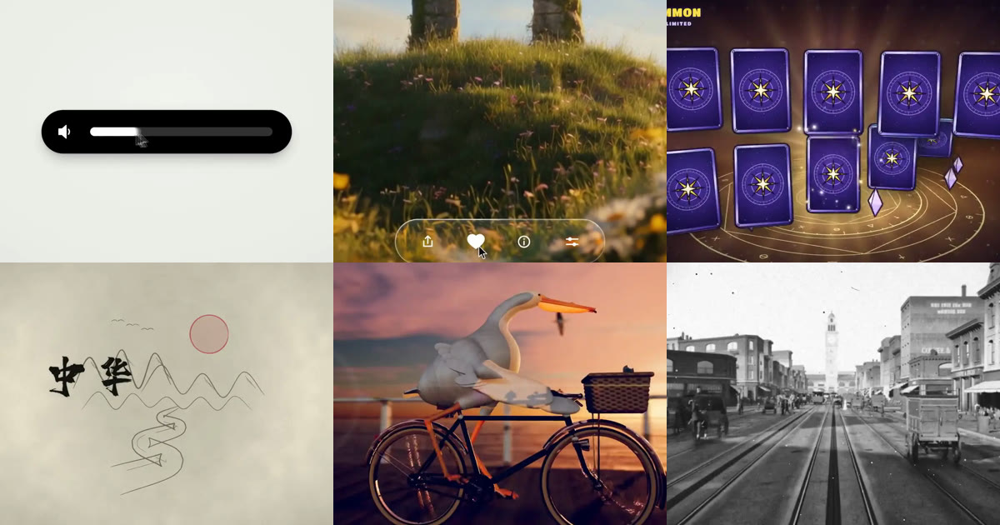

<div align="center">

<a href="https://apiko.app/zh-tw/claude-opus-5-5-video-prompts?utm_source=github&utm_medium=banner&utm_campaign=awesome-claude-opus-5.5-video-prompts"></a>

[](LICENSE)
[](README_zh-TW.md#menu)
[](https://apiko.app/zh-tw/models/claude-opus-5-5?utm_source=github&utm_medium=badge&utm_campaign=awesome-claude-opus-5.5-video-prompts&utm_content=model_try)
[](https://apiko.app/zh-tw/docs/api-manual/text-series/claude?utm_source=github&utm_medium=badge&utm_campaign=awesome-claude-opus-5.5-video-prompts&utm_content=docs)

[](README.md)
[](README_zh-CN.md)
[](README_zh-TW.md)
[](README_ko.md)

</div>

# Awesome Claude Opus 5.5 影片提示詞

<a id="introduction"></a>
## 🌟 簡介

**Claude Opus 5.5 影片提示詞：54 條用程式碼做影片的提示詞與做法，從單一 HTML 到 Remotion、Blender。**

Claude Opus 5.5 影片提示詞讓模型寫程式碼，影片由程式碼在你的電腦上算圖而成。可以直接複製提示詞，也可以看創作者怎麼做。 所有成品影片都能在 GitHub 頁面上直接播放。

線上搜尋與篩選： [apiko.app/claude-opus-5-5-video-prompts](https://apiko.app/zh-tw/claude-opus-5-5-video-prompts?utm_source=github&utm_medium=readme&utm_campaign=awesome-claude-opus-5.5-video-prompts&utm_content=intro).

> [!NOTE]
> 提示詞保持作者發布時的原文，所以大多是英文；標題與簡介由我們撰寫。每則都署名作者並連結原帖。

<a id="quick-start"></a>
## 🚀 快速開始

**網頁上用：** 每則都有「在 APIKO 執行」連結，會在 [apiko.app](https://apiko.app/zh-tw/claude-opus-5-5-video-prompts?utm_source=github&utm_medium=quickstart&utm_campaign=awesome-claude-opus-5.5-video-prompts&utm_content=browser) 開啟這則範例；點「使用」，提示詞就會填進 Claude Opus 5.5 試用台。

**用 API：** 先建立 [APIKO API 金鑰](https://apiko.app/zh-tw/dashboard/apikeys?utm_source=github&utm_medium=quickstart&utm_campaign=awesome-claude-opus-5.5-video-prompts&utm_content=api_key)，把提示詞送到 Messages API。Claude 回傳程式碼，在你的電腦上執行它來算出影片。

```bash
export APIKO_API_KEY="your_key_here"

curl -s https://api.apiko.app/v1/messages \
  -H "Authorization: Bearer $APIKO_API_KEY" \
  -H "anthropic-version: 2023-06-01" \
  -H "Content-Type: application/json" \
  -d '{
  "model": "claude-opus-5-5",
  "max_tokens": 16000,
  "messages": [{
    "role": "user",
    "content": "Write one self-contained index.html that animates a paper boat crossing a lake at sunrise for 10 seconds at 1920x1080, plus the Playwright and FFmpeg commands that render it to boat.mp4."
  }]
}' | python3 -c 'import json,sys; print("".join(b.get("text","") for b in json.load(sys.stdin)["content"]))'
```

介面: `POST https://api.apiko.app/v1/messages` (送出提示詞)

<a id="how-to-write"></a>
## ✍️ 如何撰寫 Claude Opus 5.5 影片提示詞

Claude 輸出的是程式碼而不是影片：你執行程式碼，算圖器擷取畫面，再由 FFmpeg 合成。先選好路線，並在提示詞裡點名。

- **單一 HTML、無頭瀏覽器、FFmpeg** · `單一 HTML + seek(t) + 無頭瀏覽器 + FFmpeg + 尺寸、幀率、長度` — 這批卡片最常見的路線：一個 index.html，所有樣式都由時間算出，用 Playwright 之類的無頭瀏覽器逐格算圖，再交給 FFmpeg 合成。適合 Canvas、CSS 與 SVG 動畫。
- **Remotion 或 HyperFrames** · `框架名稱 + 長度 + 腳本 + 品牌色 + 專案資料夾或網址` — 想要以 React 為基礎的影片專案，就在提示詞中寫明 Remotion 或 HyperFrames，否則模型會選零相依的 HTML。好幾張卡片把網址或專案資料夾交給模型，讓它自己取素材。
- **Three.js 與著色器** · `場景 + 鏡頭 + 色調 + 聲音來源 + 取畫面的方式` — 不用 3D 軟體也想要立體效果時，卡片會要求 Three.js 或 WebGL 著色器，讓每個像素都由程式碼算出。要說明是即時錄影還是離線逐格算圖。
- **Blender Python** · `主題 + 先建資料 + 可重複使用的生成器 + 算圖長度` — Blender 類卡片先讓模型建立資料或生成器，再用 Blender Python 搭場景，最後算出一段短鏡頭。需要本機安裝 Blender。
- **每次都要寫明的項目** · `長度 + 解析度 + 幀率 + 框架 + 你提供的素材` — 寫了長度與尺寸的卡片就得到對應長度；沒寫的那張自己排出了 7.6 分鐘的課。請說明你會提供哪些素材（照片、音樂、片段），並讓提示詞來向你索取。

**Claude Opus 5.5 範例帶來的經驗**

- **一句話拿來測環境** 那句 15 秒作品集提示詞被跑了成千上萬次，結果彼此相似。先用它確認算圖環境可以運作，再寫自己的點子。
- **禁止清單比形容詞有用** 最長的提示詞都在列出不要做什麼：彈跳緩動、發光、CSS 轉場、被壓扁的 3D 翻轉。每一條禁令都來自一次失敗的算圖。
- **整片算圖前先驗一格** 踩拍範本會在長時間算圖前，每拍抽一格或檢查若干格，出問題時能省下好幾個小時。
- **長片要分層** 五分鐘以上的卡片先排旁白節奏，再排鏡頭時間，最後做聲音，並借助代理人或審查輪次。角色動畫多改了幾輪才像樣。
- **留意音樂與肖像權** 使用授權或免版稅曲目的卡片都有註明。少數卡片用了他人的歌曲或同人致敬，轉用前請先看署名。
- **方法卡是說明，不是提示詞** 創作者沒公開提示詞的，卡片用我們自己的話描述工具鏈，並以一句可改寫的起手句收尾。

<a id="menu"></a>
## 📑 目錄

- [✨ 動態圖像](#motion-graphics) (8)
  - [一句話做 15 秒動態設計作品集](#motion-graphics-01)
  - [逐項點名技法的作品集需求](#motion-graphics-02)
  - [一個圖形連變十幾種 UI 狀態](#motion-graphics-03)
  - [發表會風格的液態玻璃發表片](#motion-graphics-04)
  - [踩著鼓點剪接的極簡產品發表片](#motion-graphics-05)
  - [手遊開寶箱獎勵演出，真 3D 算圖](#motion-graphics-06)
  - [純 Canvas 像素風法師施法](#motion-graphics-07)
  - [UI 變形範本的繽紛改版](#motion-graphics-08)
- [🚀 產品發表](#product-launch) (10)
  - [一句話生成推論新創的發表影片](#product-launch-01)
  - [HyperFrames 三步驟做宣傳片](#product-launch-02)
  - [可重複使用的 30 秒業務解說範本](#product-launch-03)
  - [阿拉伯語直式程式家教 App 宣傳片](#product-launch-04)
  - [從官網直接生成的 Kotlin 宣傳片](#product-launch-05)
  - [為自己設計的導軌外殼做宣傳動畫](#product-launch-06)
  - [Remotion 做 Notion 預告片](#product-launch-07)
  - [20 分鐘做出的 App 發表影片](#product-launch-08)
  - [兩則提示詞做出 Cosmos 宣傳片](#product-launch-09)
  - [用動畫講清楚 UX 設計決策](#product-launch-10)
- [🧑‍🏫 解說影片](#explainer) (10)
  - [Manim 導數課，edge-tts 配音](#explainer-01)
  - [12 分鐘講透 Transformer](#explainer-02)
  - [逐格算圖的中華文明史詩編年片](#explainer-03)
  - [用九種截然不同的畫風講遞迴](#explainer-04)
  - [一張照片生成內格羅尼食譜動畫](#explainer-05)
  - [可拆解的 Raptor 3 火箭引擎](#explainer-06)
  - [剪紙風雙生子悖論，1395 格 Canvas](#explainer-07)
  - [3Blue1Brown 風格的自編碼器解說](#explainer-08)
  - [全用程式碼做的 3 分鐘 AI 簡史](#explainer-09)
  - [代理人通宵打磨的黑洞透鏡實驗室](#explainer-10)
- [🗂️ 分鏡成片](#storyboard-to-video) (4)
  - [穿越復古拼貼世界的無限縮放](#storyboard-to-video-01)
  - [10 分鐘用 Krea MCP 拍出的短片](#storyboard-to-video-02)
  - [日語直式評測短片：圖解、配音、開場](#storyboard-to-video-03)
  - [兩小時八關攻城遊戲與 60 秒預告](#storyboard-to-video-04)
- [🎵 音樂影片](#music-video) (6)
  - [《Claude Pop》MV：12 小時自主執行](#music-video-01)
  - [90 年代風 OpenGL 展示作品](#music-video-02)
  - [p5.brush 手繪、多代理並行的 MV](#music-video-03)
  - [同一份需求換成 Midjourney 與情緒板](#music-video-04)
  - [《一筆之間》：代理人群做的直式 MV](#music-video-05)
  - [用 p5.brush 畫的中秋拼貼動畫](#music-video-06)
- [🎞️ 短片](#short-film) (6)
  - [兩分鐘沙畫講美國 250 年](#short-film-01)
  - [自製 GPU 光線步進的鵜鶘騎車影片](#short-film-02)
  - [滕王閣中秋夜，單一 WebGL2 著色器](#short-film-03)
  - [用 Three.js 重現《紅豬》夕陽空戰](#short-film-04)
  - [奧斯特利茨 1805：全程式碼 5 分鐘片](#short-film-05)
  - [低多邊形 3D 版《嶗山道士》](#short-film-06)
- [🧊 3D 與 Blender](#3d-blender) (4)
  - [1906 年地震前一天的舊金山市場街](#3d-blender-01)
  - [同題程序化 Blender 對比測試](#3d-blender-02)
  - [GPU 流體模擬營火，自我審查約 40 次](#3d-blender-04)
  - [15 分鐘做好的風車：建模、綁定、動畫](#3d-blender-06)
- [✂️ 影片剪輯](#video-editing) (6)
  - [把原始口播素材剪成有節奏的成品](#video-editing-01)
  - [讓 Opus 操作 AE 做後製](#video-editing-02)
  - [整支 YouTube 影片交給它剪](#video-editing-03)
  - [Opus 5.5 重剪 Grok 生成的舞蹈片](#video-editing-04)
  - [Opus 自己玩遊戲並剪出精華集錦](#video-editing-05)
  - [11 萬剛體 WebGPU 物理求解器展示片](#video-editing-06)
- [❓ 常見問題](#faq)
- [🔗 相關連結](#related)

<a id="motion-graphics"></a>
## ✨ 動態圖像

> 作品集、UI 變形與發表片，用 HTML、Canvas 與著色器逐格畫出來。 · 8 則

<a id="motion-graphics-01"></a>
### 1. 一句話做 15 秒動態設計作品集

作者 [@stephanlivera](https://x.com/stephanlivera) · 15 秒 · 16:9 · **[▶ 在 APIKO 執行](https://apiko.app/zh-tw/claude-opus-5-5-video-prompts?utm_source=github&utm_medium=case&utm_campaign=awesome-claude-opus-5.5-video-prompts&utm_content=motion-graphics-01#motion-graphics-01)** · [原帖](https://x.com/stephanlivera/status/2103315922098470926)

max 檔位的一句話，用來確認算圖環境跑得起來，而不是一個點子。

https://github.com/user-attachments/assets/4fa680de-c11d-444d-adba-ba7b3d083de2

**提示詞:**

```text
make a dynamic 15-second motion graphics video that shows what an incredible motion designer you are, like it's your showreel for a résumé. go all out.
```

<a id="motion-graphics-02"></a>
### 2. 逐項點名技法的作品集需求

作者 [@lukasersil](https://x.com/lukasersil) · 15 秒 · 16:9 · **[▶ 在 APIKO 執行](https://apiko.app/zh-tw/claude-opus-5-5-video-prompts?utm_source=github&utm_medium=case&utm_campaign=awesome-claude-opus-5.5-video-prompts&utm_content=motion-graphics-02#motion-graphics-02)** · [原帖](https://x.com/lukasersil/status/2103742861971726495)

把文字動態、粒子、遮罩、流體一一列出，讓 15 秒內同時有 2D、3D 與著色器。

https://github.com/user-attachments/assets/6350570e-d7cf-4ce7-86f4-aa27c9d40cbb

**提示詞:**

```text
Create a bold, dynamic 15-second motion graphics showreel that feels like the ultimate portfolio piece of an exceptionally talented motion designer. Showcase a wide range of advanced techniques: kinetic typography, smooth transitions, 2D and 3D animation, abstract geometry, fluid simulations, particles, distortion, creative masking, compositing, lighting, depth, and seamless camera movement. Keep the pacing fast, confident, and visually surprising, with every shot transitioning naturally into the next. Make it feel meticulously art-directed rather than like a random collection of effects. Push the creativity, polish, timing, and visual impact as far as possible. This should feel like the opening reel that gets a motion designer hired.
```

<a id="motion-graphics-03"></a>
### 3. 一個圖形連變十幾種 UI 狀態

作者 [@twoclipping](https://x.com/twoclipping) · 14 秒 · 1:1 · **[▶ 在 APIKO 執行](https://apiko.app/zh-tw/claude-opus-5-5-video-prompts?utm_source=github&utm_medium=case&utm_campaign=awesome-claude-opus-5.5-video-prompts&utm_content=motion-graphics-03#motion-graphics-03)** · [原帖](https://x.com/twoclipping/status/2103273003555402193)

先定節拍、禁掉常見套路，再寫明依時間驅動的 seek(t)、彈簧曲線與首尾相接。

https://github.com/user-attachments/assets/b411c3df-917a-4fbe-8531-eb0ae334998e

**提示詞:**

```text
<inputs>
Ask me for: 8 to 12 UI states I want the shape to become (e.g. button, loader, player, slider, toggle, tabs, chart, command palette, toast), pure black and white or one accent color, and a royalty-free song around 120 BPM (e.g. Mixkit, free for commercial use).
</inputs>
<direction>
Dribbble-level UI motion. One shape, never cut: every state is the same element morphing its size, radius and color while its content swaps with a short blur. A cursor drives every change with real clicks and drags. Light warm-gray canvas, black and white components, one clean UI font (Geist). Springs everywhere, a tiny overshoot at most. The camera zooms so each state fills the frame. The last frame is the first frame, so it loops.
Banned: bouncy easing, particle bursts, glows, gradients on UI chrome, mismatched icon strokes, dead time, anything that looks like a template.
</direction>
<structure>
120 BPM, 7 bars, something happens on every beat.
Button → loader → check → dynamic island → music player with a play/pause morph → scrub the progress bar → it becomes a volume slider that stretches when dragged past max → a toggle flips on the beat → the knob becomes a liquid tab indicator → the tabs open into a chart that draws itself, with a tooltip on hover → it collapses into ⌘K → type to filter → enter → toast → back to the button.
</structure>
<build>
1. One HTML file, square 1440x1440. Every style is computed from time inside seek(t): no CSS transitions, no timers, no state carried between frames.
2. Springs are closed-form step responses. A value that changes target many times is the sum of one spring per change, so it stays a pure function of time.
3. The tab indicator's two edges ride different springs, so the leading edge stretches ahead of the trailing one. Same trick for the toggle knob.
4. Drags are direct manipulation: while the cursor is held, the value is computed from its position. On release it springs back from wherever it was.
5. Analyze the song with numpy for the beat grid and start on a downbeat. Place every UI sound by its measured peak.
6. Render with Playwright: 4 subframes per frame, blended with ffmpeg tmix for motion blur at 60fps.
7. Render one frame per beat before the full render. Fix anything off the grid, cramped or hard to read.
</build>
<gotchas>
Never put will-change on anything the camera scales or the text renders blurry. Text that swaps inside a morphing container needs its own enter and exit timing or it overlaps. Make the last frame identical to the first, cursor position and speed included, or the loop stutters.
</gotchas>
<start>
Ask me for the inputs, then show me the state list on the beat grid before you write any code.
</start>
```

<a id="motion-graphics-04"></a>
### 4. 發表會風格的液態玻璃發表片

作者 [@twoclipping](https://x.com/twoclipping) · 29 秒 · 1:1 · **[▶ 在 APIKO 執行](https://apiko.app/zh-tw/claude-opus-5-5-video-prompts?utm_source=github&utm_medium=case&utm_campaign=awesome-claude-opus-5.5-video-prompts&utm_content=motion-graphics-04#motion-graphics-04)** · [原帖](https://x.com/twoclipping/status/2103835273813496100)

五千多字的導演稿，先向你索取照片與配樂，再鎖定一鏡到底與依峰值對齊的音效。

https://github.com/user-attachments/assets/e7bde3a8-cfea-4093-9763-8269b63eb47a

**提示詞:**

```text
<inputs>
Ask me for: a one-word brand name for the wordmark (a verb works best), 9 to 12 high-res photos, a royalty-free song around 120 BPM with a drop and a quiet breakdown (Mixkit, free for commercial use), and a free stock clip of a plain wall with moving plant shadows (Pexels).
</inputs>
<direction>
An Apple-keynote launch film, 2D only, one continuous take. Every scene is made out of the previous one: nothing fades, blurs or cuts. Objects change shape instead: text rises out of a mask line, icons pop from zero on a spring, bars draw across, pages push, and a black shape floods the whole frame and contracts into the next scene. Warm off-white canvas, black UI, iOS 26 liquid glass over the photos. Archivo (wdth 125, weight 800) for the wordmark, Geist for UI. A cursor drives every change with real clicks, drags and long-presses. The camera zooms screen-studio style so each moment fills the square, and the cursor scales with it.
Banned: crossfades, blur-ins, brightness "developing", 3D flips, particles, glows, holds longer than 1s, anything that looks like a template.
</direction>
<structure>
120 BPM, 54 beats, something happens on every beat.
Open: the wordmark squeezes into its own period like an accordion, the dot grows into a black pill, a label rises inside it. Click: six iris blades close over the label and snap open onto a photo. The circle becomes a square, shrinks, the grid unfolds from behind it like a paper map (center, plus, corners), reflows into a bento, and a click zooms into one tile, landing exactly on the drop.
Glass: a glass word pops in letter by letter, melts into a droplet that stretches into a glass toolbar. The adjust icon turns it into a slider. Dragging relights the photo from day to golden hour (two aligned shots), and the knob turns into a glass lens while held. It lifts into a glass orb, the next photo opens inside it as a circle, and the orb expands into a lock screen: glass clock digits, date, and a home bar that stretches into a glass music player.
Stage: the lock screen pulls back into a phone (the bezel grows out of the screen edge). The Dynamic Island stretches like liquid, pinches off, flies over and grows into a Mac window that rolls up like a blind. Long-press the wallpaper, drag it onto a Safari tab, the page pushes in, drop it and it becomes the hero of a landing page. Scroll: the hero morphs into a framed print on a product card, with the mat and molding growing out of the photo's edge. Pick a frame color (it paints across) and a size, then the nav button flies down into "Order print".
Order: one black shape keeps morphing: Ordered ✓ → Printing % → On its way (a van on a route) → Delivered ✓.
Wall: the delivered circle floods the frame edge to edge, holds black for a beat, and contracts into the framed print hanging on the real wall footage. The same iris opens onto the print, closes again, the frame floods the screen and contracts into the pill → the dot → the letters spring back out, landing on the beat return. Last frame = first frame.
</structure>
<build>
1. One HTML file, square 1440x1440. Every style is computed from time inside an async seek(t): no CSS transitions, no timers, no state between frames.
2. Springs are closed-form step responses. A value with many targets is the sum of one spring per change, so it stays a pure function of time.
3. Liquid glass: each glass element holds its own clone of the scene behind it, filtered with an SVG feImage displacement map (a rounded-rect distance field) through three feDisplacementMaps at slightly different scales for chromatic edges, plus a rim light. Glass letters: a canvas distance field per glyph gives the map, mask and highlights.
4. Goo: blur + alpha threshold, then composite the source atop it so the glass stays sharp inside.
5. Iris: 6 blades around a hexagonal aperture. Each blade is its two vertices, both edge extensions and the SHORT arc between them.
6. Wordmark squeeze: every letter moves toward the dot by the same factor and its drawn width follows (narrow the wdth axis, scale the rest), so the letters stay touching.
7. Footage: re-encode all-intra (ffmpeg -g 1), load it as a blob URL, await 'seeked' before drawing each frame.
8. Sound: a downloaded SFX for every event (Mixkit), never synthesized, each placed by its measured peak. The song starts on a downbeat: the zoom lands on the drop, the wall sits in the breakdown, the wordmark returns with the beat. Loudnorm to -14 LUFS.
9. Render with Playwright: 4 subframes per frame blended with ffmpeg tmix, 60fps. Check one frame per beat, then scan for single-frame pops (frame-difference spikes 3x their neighbours).
</build>
<gotchas>
backdrop-filter: url() misreads displacement maps in Chromium, so clone the scene instead. A flood must overscale past the corners and take about 0.3s, or half the screen changes in one frame. A child with visibility: visible shows through a hidden parent, so use inherit. Text that swaps inside a morphing shape needs its own mask. python http.server can't range-seek video, so use the blob URL.
</gotchas>
<start>
Ask me for the inputs, then show me the beat map and 4 stills (open, glass, stage, wall) before you write the full film.
</start>
```

<a id="motion-graphics-05"></a>
### 5. 踩著鼓點剪接的極簡產品發表片

作者 [@twoclipping](https://x.com/twoclipping) · 20 秒 · 16:9 · **[▶ 在 APIKO 執行](https://apiko.app/zh-tw/claude-opus-5-5-video-prompts?utm_source=github&utm_medium=case&utm_campaign=awesome-claude-opus-5.5-video-prompts&utm_content=motion-graphics-05#motion-graphics-05)** · [原帖](https://x.com/twoclipping/status/2102554209166000267)

每個鏡頭一個想法、一種強調色、一款字型，再用你自己的直式素材掃過一面牆。

https://github.com/user-attachments/assets/0676b75d-adf7-4702-b3af-b72e6517a359

**提示詞:**

```text
<inputs>
Ask me for: the product name and a one-line promise, 3 to 5 UI moments to show, one accent color, 10 to 20 real vertical clips I own, and a royalty-free song with a clear drop (e.g. Mixkit, free for commercial use).
</inputs>
<direction>
High-end minimal. One idea per shot, lots of empty space, one accent color, one clean sans (Geist or Inter) with tight tracking. Masked type reveals, match cuts, one smooth camera language. Real footage only, never placeholder cards. No full stops in on-screen text.
Banned: shockwave rings, particle bursts, RGB split, camera shake, lens flares, neon glows, grid floors, flashing backgrounds, bouncy easing.
</direction>
<structure>
10 bars at 120 BPM, 2 seconds each.
Bar 1: the hook lands word by word on the beats.
Bar 2: one hook word morphs into the product UI. A cursor types and clicks.
The drop: a circle opens out of the button into a dark scene.
Then one move per bar: a wall of real clips with a scan line and 3 winners, the key output as big type, a 3D carousel of real videos with floor reflections and a motion-blurred whip onto one hero clip, the hero in a phone next to a panel that flips into results, big stats on push cuts, a 3-word ticker, a logo reveal, a fade to black.
</structure>
<build>
1. One HTML file at 1920x1080. Every style is computed from time inside window.seek(t): no CSS animations, no timers, no state between frames.
2. Real video: extract clips to 30fps JPEG sequences with ffmpeg and swap img sources per frame. seek awaits the image decodes.
3. Analyze the song with numpy: tempo, beat grid, energy per bar, the drop. Calibrate the grid to the real kick hits. Every cut sits on a downbeat, every UI hit on a beat.
4. Render with Playwright: 3 subframes per frame at t minus, at, and plus 1/240s, then blend with ffmpeg tmix for real motion blur at 60fps.
5. Place each sound effect so its measured peak, not its file start, lands on the event. Keep the effects quiet under the music. Loudnorm to -14 LUFS.
6. Probe 20 or more frames before the full render. Fix anything cluttered, overlapping or hard to read.
</build>
<gotchas>
Never set opacity or filter on a preserve-3d element, because it flattens and both faces show. Fade its wrapper instead. Measure element positions at runtime for match cuts. Only use music and sound effects whose license allows commercial use.
</gotchas>
<start>
Ask me for the inputs, then show me a storyboard with every timing on the beat grid before you write any code.
</start>
```

<a id="motion-graphics-06"></a>
### 6. 手遊開寶箱獎勵演出，真 3D 算圖

作者 [@op7418](https://x.com/op7418) · 18 秒 · 16:9 · **[▶ 在 APIKO 執行](https://apiko.app/zh-tw/claude-opus-5-5-video-prompts?utm_source=github&utm_medium=case&utm_campaign=awesome-claude-opus-5.5-video-prompts&utm_content=motion-graphics-06#motion-graphics-06)** · [原帖](https://x.com/op7418/status/2104085484347818226)

可填空的範本：等級配色、卡通著色 3D，加上一長串禁止事項。

https://github.com/user-attachments/assets/dcfa9d92-a889-4c60-9a6c-8391d0438307

**提示詞:**

```text
帮我做一个原创的手游「高光时刻」动效：[主体，例如：开宝箱 / 段位晋升 / 成就解锁 / Boss 掉落 / 角色升级]。
做成一个可以直接打开的单文件网页（HTML + CSS + JS），点一下就能完整播放，效果对标商业手游的结算 / 奖励演出。
【世界观与风格】
- 原创美术，不要模仿任何现有游戏的 IP、角色或 Logo。
- 卡通手游风：高饱和配色，统一的深色描边（例如 #1A1033），圆润厚重的造型。
- 配色随等级升级：[等级阶梯，例如：普通绿 → 稀有蓝 → 史诗紫 → 传说金]。每升一级都要切换主色、光效颜色和背景色调。
- 标题用圆胖的游戏字体（如 Titan One / Lilita One），描黑边，加投影；文字逐字「砸」进画面，带回弹。
【主体物：做成真 3D】
- 用 Three.js 建模，不要用平面 SVG 贴图。要有厚度、倒角，以及符合主体的结构细节（木板缝、铆钉、包边、宝石切面、锁扣等）；木板缝这类细节用真实几何体拼出来，不要贴黑线条。
- 着色用卡通分阶（MeshToonMaterial 加 3～4 阶的渐变贴图），配三种灯光：主光、天光、等级色的轮廓光。
- 描边用后期边缘检测：渲染法线图 + 深度图，再用着色器画线。外轮廓粗、零件交界细，粗细全程一致；另外做 1.5 倍超采样和多重采样抗锯齿。
不要用「放大一圈的黑色背面」那种描边，那样粗细不均、转角会断。
深度判断的阈值要放宽，接缝主要靠法线判断，否则斜着看的表面会冒出细碎斜纹。
- 活动部件要真实运动，比如箱盖绕铰链翻开、奖章绕竖轴旋转。
- 待机时主体缓慢左右转动，让人看到侧面和厚度，同时轻微上下浮动；脚下要有随高度变化的柔和投影。
【如果画面里有 2D 插画（卡面、奖励图标、角色）】
- 三层卡通着色：底色、成块的阴影色、高光色，不要只用一层渐变。
- 线条分粗细：外轮廓粗，内部结构线细。
- 每个角色或物件要有自己的表情和姿态，不要所有东西共用同一张脸。
- 脚下画投影，让主体「站」在画面里；背景按属性区分图案，不要全用同一套放射线。
【演出节奏：五个阶段，缺一不可】
1. 预备：主体待机浮动，每隔几秒抖一下提示可以点击，底部显示「点击」提示。
2. 升级：每点一次，主体跳起、在空中转一圈、落地时压扁再回弹；同时切换到下一等级的颜色，闪一下光，冒一圈粒子，标题更新。
3. 蓄力（约 1 秒）：主体越抖越剧烈，缝隙透出光，四周粒子往中心吸，音效音调持续上升；最后一刻猛地压扁。
4. 爆发：从爆点向外扩散的泛光闪白、屏幕震动、镜头往前一推、多层冲击波、细长流光迸射、闪光星点、金币和宝石（带旋转）。高等级的爆发要明显更强。彩带只在最高潮用一次，不要满屏彩带。
5. 揭晓与结算：
- 奖励卡片从主体里沿弧线飞出，落位时带超调和晃动收尾，数字滚动计数。
- 稀有物品带彩虹流光边框和「NEW!」角标。
- 点击领取后，金币和宝石沿贝塞尔曲线飞进右上角的余额，每到一个余额就跳一下。
【揭晓舞台：让主角独占画面】
- 最高稀有度揭晓时，其他元素收起或淡出，背后换成一层干净的渐变幕布加缓慢旋转的柔光，不要让主角压在杂乱的背景上。
- 幕布出现时，把场景里的其他 3D 物件隐藏掉，否则后期描边会把它们的轮廓线画在幕布上。
- 主角的外发光要放在主体背后，只从边缘溢出，不能盖在主体前面把它糊成一片白。
- 可以加一圈围绕主角盘旋的星尘拖尾，但轨道必须完整在主角轮廓外侧，不能从主体正面扫过。
【光效：必须柔和，不能有硬边】
- 背景光芒：用带渐变过渡的 conic-gradient，不要一刀切的色块边缘；叠 2～3 层不同密度、不同转速的光。
- 光柱：由 5～7 道带模糊的光束呈扇形散开，亮度各自轻微闪动；根部加一团柔光核心，光里有光尘缓慢上飘。
- 闪白：从爆点向外的径向泛光（mix-blend-mode: screen），强度不超过 0.8，不要整屏纯白过曝。
- 粒子：每个火花都带一圈低透明度的外晕；冲击波用三层描边（宽而淡、中等、细而亮）。
【材质与界面】
- 边框、名牌、按钮要有材质感：金属拉丝渐变、左上亮右下暗的倒角光、内阴影；按稀有度换镶嵌件（钢铆钉 → 银框宝石 → 金框钻石加小王冠）。
- 小卡片上不要塞小字数值；详细数值放到揭晓时的信息面板里，面板里的数字滚动上涨，并弹出「▲+数值」。
- 画在 Canvas 上的贴图，分辨率至少是屏幕上最大显示尺寸的 1.5 倍，否则放大时会发虚。
【动画原则】
- 用 GSAP 时间线编排。所有动作都要有挤压拉伸、超调和弹性回弹，不要匀速。
- 粒子系统用 Canvas 2D 自己写：重力、阻力、生命周期、叠加混合，以及「吸入」「曲线飞行」「环绕」三种运动。
- 不要用 CSS 3D 透视去翻转大尺寸元素，放大加侧翻时会被投影成铺满屏幕的平面，3D 翻转一律放在 WebGL 里做。
- 所有「抖动」「呼吸」类的循环补间，在状态切换时要先取消再归零，避免它比停止指令晚一帧结束，又把值设回去。
【音效】
- 全部用 Web Audio 实时合成，不用音频文件：跳起、落地、升级和弦、蓄力上升音、爆炸低频加噪声、弹出音、计数滴答、金币叮当、胜利号角。
- 第一次点击时才初始化音频；右上角放静音开关。
【界面与工程】
- 顶部 HUD：模式切换、金币和宝石余额、静音按钮。
- 手机宽度也要能用；遵守「减少动态效果」设置（关闭震屏，减少粒子）。
- 动画状态机要严谨：动画播放中忽略点击，不能出现点击被吞或状态错乱。
- 目标 60fps。第一次打开时就是完整的待机画面，不能是空白。
【交付前自检】
在蓄力、爆发、揭晓、结算这几个时刻各截一张图，逐张检查：
- 主角有没有被光晕、粒子或文字挡住？
- 有没有过曝成一片白？
- 背景是否杂乱，有没有穿帮的描边线？
- 小字是否能看清？
- 结算后是否还有东西在不该动的时候继续抖动？
最后告诉我：每个阶段的时长，以及哪些参数可以调整演出强度。
```

<a id="motion-graphics-07"></a>
### 7. 純 Canvas 像素風法師施法

作者 [@majidmanzarpour](https://x.com/majidmanzarpour) · 11 秒 · 5:4 · **[▶ 在 APIKO 執行](https://apiko.app/zh-tw/claude-opus-5-5-video-prompts?utm_source=github&utm_medium=case&utm_campaign=awesome-claude-opus-5.5-video-prompts&utm_content=motion-graphics-07#motion-graphics-07)** · [原帖](https://x.com/majidmanzarpour/status/2102476258948927543)

固定邏輯解析度、色盤、狀態機與粒子池，讓像素動畫程式碼保持乾淨。

https://github.com/user-attachments/assets/1d707e18-89ad-4c80-ac4a-4aa6c3538f39

**提示詞:**

```text
Create a single self-contained HTML file that renders an animated pixel art wizard casting a spell, using vanilla JavaScript and Canvas 2D. No external assets, libraries, or network requests.
RENDERING
- Draw everything to an offscreen canvas at a fixed logical resolution of 128x96, then blit to a fullscreen display canvas scaled by the largest integer factor that fits the window, centered, with imageSmoothingEnabled = false and CSS image-rendering: pixelated.
- All drawing snaps to integer coordinates on the logical canvas. No sub-pixel positions, anti-aliasing, gradients, or shadowBlur.
- Fixed palette of ~24 hex colors: deep blues/purples for night sky, warm robe tones, 3-4 bright magic colors. Every pixel comes from this palette.
CHARACTER
- Build the wizard procedurally from filled rects and pixel runs, ~24x32 logical pixels: pointed hat with a bend, long beard, two-shade robe with darker outline, staff with a gem at the tip.
- Parameterize the pose (staff angle, arm raise, head tilt, robe sway). Animate parameters smoothly, then quantize to the pixel grid each frame so motion reads at an 8-12 fps pixel animation feel even though the loop runs at 60fps.
ANIMATION
- Looping state machine: IDLE (2-frame bob, beard sway) -> CHARGE (staff raises, gem flickers, sparks spiral inward) -> CAST (bright burst, projectile fires across the scene, 1-2 pixel screen shake) -> RECOVER (settle back). Ease pose parameters between keyframes.
- Pooled allocation-free particle system: preallocate and reuse. Sparks orbit the gem during CHARGE, explode outward on CAST, each particle stepping its palette index from white to magic color to dark before despawn. Snap particle positions to the grid when drawing.
- Fixed 60hz timestep update with rAF rendering. Zero object allocation inside the loop.
SCENE
- Minimal background: dark sky, a few twinkling 1px stars, moon, stone floor line. Character silhouette must read clearly.
- Subtle 1px rim light on the wizard from the gem, brightening during CHARGE and CAST.
QUALITY BAR
- Crisp pixels at any window size, seamless loop, stable 60fps, readable silhouette. Should look like a polished 16-bit sprite animation, not vector shapes scaled down.
```

<a id="motion-graphics-08"></a>
### 8. UI 變形範本的繽紛改版

作者 [@__morse](https://x.com/__morse) · 15 秒 · 1:1 · **[▶ 在 APIKO 執行](https://apiko.app/zh-tw/claude-opus-5-5-video-prompts?utm_source=github&utm_medium=case&utm_campaign=awesome-claude-opus-5.5-video-prompts&utm_content=motion-graphics-08#motion-graphics-08)** · [原帖](https://x.com/__morse/status/2103485566570369333)

同一份範本只多加一句要更多色彩，作者因此看到模型自己選的算圖流程。

https://github.com/user-attachments/assets/73cf26b5-bb0b-4713-9aee-e90a580a2bc0

**做法（作者沒有公開提示詞）:**

作者沿用 UI 變形的提示詞，只補了一句要更豐富的色彩。Claude 把所有程式碼寫進單一 index.html，以 seek 函式在無頭 Playwright 視窗裡逐格算圖，再交給 FFmpeg 合成 MP4。沒有指定框架時，它傾向零相依、全部從頭寫。可改寫的起手句：「需求相同，但色彩更豐富；維持單一 HTML 檔，逐格算圖後用 FFmpeg 合成。」

<a id="product-launch"></a>
## 🚀 產品發表

> App 與產品的宣傳片、預告片，多半用 Remotion 或 HyperFrames 製作。 · 10 則

<a id="product-launch-01"></a>
### 9. 一句話生成推論新創的發表影片

作者 [@deedydas](https://x.com/deedydas) · 26 秒 · 16:9 · **[▶ 在 APIKO 執行](https://apiko.app/zh-tw/claude-opus-5-5-video-prompts?utm_source=github&utm_medium=case&utm_campaign=awesome-claude-opus-5.5-video-prompts&utm_content=product-launch-01#product-launch-01)** · [原帖](https://x.com/deedydas/status/2102787937482252537)

一句話交代產品類型與語氣，場景、文案與節奏交給模型。

https://github.com/user-attachments/assets/e9c9bc7a-4785-4a78-8718-3ae61f5330e5

**提示詞:**

```text
make a modern slick and punchy video for a modern startup that works on inference
```

<a id="product-launch-02"></a>
### 10. HyperFrames 三步驟做宣傳片

作者 [@thayto_dev](https://x.com/thayto_dev) · 15 秒 · 16:9 · **[▶ 在 APIKO 執行](https://apiko.app/zh-tw/claude-opus-5-5-video-prompts?utm_source=github&utm_medium=case&utm_campaign=awesome-claude-opus-5.5-video-prompts&utm_content=product-launch-02#product-launch-02)** · [原帖](https://x.com/thayto_dev/status/2104200591278739735)

沿用作品集那一句，再把專案資料夾指給模型，讓它取用真實素材。

https://github.com/user-attachments/assets/1f65db0e-ed59-4ab9-b074-bbc9b1435b29

**提示詞:**

```text
make a dynamic 15-second motion graphics video that shows what an incredible motion designer you are, like it's your showreel for a résumé. go all out.
```

<a id="product-launch-03"></a>
### 11. 可重複使用的 30 秒業務解說範本

作者 [@alex_prompter](https://x.com/alex_prompter) · 35 秒 · 16:9 · **[▶ 在 APIKO 執行](https://apiko.app/zh-tw/claude-opus-5-5-video-prompts?utm_source=github&utm_medium=case&utm_campaign=awesome-claude-opus-5.5-video-prompts&utm_content=product-launch-03#product-launch-03)** · [原帖](https://x.com/alex_prompter/status/2103499977632997524)

限定角色、長度、分場與品牌色，只留一處括號填入你的業務。

https://github.com/user-attachments/assets/fe995a4e-4904-45b8-93dd-4d12f7ceb41a

**提示詞:**

```text
Adopt the role of an expert motion designer. Build a 30-second animated explainer for my business as a single HTML page. 5 scenes. The customer's problem, what I do, how it works in 3 steps, one proof point, and my name at the end. Bold text, smooth transitions, my brand colours. My business [DESCRIBE WHAT YOU SELL, WHO IT'S FOR AND YOUR COLOURS]
```

<a id="product-launch-04"></a>
### 12. 阿拉伯語直式程式家教 App 宣傳片

作者 [@YarHmm](https://x.com/YarHmm) · 56 秒 · 9:16 · **[▶ 在 APIKO 執行](https://apiko.app/zh-tw/claude-opus-5-5-video-prompts?utm_source=github&utm_medium=case&utm_campaign=awesome-claude-opus-5.5-video-prompts&utm_content=product-launch-04#product-launch-04)** · [原帖](https://x.com/YarHmm/status/2103505435802341449)

以 Remotion 加合成配音完成的 56 秒直式宣傳片。

https://github.com/user-attachments/assets/ea43a1ca-aa74-4686-b704-5217af2e46fa

**做法（作者沒有公開提示詞）:**

作者用 Opus 5.5 的中高檔位聊了約一個半小時，用掉約五小時額度視窗的四分之一。預覽用 Remotion，配音用 Gemini 的語音合成模型，成品約 56 秒、1080x1920 直式。可改寫的起手句：「用 Remotion 幫我的 App 做一支 55 秒的直式宣傳片，1080x1920，配音腳本可以替換。」

<a id="product-launch-05"></a>
### 13. 從官網直接生成的 Kotlin 宣傳片

作者 [@JetBrains](https://x.com/jetbrains) · 35 秒 · 16:9 · **[▶ 在 APIKO 執行](https://apiko.app/zh-tw/claude-opus-5-5-video-prompts?utm_source=github&utm_medium=case&utm_campaign=awesome-claude-opus-5.5-video-prompts&utm_content=product-launch-05#product-launch-05)** · [原帖](https://x.com/jetbrains/status/2102459650125754812)

給模型一個網址與 HyperFrames 技能，就能做出 35 秒宣傳片。

https://github.com/user-attachments/assets/4384deb5-1edc-4ac4-872c-f446cbc2f0b9

**做法（作者沒有公開提示詞）:**

JetBrains 的工程師把 HyperFrames 技能交給 Claude Opus 5.5，再指向 kotlinlang.org，模型自行擷取素材，做出約 35 秒、2560x1440 的宣傳片。這則來自 JetBrains 官方帳號，適合當成展示，而非評測。可改寫的起手句：「用 HyperFrames 技能，為這個網址的產品做一支 35 秒宣傳片，文案與畫面取自網站。」

<a id="product-launch-06"></a>
### 14. 為自己設計的導軌外殼做宣傳動畫

作者 [@VectorCrossProd](https://x.com/VectorCrossProd) · 10 秒 · 16:9 · **[▶ 在 APIKO 執行](https://apiko.app/zh-tw/claude-opus-5-5-video-prompts?utm_source=github&utm_medium=case&utm_campaign=awesome-claude-opus-5.5-video-prompts&utm_content=product-launch-06#product-launch-06)** · [原帖](https://x.com/VectorCrossProd/status/2104093497561436573)

模型先設計外殼，再替它做 10 秒宣傳動畫，全在 Claude Code 裡完成。

https://github.com/user-attachments/assets/8a7f67f6-f39c-4d14-9868-fc5ac3b860d6

**做法（作者沒有公開提示詞）:**

作者先讓 Claude Code 為一塊現成的 PCB 設計可 3D 列印的外殼並輸出 STL，再請它替同一個零件做宣傳動畫。外殼、STL 與這段 10 秒、1920x1080 的影片都來自提示詞。可改寫的起手句：「再為這個外殼做一段 10 秒宣傳動畫，1920x1080，呈現它如何包住電路板。」

<a id="product-launch-07"></a>
### 15. Remotion 做 Notion 預告片

作者 [@wustep](https://x.com/wustep) · 32 秒 · 16:9 · **[▶ 在 APIKO 執行](https://apiko.app/zh-tw/claude-opus-5-5-video-prompts?utm_source=github&utm_medium=case&utm_campaign=awesome-claude-opus-5.5-video-prompts&utm_content=product-launch-07#product-launch-07)** · [原帖](https://x.com/wustep/status/2104610435571884086)

一支預告片做了兩天、改了 33 版才定稿。

https://github.com/user-attachments/assets/16b5489f-039a-490f-9419-d1fbf53ae8a8

**做法（作者沒有公開提示詞）:**

一位 Notion 員工利用週末，以 Claude Opus 5.5（xhigh 檔位）搭配 Remotion 為新功能做預告片。作者表示改了 33 版才過關，用掉大量 API 額度，並公開了製作流程文件。成品約 32 秒、1920x1080。可改寫的起手句：「用 Remotion 為這個功能做一支 30 秒預告片，我會逐版審閱。」

<a id="product-launch-08"></a>
### 16. 20 分鐘做出的 App 發表影片

作者 [@Miguel07Code](https://x.com/Miguel07Code) · 58 秒 · 16:9 · **[▶ 在 APIKO 執行](https://apiko.app/zh-tw/claude-opus-5-5-video-prompts?utm_source=github&utm_medium=case&utm_campaign=awesome-claude-opus-5.5-video-prompts&utm_content=product-launch-08#product-launch-08)** · [原帖](https://x.com/Miguel07Code/status/2102441708395041170)

為真實 App 一次生成的發表影片，用到 HyperFrames 技能。

https://github.com/user-attachments/assets/b7bff036-6b23-4ce6-8f8a-5cb2b04035d7

**做法（作者沒有公開提示詞）:**

作者表示 Claude Opus 5.5 用 HyperFrames 框架在 20 分鐘內一次做完 Shotbase 應用的發表影片，成品約 58 秒、1920x1080。這裡不收錄原始提示詞。可改寫的起手句：「用 HyperFrames 為我的 App 做一支 55 秒發表影片，功能清單與標語如下。」

<a id="product-launch-09"></a>
### 17. 兩則提示詞做出 Cosmos 宣傳片

作者 [@kaolti](https://x.com/kaolti) · 40 秒 · 16:9 · **[▶ 在 APIKO 執行](https://apiko.app/zh-tw/claude-opus-5-5-video-prompts?utm_source=github&utm_medium=case&utm_campaign=awesome-claude-opus-5.5-video-prompts&utm_content=product-launch-09#product-launch-09)** · [原帖](https://x.com/kaolti/status/2103481296018092204)

在 HyperFrames 裡只用兩則提示詞、沒有任何參考做出的 40 秒宣傳片。

https://github.com/user-attachments/assets/c70459c7-be6a-44be-86a4-6e2e237eef9b

**做法（作者沒有公開提示詞）:**

作者在 HyperFrames 裡只用兩則提示詞、不附參考圖就做出這支宣傳片，約 40 秒、1920x1080。提示詞在原串文中，這裡不轉載。可改寫的起手句：「在 HyperFrames 裡為一款靈感板 App 做 40 秒宣傳片，先出概念與腳本，再做動畫。」

<a id="product-launch-10"></a>
### 18. 用動畫講清楚 UX 設計決策

作者 [@moguzbulbul](https://x.com/moguzbulbul) · 42 秒 · 4:3 · **[▶ 在 APIKO 執行](https://apiko.app/zh-tw/claude-opus-5-5-video-prompts?utm_source=github&utm_medium=case&utm_campaign=awesome-claude-opus-5.5-video-prompts&utm_content=product-launch-10#product-launch-10)** · [原帖](https://x.com/moguzbulbul/status/2104206095313215591)

4:3 畫面的設計案例動畫，為面試說明而做。

https://github.com/user-attachments/assets/1a29ce3c-bf9d-4122-8e10-8c1af0d63734

**做法（作者沒有公開提示詞）:**

作者為了在面試中講清楚 UX 決策，請 Opus 5.5 做成動畫案例，並問大家想不想要他用的技能。成品約 42 秒、1600x1200。可改寫的起手句：「把這個 UX 案例做成 4:3 動畫：問題、三個設計決策的前後對照，以及結果。」

<a id="explainer"></a>
## 🧑‍🏫 解說影片

> 從 30 秒的食譜到 12 分鐘的講座，各種課程與科普解說。 · 10 則

<a id="explainer-01"></a>
### 19. Manim 導數課，edge-tts 配音

作者 [@LinearUncle](https://x.com/LinearUncle) · 457 秒 · 16:9 · **[▶ 在 APIKO 執行](https://apiko.app/zh-tw/claude-opus-5-5-video-prompts?utm_source=github&utm_medium=case&utm_campaign=awesome-claude-opus-5.5-video-prompts&utm_content=explainer-01#explainer-01)** · [原帖](https://x.com/LinearUncle/status/2103128559174971663)

點名工具 Manim 與配音 edge-tts，要求舉例；沒給長度，它排了 7.6 分鐘。

https://github.com/user-attachments/assets/06ee4703-b1d8-4b89-9806-6ccfcc04e775

**提示詞:**

```text
请用Manim给我制作一个导数概念学习的视频，要求通俗易懂，并且有例子，引人思考。配音使用edge-tts
```

<a id="explainer-02"></a>
### 20. 12 分鐘講透 Transformer

作者 [@dotey](https://x.com/dotey) · 732 秒 · 16:9 · **[▶ 在 APIKO 執行](https://apiko.app/zh-tw/claude-opus-5-5-video-prompts?utm_source=github&utm_medium=case&utm_campaign=awesome-claude-opus-5.5-video-prompts&utm_content=explainer-02#explainer-02)** · [原帖](https://x.com/dotey/status/2103683057689522564)

說明對象是高中生、要有細節，並給足工具自由，長度與結構由模型決定。

https://github.com/user-attachments/assets/313fdcf3-12cc-4970-b641-6582f3e24cc1

<sub>這裡只放前 4 分鐘，完整影片見 [apiko.app](https://apiko.app/zh-tw/claude-opus-5-5-video-prompts?utm_source=github&utm_medium=case&utm_campaign=awesome-claude-opus-5.5-video-prompts&utm_content=explainer-02#explainer-02)</sub>

**提示詞:**

```text
帮我用js制作一个视频，主题是：什么是 Transformer
要深入浅出，让高中生也能看得懂，不仅high level说的清楚，也要有细节，包括注意力机制，甚至一些数学概念

你可以用任何工具或者安装工具，可以联网检索

请给我惊喜
```

<a id="explainer-03"></a>
### 21. 逐格算圖的中華文明史詩編年片

作者 [@dotey](https://x.com/dotey) · 217 秒 · 16:9 · **[▶ 在 APIKO 執行](https://apiko.app/zh-tw/claude-opus-5-5-video-prompts?utm_source=github&utm_medium=case&utm_campaign=awesome-claude-opus-5.5-video-prompts&utm_content=explainer-03#explainer-03)** · [原帖](https://x.com/dotey/status/2103964025683927166)

導演式需求：配樂當時鐘，先定節拍與分鏡表再算圖，年代先核對。

https://github.com/user-attachments/assets/9beec9a4-7735-4d36-9639-0bd007dfe4f0

**提示詞:**

```text
做一支史诗编年片《中华文明史》，可以写代码逐帧渲染，再用 ffmpeg 合成。
配乐当时钟：五声调式，乐器从骨笛、编钟一路演进到管弦，BPM 随年代加快，所有切点踩拍。
宣纸白描和玄底泥金两种画风交替；每卷一个主色和一套随时代演变的纹样（彩陶纹 → 饕餮纹 → 云气纹 → 卷草纹 → 缠枝纹 → 回纹）。
每镜一个按词组出现的书法大字关键词，配一幅线稿。全片 HUD：左上朱印卷号，右侧竖排朝代名，底部卷轴时间尺和年份计数。
卷交界用朱印盖下、鼓钟重击的冲击转场。先定拍点网格和分镜表，再渲染。
地图只画示意，不画近现代真实人物，年代核对后再交付。
```

<a id="explainer-04"></a>
### 22. 用九種截然不同的畫風講遞迴

作者 [@emollick](https://x.com/emollick) · 75 秒 · 16:9 · **[▶ 在 APIKO 執行](https://apiko.app/zh-tw/claude-opus-5-5-video-prompts?utm_source=github&utm_medium=case&utm_campaign=awesome-claude-opus-5.5-video-prompts&utm_content=explainer-04#explainer-04)** · [原帖](https://x.com/emollick/status/2103688362960019567)

一個概念加一條結構規則：每一段換一種畫風。

https://github.com/user-attachments/assets/4bc7e2c6-51f1-49da-be45-a9c38c69ca4c

**提示詞:**

```text
A video explaining recursion, where every explanation about recursion has a radically different video style, make this self-referential & clever & fast moving.
```

<a id="explainer-05"></a>
### 23. 一張照片生成內格羅尼食譜動畫

作者 [@Ror_Fly](https://x.com/Ror_Fly) · 30 秒 · 1:1 · **[▶ 在 APIKO 執行](https://apiko.app/zh-tw/claude-opus-5-5-video-prompts?utm_source=github&utm_medium=case&utm_campaign=awesome-claude-opus-5.5-video-prompts&utm_content=explainer-05#explainer-05)** · [原帖](https://x.com/Ror_Fly/status/2102853258582880547)

直白的請求：輸入一張照片，輸出 30 秒 HTML 食譜動畫。

https://github.com/user-attachments/assets/c3f7b71d-0a82-42db-8b20-b4babda1ed6e

**提示詞:**

```text
We're going to try a little test. Do you think you could render a recipe motion graphic animation using javascript or html (w/e you think will produce the best) to show the full recipe from start to finish (empty glass to completed cocktail) - Explainer video style - Showing the recipe ingreidents + measurements as they're going into the cup. Should be a 30s video.
```

<a id="explainer-06"></a>
### 24. 可拆解的 Raptor 3 火箭引擎

作者 [@konstantinsaifo](https://x.com/konstantinsaifo) · 35 秒 · 16:9 · **[▶ 在 APIKO 執行](https://apiko.app/zh-tw/claude-opus-5-5-video-prompts?utm_source=github&utm_medium=case&utm_campaign=awesome-claude-opus-5.5-video-prompts&utm_content=explainer-06#explainer-06)** · [原帖](https://x.com/konstantinsaifo/status/2104094723887501736)

在瀏覽器裡能剖開、追蹤流向、調整推力的頁面，錄成 35 秒解說。

https://github.com/user-attachments/assets/6f9b3002-f4d6-4e27-8d99-e205813de824

**做法（作者沒有公開提示詞）:**

作者請 Claude Opus 5.5 做一個可互動的猛禽 3 引擎模型來解釋原理：能剖開、跟著兩種推進劑穿過渦輪泵、調推力看震波菱形移動。影片是這個頁面的螢幕錄影，約 35 秒。可改寫的起手句：「請做一個能拆開的瀏覽器互動模型，來說明這台機器的運作原理。」

<a id="explainer-07"></a>
### 25. 剪紙風雙生子悖論，1395 格 Canvas

作者 [@masahirochaen](https://x.com/masahirochaen) · 47 秒 · 1:1 · **[▶ 在 APIKO 執行](https://apiko.app/zh-tw/claude-opus-5-5-video-prompts?utm_source=github&utm_medium=case&utm_campaign=awesome-claude-opus-5.5-video-prompts&utm_content=explainer-07#explainer-07)** · [原帖](https://x.com/masahirochaen/status/2102722719502704941)

全程用 Canvas 繪製、約兩分鐘算完的日語相對論解說。

https://github.com/user-attachments/assets/f79740bb-eb2c-4372-9b7d-fd24a53ca882

**做法（作者沒有公開提示詞）:**

提示詞只有一個熱門案例的連結加簡短說明。Claude Code 搭配 Opus 5.5 用 Canvas 畫出 1395 格剪紙風畫面，以 JavaScript 產生音樂與音效，再轉成 MP4；算圖約兩分鐘，成品 46 秒、1080x1080。可改寫的起手句：「用 45 秒說明狹義相對論，剪紙風，每一格都用 Canvas 繪製，聲音也由程式產生。」

<a id="explainer-08"></a>
### 26. 3Blue1Brown 風格的自編碼器解說

作者 [@ng169onX](https://x.com/ng169onX) · 335 秒 · 16:9 · **[▶ 在 APIKO 執行](https://apiko.app/zh-tw/claude-opus-5-5-video-prompts?utm_source=github&utm_medium=case&utm_campaign=awesome-claude-opus-5.5-video-prompts&utm_content=explainer-08#explainer-08)** · [原帖](https://x.com/ng169onX/status/2103183904563998809)

Manim 動畫、真的訓練過的 MNIST 模型與複製聲音旁白，約五分半鐘。

https://github.com/user-attachments/assets/028010a1-7874-44ad-a3a2-e88605d180c4

**做法（作者沒有公開提示詞）:**

作者只給了一則簡短提示詞，表示得到約 5.5 分鐘的影片：Manim 動畫、出自真實在 MNIST 上訓練的數字、以本機語音模型複製的旁白，以及原創配樂。該貼文觸及很低，公開細節有限。可改寫的起手句：「用 Manim 做一支 3Blue1Brown 風格的論文解說，含真實訓練的範例與旁白。」

<a id="explainer-09"></a>
### 27. 全用程式碼做的 3 分鐘 AI 簡史

作者 [@kimmonismus](https://x.com/kimmonismus) · 180 秒 · 16:9 · **[▶ 在 APIKO 執行](https://apiko.app/zh-tw/claude-opus-5-5-video-prompts?utm_source=github&utm_medium=case&utm_campaign=awesome-claude-opus-5.5-video-prompts&utm_content=explainer-09#explainer-09)** · [原帖](https://x.com/kimmonismus/status/2102844654169575547)

約 7400 行 React/TypeScript，圖像全以 SVG 與 Canvas 繪製，搭配開源語音。

https://github.com/user-attachments/assets/644e1b2a-c2b0-45d1-8782-67055943c599

**做法（作者沒有公開提示詞）:**

整部片由 Claude Code 以 Remotion 寫成：約 7400 行 React 與 TypeScript，每張圖都用 SVG 與 Canvas 畫，旁白用開源語音，配樂用 Python 合成。作者說約花一小時、用掉 7% 的週額度，成品 3 分鐘、1920x1080。可改寫的起手句：「用 Remotion 做一支 3 分鐘的 AI 簡史，不用素材庫與圖像生成，全部用程式碼繪製。」

<a id="explainer-10"></a>
### 28. 代理人通宵打磨的黑洞透鏡實驗室

作者 [@Voxyz_ai](https://x.com/Voxyz_ai) · 22 秒 · 16:9 · **[▶ 在 APIKO 執行](https://apiko.app/zh-tw/claude-opus-5-5-video-prompts?utm_source=github&utm_medium=case&utm_campaign=awesome-claude-opus-5.5-video-prompts&utm_content=explainer-10#explainer-10)** · [原帖](https://x.com/Voxyz_ai/status/2103117246860345550)

三輪審查加修正在作者睡覺時跑完：審查者排優先順序，修正者動手。

https://github.com/user-attachments/assets/da053832-0663-4fa0-be0c-2ca1cd5bbf7a

**做法（作者沒有公開提示詞）:**

一則提示詞產出互動式黑洞頁面的初版，之後的工作流程跑三輪，每輪兩位審查者依 P0 到 P2 排列問題，另一位負責修正。整個過程約五個半小時，影片是 22 秒的 4K 錄影。可改寫的起手句：「先做成互動頁面，再跑三輪審查：兩位審查者列出分級問題，第三位修掉所有 P0。」

<a id="storyboard-to-video"></a>
## 🗂️ 分鏡成片

> Claude 規劃鏡頭，並透過 MCP 或腳本呼叫圖像與影片工具。 · 4 則

<a id="storyboard-to-video-01"></a>
### 29. 穿越復古拼貼世界的無限縮放

作者 [@koldo2k](https://x.com/koldo2k) · 20 秒 · 16:9 · **[▶ 在 APIKO 執行](https://apiko.app/zh-tw/claude-opus-5-5-video-prompts?utm_source=github&utm_medium=case&utm_campaign=awesome-claude-opus-5.5-video-prompts&utm_content=storyboard-to-video-01#storyboard-to-video-01)** · [原帖](https://x.com/koldo2k/status/2103129343253778767)

生成的圖片與片段在程式碼中合成，並設有費用關卡：先列清單等你同意。

https://github.com/user-attachments/assets/68b77d3b-130e-4ff9-aefd-069d9e88ad22

**提示詞:**

```text
Build a looping "infinite zoom" animation, After Effects style: the camera
travels from landscape to landscape by flying through vintage objects.
LOOK: vintage collage realistic photo landscapes + black & white newspaper
cutout objects (halftone, white paper border, soft shadow). Film grain,
vignette, light flicker.
WORLDS (loop): snowy mountains → pocket watch (swinging on its chain) →
sea cliffs → box camera lens → desert dunes → magnifying glass →
misty lake → hand mirror → back to start.
Extras: floating hat, phone, umbrella, gramophone, key; a 1950s man walking
toward the watch; a whale swimming across the cliffs sky.
HOW:
- Generate everything via the Magnific MCP (Seedream 5 Pro landscapes,
GPT 2.5 transparent cutouts, depth maps, Kling 2.5 animation, Lyria 3
music). List the generations + credit cost and wait for my OK first.
- Split each landscape into 3 depth layers from its depth map and fill the
hidden areas. Parallax: layer scale = camera^Z, Z between 0.45 and 1.22.
- Each portal's glass holds the next world; cut seamlessly when it fills
the frame.
- Constant speed: exponential zoom to a fixed point, each segment's duration
proportional to log(zoom). Verify the cuts frame by frame.
- Man & whale: generate on pure green (#00B140), animate in place with
Kling, key out every frame, build a seamless loop (ping-pong if needed).
- Cutouts animate at 15 fps (on twos).
- 20 s loop, 1920×1080, 30 fps. Music: 96 BPM, cut to exactly 8 bars = 20 s.
DELIVER: an interactive artifact (viewer, AE-style timeline, music +
MP4 download) and a rendered MP4 with music under 30 MB.
Show me screenshots before each expensive step.
```

<a id="storyboard-to-video-02"></a>
### 30. 10 分鐘用 Krea MCP 拍出的短片

作者 [@angrypenguinPNG](https://x.com/angrypenguinPNG) · 30 秒 · 16:9 · **[▶ 在 APIKO 執行](https://apiko.app/zh-tw/claude-opus-5-5-video-prompts?utm_source=github&utm_medium=case&utm_campaign=awesome-claude-opus-5.5-video-prompts&utm_content=storyboard-to-video-02#storyboard-to-video-02)** · [原帖](https://x.com/angrypenguinPNG/status/2102829318875537683)

模型驅動圖像與影片 MCP，一次做出 30 秒短片。

https://github.com/user-attachments/assets/a95a6bb8-3940-4533-a5bf-af2226380d13

**做法（作者沒有公開提示詞）:**

作者把 Krea MCP 接給 Claude，表示 Opus 5.5 約十分鐘一次做完這支 30 秒、1280x720 的短片，生成費用寫在貼文裡。可改寫的起手句：「用已連接的 MCP 寫一個 30 秒短片腳本，生成鏡頭並剪成片，先把方案給我看。」

<a id="storyboard-to-video-03"></a>
### 31. 日語直式評測短片：圖解、配音、開場

作者 [@masahirochaen](https://x.com/masahirochaen) · 57 秒 · 9:16 · **[▶ 在 APIKO 執行](https://apiko.app/zh-tw/claude-opus-5-5-video-prompts?utm_source=github&utm_medium=case&utm_campaign=awesome-claude-opus-5.5-video-prompts&utm_content=storyboard-to-video-03#storyboard-to-video-03)** · [原帖](https://x.com/masahirochaen/status/2103872865770836012)

三個工具分工：Opus 做圖解動畫，語音模型配音，Seedance 做開場人臉。

https://github.com/user-attachments/assets/6a30d473-9d1c-44fb-9c00-b47a0ef18f56

**做法（作者沒有公開提示詞）:**

創作者用 Claude Opus 5.5 做圖解動畫，用 Gemini 3.8 Flash TTS 複製自己的聲音，開場的臉與聲音來自 Seedance 2.5。成品 57 秒、1080x1920。可改寫的起手句：「把這份腳本做成 9:16 的簡潔圖解動畫，開頭留出主持人片段的位置，時間軸方便對上配音。」

<a id="storyboard-to-video-04"></a>
### 32. 兩小時八關攻城遊戲與 60 秒預告

作者 [@KanaWorks_AI](https://x.com/KanaWorks_AI) · 60 秒 · 16:9 · **[▶ 在 APIKO 執行](https://apiko.app/zh-tw/claude-opus-5-5-video-prompts?utm_source=github&utm_medium=case&utm_campaign=awesome-claude-opus-5.5-video-prompts&utm_content=storyboard-to-video-04#storyboard-to-video-04)** · [原帖](https://x.com/KanaWorks_AI/status/2102684116525437206)

Opus 寫遊戲，影片模型生成預告片鏡頭。

https://github.com/user-attachments/assets/7d1a0114-a5da-4dc9-91d1-95ba0e9af13d

**做法（作者沒有公開提示詞）:**

作者請 Opus 5.5 約兩小時做出網站與八關橫向捲軸攻城遊戲，再錄影剪成 60 秒預告片，素材用到 Seedance 2.5 與另一款影片模型。程式碼出自 Claude，影片生成則不是。可改寫的起手句：「做一個可以錄影的橫向小遊戲，再寫一份 60 秒預告片的分鏡表。」

<a id="music-video"></a>
## 🎵 音樂影片

> 長時間自主執行與踩拍成片，有的讓代理人各畫一章。 · 6 則

<a id="music-video-01"></a>
### 33. 《Claude Pop》MV：12 小時自主執行

作者 [@donaldjewkes](https://x.com/donaldjewkes) · 142 秒 · 16:9 · **[▶ 在 APIKO 執行](https://apiko.app/zh-tw/claude-opus-5-5-video-prompts?utm_source=github&utm_medium=case&utm_campaign=awesome-claude-opus-5.5-video-prompts&utm_content=music-video-01#music-video-01)** · [原帖](https://x.com/donaldjewkes/status/2102801274173587569)

口述的長需求加完整環境：參考資料、圖像介面、影片模型與花費上限。

https://github.com/user-attachments/assets/f41a5796-7258-412e-a0f2-96073aca6ff7

**提示詞:**

```text
I've included an MP4 file and an original link to a video that is called "Claude Pop." It's a pop song that is about increasing rate of progress and the experience of the singularity approaching.
I want you to independently do an end-to-end complete pass on making an updated version of this video. Use the exact same audio track and think and feel very deeply about what is the best way to visually represent all of the lyrics on screen. You do not need to anchor to the current style, you can do truly anything that you think might best let you visually express yourself, including abstract motion graphics.
……
I think after that, what might be fun is if you use your visual reasoning skills and your ability to build animations in JavaScript, and then reconstruct the video from scratch as sort of an overlay, so that the visual continuity of the base is really there. It's like that animation technique where you shoot first in traditional film and then draw over top of it.
……
You're going to want to watch the entire video multiple times, take screenshots at individual parts, and think about if something is really up to the bar of quality that we need here.
……
make no mistakes.
```

<a id="music-video-02"></a>
### 34. 90 年代風 OpenGL 展示作品

作者 [@gandamu_ml](https://x.com/gandamu_ml) · 383 秒 · 16:9 · **[▶ 在 APIKO 執行](https://apiko.app/zh-tw/claude-opus-5-5-video-prompts?utm_source=github&utm_medium=case&utm_campaign=awesome-claude-opus-5.5-video-prompts&utm_content=music-video-02#music-video-02)** · [原帖](https://x.com/gandamu_ml/status/2102919394775220530)

先要求研究與分析音樂，再寫出與 S3M 曲目同步的原生 OpenGL 展示。

https://github.com/user-attachments/assets/8d769efe-1956-4dce-8458-fcb11386df05

<sub>這裡只放前 4 分鐘，完整影片見 [apiko.app](https://apiko.app/zh-tw/claude-opus-5-5-video-prompts?utm_source=github&utm_medium=case&utm_campaign=awesome-claude-opus-5.5-video-prompts&utm_content=music-video-02#music-video-02)</sub>

**提示詞:**

```text
I would like you to create a kickass, impressive 1990s style demoscene demo using this S3M track as the music. Prior to getting to work, please see how to best play and analyze the S3M track. This will be important since synchronization of effects and appropriateness of scenes to the musical vibe (and this song does have a variety of sections with different attitude) is essential to a great demoscene demo. Also prior to getting started, please research what kinds of effects, physics, etc. would be good to use in combination. Please use C/C++ -- with appropriate demoscene/embedded/console gamedev sensibilities to avoid needlessly bloating compile times -- with OpenGL. In some cases, blitting to surfaces in realtime may be appropriate.. while in others, using OpenGL or even shaders is appropriate as well. It should be planned and polished to be spectacular and shocking. This is Claude's way of really showing off to the world that it kicks ass.
```

<a id="music-video-03"></a>
### 35. p5.brush 手繪、多代理並行的 MV

作者 [@other__reality](https://x.com/other__reality) · 157 秒 · 16:9 · **[▶ 在 APIKO 執行](https://apiko.app/zh-tw/claude-opus-5-5-video-prompts?utm_source=github&utm_medium=case&utm_campaign=awesome-claude-opus-5.5-video-prompts&utm_content=music-video-03#music-video-03)** · [原帖](https://x.com/other__reality/status/2102514581684052169)

一份分鏡檔、一份動畫指南、九章九個檔案，再以無頭 Chrome 算圖。

https://github.com/user-attachments/assets/19ac1237-6adb-4482-ac44-5e96bab89bfd

**做法（作者沒有公開提示詞）:**

Claude 先寫出給並行子代理的動畫指南與分鏡，把整支 MV 拆成九章、各一個檔案，以 p5.js 與 p5.brush 繪製，再用無頭 Chrome 逐格算圖並交給 FFmpeg。全部動畫約 45 分鐘；歌曲來自他處，並非作者自己的。成品約 157 秒、1920x1080。可改寫的起手句：「先寫分鏡與動畫指南，再讓並行代理各畫一章，用 p5.brush 繪製，無頭 Chrome 加 FFmpeg 算圖。」

<a id="music-video-04"></a>
### 36. 同一份需求換成 Midjourney 與情緒板

作者 [@anabology](https://x.com/anabology) · 307 秒 · 16:9 · **[▶ 在 APIKO 執行](https://apiko.app/zh-tw/claude-opus-5-5-video-prompts?utm_source=github&utm_medium=case&utm_campaign=awesome-claude-opus-5.5-video-prompts&utm_content=music-video-04#music-video-04)** · [原帖](https://x.com/anabology/status/2103534482930491441)

需求不變、參考素材一換，出來是完全不同的 5 分鐘影片。

https://github.com/user-attachments/assets/f0162d5f-c9cc-40f0-ae40-f4cd1c5a7176

**做法（作者沒有公開提示詞）:**

作者把一份已流行的需求、Midjourney 權限與一塊情緒板交給 Opus 5.5，讓它跑了一整晚，表示 12 小時後成片。片長約 306 秒、1920x1080，是本資料庫中觀看數最高的一則。可改寫的起手句：「照這份需求做，用 Midjourney 決定畫面風格，並對齊我附上的情緒板。」

<a id="music-video-05"></a>
### 37. 《一筆之間》：代理人群做的直式 MV

作者 [@bradmillscan](https://x.com/bradmillscan) · 203 秒 · 9:16 · **[▶ 在 APIKO 執行](https://apiko.app/zh-tw/claude-opus-5-5-video-prompts?utm_source=github&utm_medium=case&utm_campaign=awesome-claude-opus-5.5-video-prompts&utm_content=music-video-05#music-video-05)** · [原帖](https://x.com/bradmillscan/status/2103108967194833310)

約 75 個踩拍鏡頭，修改兩次才把火柴人改成像樣的角色。

https://github.com/user-attachments/assets/94e93850-505e-475c-b6d8-9d8a1f04dc3d

**做法（作者沒有公開提示詞）:**

作者請 Opus 5.5 讀自己整理的比特幣與貨幣史筆記，用語音工具生成歌曲，再由一群代理人做分鏡並寫程式，得到約 75 個鏡頭、3 分 23 秒的直式影片。第一輪改了兩次，其中一次重寫了角色骨架。可改寫的起手句：「讀這些筆記，寫歌曲需求，做 70 個鏡頭的分鏡，用程式做成 9:16 並踩拍剪接。」

<a id="music-video-06"></a>
### 38. 用 p5.brush 畫的中秋拼貼動畫

作者 [@ring_hyacinth](https://x.com/ring_hyacinth) · 40 秒 · 16:9 · **[▶ 在 APIKO 執行](https://apiko.app/zh-tw/claude-opus-5-5-video-prompts?utm_source=github&utm_medium=case&utm_campaign=awesome-claude-opus-5.5-video-prompts&utm_content=music-video-06#music-video-06)** · [原帖](https://x.com/ring_hyacinth/status/2102986085328716066)

腳本與音樂由人提供，每一格畫面由模型用 JavaScript 畫出。

https://github.com/user-attachments/assets/57dcf36e-2875-4533-83e5-f3329420c4d2

**做法（作者沒有公開提示詞）:**

腳本與音樂由作者提供；Opus 5.5 以 JavaScript 逐格畫出動畫，手繪質感來自 p5.js 加 p5.brush，底圖由圖像模型生成，音效由 Node.js 程式合成。成品約 40 秒、1920x1080。可改寫的起手句：「把這份腳本做成紙張拼貼風動畫，用 p5.brush 逐格繪製，音效用程式合成。」

<a id="short-film"></a>
## 🎞️ 短片

> 用程式碼寫成的故事與場景，從沙畫動畫到光線步進著色器。 · 6 則

<a id="short-film-01"></a>
### 39. 兩分鐘沙畫講美國 250 年

作者 [@Michaelzsguo](https://x.com/Michaelzsguo) · 120 秒 · 16:9 · **[▶ 在 APIKO 執行](https://apiko.app/zh-tw/claude-opus-5-5-video-prompts?utm_source=github&utm_medium=case&utm_campaign=awesome-claude-opus-5.5-video-prompts&utm_content=short-film-01#short-film-01)** · [原帖](https://x.com/Michaelzsguo/status/2102592355165782312)

一句話交代長度、故事與聲音；沒有用 Blender 或 Three.js。

https://github.com/user-attachments/assets/a5c86a65-2423-4b9b-89f6-bd50dc954906

**提示詞:**

```text
Make a 2-minute sand animation that tells the story of 250 years of U.S. history. Keep it lively, engaging, and tasteful. Add appropriate background music and sound design.
```

<a id="short-film-02"></a>
### 40. 自製 GPU 光線步進的鵜鶘騎車影片

作者 [@AxtonLiu](https://x.com/AxtonLiu) · 38 秒 · 16:9 · **[▶ 在 APIKO 執行](https://apiko.app/zh-tw/claude-opus-5-5-video-prompts?utm_source=github&utm_medium=case&utm_campaign=awesome-claude-opus-5.5-video-prompts&utm_content=short-film-02#short-film-02)** · [原帖](https://x.com/AxtonLiu/status/2103119648271290566)

要求最精緻的版本、不限技術、時間隨便用。

https://github.com/user-attachments/assets/97793470-430e-4132-840e-fa590babcded

**提示詞:**

```text
每次一个新的模型出来呢，大家都让它去画 "鹈鹕骑自行车" 来判断这个模型的空间能力，基本上都是用 HTML、SVG 来画动画。当我实在看得都有审美疲劳了，我希望你能画一个最复杂、最精细、最精美的 "鹈鹕骑自行车"的动画视频，你可以用任何的技术，不用着急，画一天都可以。
```

<a id="short-film-03"></a>
### 41. 滕王閣中秋夜，單一 WebGL2 著色器

作者 [@DemitiyaGeekzen](https://x.com/DemitiyaGeekzen) · 30 秒 · 16:9 · **[▶ 在 APIKO 執行](https://apiko.app/zh-tw/claude-opus-5-5-video-prompts?utm_source=github&utm_medium=case&utm_campaign=awesome-claude-opus-5.5-video-prompts&utm_content=short-film-03#short-film-03)** · [原帖](https://x.com/DemitiyaGeekzen/status/2103517910274818523)

主題由模型自選，每個像素出自同一個著色器，聲音來自 Web Audio。

https://github.com/user-attachments/assets/f066e58e-c1a1-455d-a24e-436e72145c5d

**提示詞:**

```text
用你最强的思维和能力，根据对我的了解，自行寻找我可能喜欢的主题，制作一个30s的视频还有互动html，尽可能的展示你的前端能力！
```

<a id="short-film-04"></a>
### 42. 用 Three.js 重現《紅豬》夕陽空戰

作者 [@NFT_Chen](https://x.com/NFT_Chen) · 14 秒 · 16:9 · **[▶ 在 APIKO 執行](https://apiko.app/zh-tw/claude-opus-5-5-video-prompts?utm_source=github&utm_medium=case&utm_campaign=awesome-claude-opus-5.5-video-prompts&utm_content=short-film-04#short-film-04)** · [原帖](https://x.com/NFT_Chen/status/2103401780117938683)

一句話寫清場景、戰機塗裝、天空與氛圍，屬於同人致敬。

https://github.com/user-attachments/assets/7159116d-018b-43d7-8975-8adf4c4fc0e8

**提示詞:**

```text
用 web3D 复刻宫崎骏《红猪》日落海面上的经典空战：白绿红涂装战斗机、紫色积云、海面反光、吉卜力运镜，画面写 just breathe.
```

<a id="short-film-05"></a>
### 43. 奧斯特利茨 1805：全程式碼 5 分鐘片

作者 [@WinterArc2125](https://x.com/WinterArc2125) · 301 秒 · 16:9 · **[▶ 在 APIKO 執行](https://apiko.app/zh-tw/claude-opus-5-5-video-prompts?utm_source=github&utm_medium=case&utm_campaign=awesome-claude-opus-5.5-video-prompts&utm_content=short-film-05#short-film-05)** · [原帖](https://x.com/WinterArc2125/status/2103116235009347650)

真實地形與太陽位置，自寫引擎、配樂與旁白。

https://github.com/user-attachments/assets/1c0e28d6-23a9-473c-9e5d-4f4b14624b8e

**做法（作者沒有公開提示詞）:**

作者請 Opus 5.5 自己寫引擎、士兵、配樂與旁白，做出 5 分鐘影片：山丘用衛星高程資料，日出位置依當天實際計算。準備約 90 分鐘，算圖約 4 小時，程式碼已公開。可改寫的起手句：「用程式碼做一支這場戰役的 5 分鐘影片：真實地形、正確的太陽位置、原創配樂與旁白。」

<a id="short-film-06"></a>
### 44. 低多邊形 3D 版《嶗山道士》

作者 [@wshuyi](https://x.com/wshuyi) · 359 秒 · 16:9 · **[▶ 在 APIKO 執行](https://apiko.app/zh-tw/claude-opus-5-5-video-prompts?utm_source=github&utm_medium=case&utm_campaign=awesome-claude-opus-5.5-video-prompts&utm_content=short-film-06#short-film-06)** · [原帖](https://x.com/wshuyi/status/2103308292613345504)

不寫分鏡、不套現成影片技能，只提供複製的聲音。

https://github.com/user-attachments/assets/e385a9b4-ab11-46d2-acfd-e08ee0a62990

**做法（作者沒有公開提示詞）:**

作者用 Claude Code 搭配 Opus 5.5，只提供自己的聲音複製，不寫分鏡、也不用現成影片技能，想測試模型能否端到端把故事「拍」出來。成品是約六分鐘的 3D 敘事，1920x1080。可改寫的起手句：「把這篇短篇故事做成低多邊形 3D 影片，配上我的旁白，鏡頭自己規劃。」

<a id="3d-blender"></a>
## 🧊 3D 與 Blender

> 以 Blender Python 或 MCP 搭建的場景，以及用 JavaScript 寫的模擬。 · 4 則

<a id="3d-blender-01"></a>
### 45. 1906 年地震前一天的舊金山市場街

作者 [@alexalbert__](https://x.com/alexalbert__) · 8 秒 · 4:3 · **[▶ 在 APIKO 執行](https://apiko.app/zh-tw/claude-opus-5-5-video-prompts?utm_source=github&utm_medium=case&utm_campaign=awesome-claude-opus-5.5-video-prompts&utm_content=3d-blender-01#3d-blender-01)** · [原帖](https://x.com/alexalbert__/status/2102466523164274839)

先建立附出處的資料檔，再寫 Blender 生成器，每棟樓都能追溯到來源。

https://github.com/user-attachments/assets/c9b677e6-2f2b-4ff3-b3a9-9ada3865005b

**提示詞:**

```text
Recreate Market Street, San Francisco as it stood on April 17, 1906, the afternoon before the earthquake, in Blender.
Scope: the Ferry Building up Market to Fifth Street, including the Palace Hotel, the Call Building, the Chronicle Building, Lotta's Fountain and the Emporium.
Before modeling anything, build a source file from: the 1899-1905 Sanborn fire insurance maps (footprints, heights, materials, occupants), the Miles Brothers film "A Trip Down Market Street" (April 1906), period photographs from OpenSFHistory, the Library of Congress and the David Rumsey collection, and USGS topography. Record every building with footprint, height, facade material, occupant, and the source for each fact with a confidence level.
Build everything in Blender Python. No downloaded meshes, textures or HDRIs. Write reusable generators (Victorian commercial facade, mansard roof, bay windows, awnings, painted signage, gas and electric street lamps, cable car, horse-drawn wagon, early automobile) and assemble the street from the source file, so every building traces back to data.
Provide a 10 second video up the street.
```

<a id="3d-blender-02"></a>
### 46. 同題程序化 Blender 對比測試

作者 [@Stefan_3D_AI](https://x.com/Stefan_3D_AI) · 46 秒 · 16:9 · **[▶ 在 APIKO 執行](https://apiko.app/zh-tw/claude-opus-5-5-video-prompts?utm_source=github&utm_medium=case&utm_campaign=awesome-claude-opus-5.5-video-prompts&utm_content=3d-blender-02#3d-blender-02)** · [原帖](https://x.com/Stefan_3D_AI/status/2102471841046786153)

一則提示詞，只用 Blender，算圖 10 秒鏡頭並錄下建模縮時。

https://github.com/user-attachments/assets/52f1dedf-18d3-4dc3-8ba6-3539154e35bc

**做法（作者沒有公開提示詞）:**

作者給兩個模型同一則提示詞：全部程序化建模、算圖 10 秒鏡頭，並錄製建模縮時。Opus 5.5 花了 35 分鐘，輸出的 token 比對手多很多。片長 46 秒、1920x1080。可改寫的起手句：「只用 Blender Python 程序化搭一個場景，算圖 10 秒鏡頭，並錄下搭建過程的縮時。」

<a id="3d-blender-04"></a>
### 47. GPU 流體模擬營火，自我審查約 40 次

作者 [@NathanWilbanks_](https://x.com/NathanWilbanks_) · 38 秒 · 16:9 · **[▶ 在 APIKO 執行](https://apiko.app/zh-tw/claude-opus-5-5-video-prompts?utm_source=github&utm_medium=case&utm_campaign=awesome-claude-opus-5.5-video-prompts&utm_content=3d-blender-04#3d-blender-04)** · [原帖](https://x.com/NathanWilbanks_/status/2103881538592981110)

用 JavaScript 寫出真實火焰模擬，附帶算圖與審查的循環。

https://github.com/user-attachments/assets/a3613517-128c-46eb-8cc2-4139b731e710

**做法（作者沒有公開提示詞）:**

作者要求只用 JavaScript 做出最逼真的火。Claude 寫了 GPU 流體模擬，火焰顏色依黑體輻射，離線算圖，並讓視覺模型像特效總監一樣審查約 40 次，聲音由火焰亮度驅動。成果是一個 HTML 檔做出的 38 秒 1080p 短片。可改寫的起手句：「用 JavaScript 做最逼真的營火，算一格畫面，像特效總監一樣挑毛病、修好，再重複。」

<a id="3d-blender-06"></a>
### 48. 15 分鐘做好的風車：建模、綁定、動畫

作者 [@Higgsfield](https://x.com/higgsfield_ai) · 21 秒 · 9:16 · **[▶ 在 APIKO 執行](https://apiko.app/zh-tw/claude-opus-5-5-video-prompts?utm_source=github&utm_medium=case&utm_campaign=awesome-claude-opus-5.5-video-prompts&utm_content=3d-blender-06#3d-blender-06)** · [原帖](https://x.com/higgsfield_ai/status/2102453658889953717)

透過 MCP 連線驅動 Blender，做出直式短片。

https://github.com/user-attachments/assets/76e7d3fa-0892-4d73-8007-f710bccaa3f9

**做法（作者沒有公開提示詞）:**

廠商表示 Claude Opus 5.5 透過 MCP 連線在 Blender 裡 15 分鐘完成風車的建模、綁定、貼圖與動畫。成品 21 秒、1080x1920 直式，貼文中也連到較長的教學。可改寫的起手句：「透過 MCP 在 Blender 裡建一座風車，綁定葉片、貼圖，並做出轉動動畫。」

<a id="video-editing"></a>
## ✂️ 影片剪輯

> 讓 Claude 當剪輯師：剪素材、操作 After Effects 或 Resolve、組合精華集錦。 · 6 則

<a id="video-editing-01"></a>
### 49. 把原始口播素材剪成有節奏的成品

作者 [@sab8a](https://x.com/sab8a) · 37 秒 · 16:9 · **[▶ 在 APIKO 執行](https://apiko.app/zh-tw/claude-opus-5-5-video-prompts?utm_source=github&utm_medium=case&utm_campaign=awesome-claude-opus-5.5-video-prompts&utm_content=video-editing-01#video-editing-01)** · [原帖](https://x.com/sab8a/status/2103144778481475686)

一句話的剪輯需求：字幕、圖形與配樂。

https://github.com/user-attachments/assets/47a6a27f-677a-4fe6-b4ca-5e3026a69301

**提示詞:**

```text
Cut a raw talking-head clip into a punchy, fun edit with subtitles, graphics and music
```

<a id="video-editing-02"></a>
### 50. 讓 Opus 操作 AE 做後製

作者 [@aicreataro](https://x.com/aicreataro) · 32 秒 · 16:9 · **[▶ 在 APIKO 執行](https://apiko.app/zh-tw/claude-opus-5-5-video-prompts?utm_source=github&utm_medium=case&utm_campaign=awesome-claude-opus-5.5-video-prompts&utm_content=video-editing-02#video-editing-02)** · [原帖](https://x.com/aicreataro/status/2103757144789221819)

用舞蹈影片的骨架資料驅動文字、光線與鏡頭。

https://github.com/user-attachments/assets/b73b7c64-9b33-478f-adfc-74c279a7d01e

**做法（作者沒有公開提示詞）:**

作者生成了歌曲與兩段 15 秒舞蹈片，請 Opus 5.5 操作 After Effects：逐格擷取舞者骨架，用它驅動文字、光線與鏡頭。輸出是人還能繼續編輯的 .aep 專案。可改寫的起手句：「從這段影片擷取骨架，在 After Effects 裡把歌詞與光效掛到舞者身上，每一章用不同的效果。」

<a id="video-editing-03"></a>
### 51. 整支 YouTube 影片交給它剪

作者 [@NickSpisak_](https://x.com/NickSpisak_) · 539 秒 · 16:9 · **[▶ 在 APIKO 執行](https://apiko.app/zh-tw/claude-opus-5-5-video-prompts?utm_source=github&utm_medium=case&utm_campaign=awesome-claude-opus-5.5-video-prompts&utm_content=video-editing-03#video-editing-03)** · [原帖](https://x.com/NickSpisak_/status/2103511092043628807)

Claude 當剪輯師，Resolve 經 MCP 驅動，HyperFrames 做 B-roll。

https://github.com/user-attachments/assets/05ff9091-c704-4686-a40b-baf8f4c1a09b

**做法（作者沒有公開提示詞）:**

創作者用錄製工具的原始素材、經 MCP 控制的 DaVinci Resolve、負責 B-roll 的 HyperFrames，再由 Claude Opus 5.5 擔任剪輯師。成品 9 分鐘、4K；提示詞在貼文的影片與文章裡。可改寫的起手句：「在 Resolve 裡把這些原始素材剪成 9 分鐘影片，剪掉停頓，加 B-roll 卡片與字幕。」

<a id="video-editing-04"></a>
### 52. Opus 5.5 重剪 Grok 生成的舞蹈片

作者 [@Gorden_Sun](https://x.com/Gorden_Sun) · 15 秒 · 16:9 · **[▶ 在 APIKO 執行](https://apiko.app/zh-tw/claude-opus-5-5-video-prompts?utm_source=github&utm_medium=case&utm_campaign=awesome-claude-opus-5.5-video-prompts&utm_content=video-editing-04#video-editing-04)** · [原帖](https://x.com/Gorden_Sun/status/2104009748874141941)

原始生成片與重剪版並排對照。

https://github.com/user-attachments/assets/bea453e6-d1d3-4ddd-98b6-77beee2f5718

**做法（作者沒有公開提示詞）:**

作者把影片模型生成的原片，與 Opus 5.5 重剪包裝後的版本放在一起，並感嘆剪輯軟體可能被取代。兩段都約 15 秒。可改寫的起手句：「重剪這段影片：依節拍卡點，加字幕與標題卡，保留原聲。」

<a id="video-editing-05"></a>
### 53. Opus 自己玩遊戲並剪出精華集錦

作者 [@rehan_shei](https://x.com/rehan_shei) · 30 秒 · 16:9 · **[▶ 在 APIKO 執行](https://apiko.app/zh-tw/claude-opus-5-5-video-prompts?utm_source=github&utm_medium=case&utm_campaign=awesome-claude-opus-5.5-video-prompts&utm_content=video-editing-05#video-editing-05)** · [原帖](https://x.com/rehan_shei/status/2103755997533839416)

Unity 遊戲、通關錄影與 30 秒集錦，全由模型完成。

https://github.com/user-attachments/assets/096b166c-7f68-4f0f-800b-26d2ef99d838

**做法（作者沒有公開提示詞）:**

作者用 Unity 命令列加 Opus 5.5 做了一款遊戲，又讓模型用多個角色玩過一遍，把精彩片段拼成展示影片。遊戲可在瀏覽器試玩，片長約 30 秒、1920x1080。可改寫的起手句：「用每個角色玩過這款遊戲並錄影，剪出一支 30 秒的精華集錦。」

<a id="video-editing-06"></a>
### 54. 11 萬剛體 WebGPU 物理求解器展示片

作者 [@nybobs](https://x.com/nybobs) · 26 秒 · 16:9 · **[▶ 在 APIKO 執行](https://apiko.app/zh-tw/claude-opus-5-5-video-prompts?utm_source=github&utm_medium=case&utm_campaign=awesome-claude-opus-5.5-video-prompts&utm_content=video-editing-06#video-editing-06)** · [原帖](https://x.com/nybobs/status/2103385835328680050)

求解器與展示片都由模型從一則提示詞做出。

https://github.com/user-attachments/assets/77298e62-d2b7-4ffd-80a3-eda1314366c0

**做法（作者沒有公開提示詞）:**

作者用 Opus 5.5 在 WebGPU 與 Three.js 中實作了一篇已發表的物理求解器，並表示模型在 Claude Code 裡同樣由一則提示詞拼出這支 26 秒展示片。程式碼以 MIT 授權公開。可改寫的起手句：「為這個專案做一支 25 秒的展示片：鏡頭運動、標題卡與字幕。」

<a id="faq"></a>
## ❓ 常見問題

<details>
<summary><b>Claude Opus 5.5 可以直接做影片嗎？</b></summary>

它寫的是程式碼，例如 HTML 檔、Remotion 專案或 Blender 腳本。影片由你電腦上的瀏覽器、Remotion 或 Blender 算圖，再用 FFmpeg 合成。

</details>

<details>
<summary><b>執行 Claude Opus 5.5 影片提示詞需要安裝什麼？</b></summary>

依卡片而定：HTML 路線需要 Node、Playwright 與 FFmpeg，Remotion 與 HyperFrames 卡片要裝對應框架，Blender 卡片要裝 Blender。不少創作者在 Claude Code 裡執行 Claude Opus 5.5，讓模型自己安裝工具。

</details>

<details>
<summary><b>這些 Claude Opus 5.5 提示詞可以免費使用嗎？成果歸誰？</b></summary>

提示詞與影片屬於各卡片標示的創作者，每張卡片都連到原始貼文。可以當作起點，轉發前請先確認創作者的使用條款。

</details>

<details>
<summary><b>要用什麼語言對 Claude Opus 5.5 寫提示詞？</b></summary>

這裡的提示詞保留作者原本的語言，Claude Opus 5.5 可以讀英文與中文。用你最順手的語言寫需求，畫面上的文字則依影片需要的語言撰寫。

</details>

<details>
<summary><b>如何用 API 執行這些 Claude Opus 5.5 提示詞？</b></summary>

把提示詞送到 claude-opus-5-5 模型的 Messages 介面，再儲存回傳的程式碼即可。端點與標頭請見 API 文件。

</details>

<details>
<summary><b>為什麼我用 Claude Opus 5.5 做出的結果和影片不同？</b></summary>

模型輸出並不固定，創作者也可能用了別的推理檔位、工具、音樂，或修改了很多版。例如 Notion 預告片就改了 33 版。

</details>

<details>
<summary><b>使用 Claude Opus 5.5 該選哪個推理檔位？</b></summary>

有註明檔位的創作者用的是 max、xhigh，或中到高檔。API 接受 low、medium、high、xhigh、max；思考也計入 max_tokens，要替程式碼留足空間。

</details>

<details>
<summary><b>Claude Opus 5.5 能做多長的影片？</b></summary>

沒有說明上限；這些卡片從約 8 秒到 12 分鐘以上都有。請在提示詞中寫明長度，因為沒寫長度的那堂課被排成了 7.6 分鐘。

</details>

<details>
<summary><b>Claude Opus 5.5 連配樂與配音也一併處理嗎？</b></summary>

有的卡片用程式碼合成聲音，有的接入語音合成、音樂生成器或授權曲目，詳見各卡片說明。

</details>

<details>
<summary><b>做這些該選 Claude Opus 5.5 還是 Opus 5？</b></summary>

這裡的範例都出自 Opus 5.5。想比較兩個模型，可以看 APIKO 的對照文章。

</details>


<a id="related"></a>
## 🔗 相關連結

- [Claude Opus 5.5 影片提示詞 · apiko.app](https://apiko.app/zh-tw/claude-opus-5-5-video-prompts?utm_source=github&utm_medium=related&utm_campaign=awesome-claude-opus-5.5-video-prompts)
- [Claude Opus 5.5 模型頁](https://apiko.app/zh-tw/models/claude-opus-5-5?utm_source=github&utm_medium=related&utm_campaign=awesome-claude-opus-5.5-video-prompts)
- [Claude API 文件](https://apiko.app/zh-tw/docs/api-manual/text-series/claude?utm_source=github&utm_medium=related&utm_campaign=awesome-claude-opus-5.5-video-prompts)
- [Claude Opus 5.5 與 Opus 5 比較](https://apiko.app/zh-tw/blog/claude-opus-5-5-vs-claude-opus-5?utm_source=github&utm_medium=related&utm_campaign=awesome-claude-opus-5.5-video-prompts)
- [APIKO 對話](https://apiko.app/zh-tw/chat?utm_source=github&utm_medium=related&utm_campaign=awesome-claude-opus-5.5-video-prompts)
- [Seedance 2.5 提示詞](https://apiko.app/zh-tw/seedance-2-5-prompts?utm_source=github&utm_medium=related&utm_campaign=awesome-claude-opus-5.5-video-prompts)
- [APIKO API 程式碼範例](https://github.com/tong0619453646-dev/apiko-ai-api-examples)

**更多提示詞合集**

- [Awesome Seedance 2.5 Prompts](https://github.com/tong0619453646-dev/awesome-seedance-2.5-prompts/blob/main/README_zh-TW.md)
- [Awesome GPT Image 2.6 Prompts](https://github.com/tong0619453646-dev/awesome-gpt-image-2.6-prompts/blob/main/README_zh-TW.md)
- [Awesome Nano Banana 2.1 Prompts](https://github.com/tong0619453646-dev/awesome-nano-banana-2.1-prompts/blob/main/README_zh-TW.md)
- [Awesome GPT Image 2.5 Prompts](https://github.com/tong0619453646-dev/awesome-gpt-image-2.5-prompts/blob/main/README_zh-TW.md)
- [Awesome GPT Image 2 Prompts](https://github.com/tong0619453646-dev/awesome-gpt-image-2-prompts/blob/main/README_zh-TW.md)
- [Awesome Wan 3.0 Prompts](https://github.com/tong0619453646-dev/awesome-wan-3.0-prompts/blob/main/README_zh-TW.md)

<a id="license"></a>
## 📄 授權與出處

提示詞與影片屬於各卡片標示的創作者，每張卡片都連到原始貼文。標題、簡介、譯文與生成腳本採用 [CC BY 4.0](LICENSE) 授權。

如果這份合集幫你省了時間，按個 ⭐ 能讓更多人看到。
